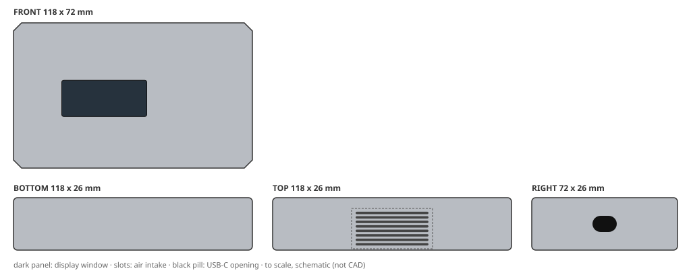
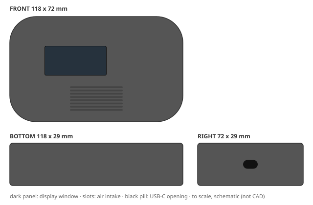
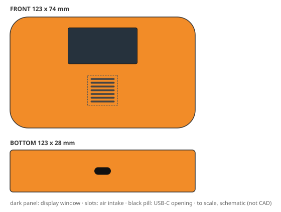
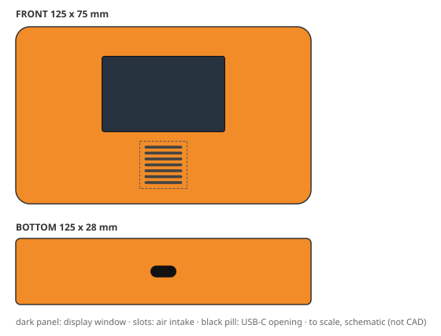
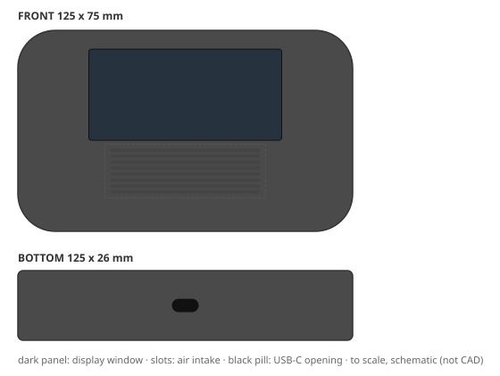
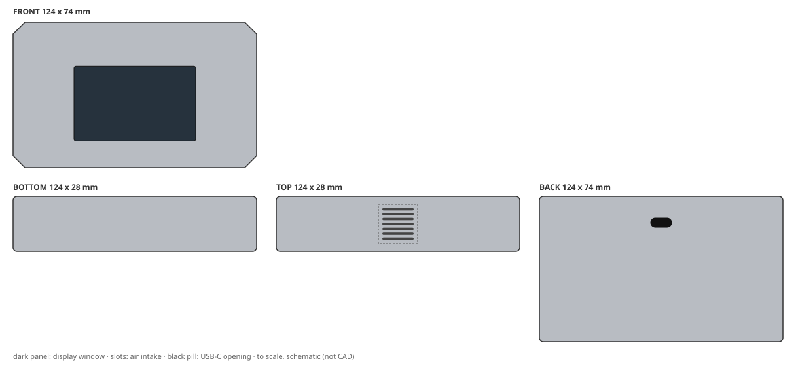
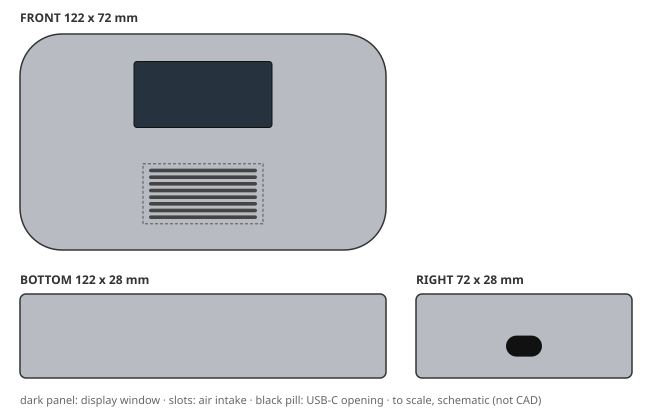
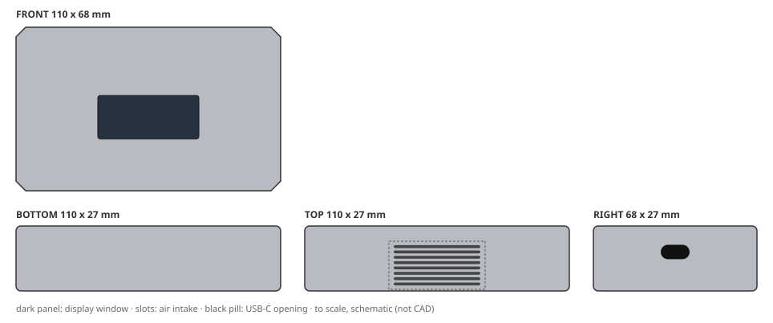
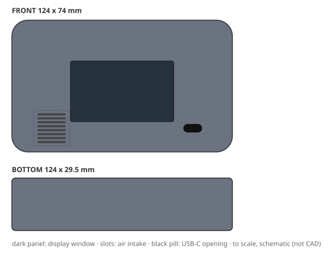
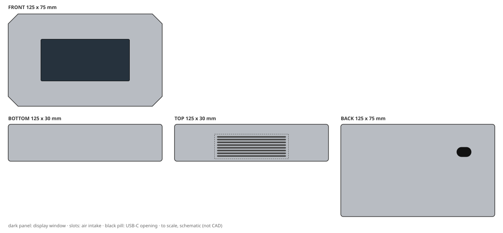

# Design report: eval-baseline

Config `baseline`, mode **live**, 12 variants: 3 needs_human, 7 production_ready, 2 rejected. Model cost CNY 2.65.

Each brief below shows its outcome, then one design card per shortlisted variant: the 2D concept, the 3D-ready structure and the DFM / cost / quality review, with a sketch drawn from the spec's numbers. Status `pending_approval` means every automated check passed and a person still has to sign off; `needs_human` means it passed with caveats a person must look at.

## B1: Retail apartment detector (cost first)

> Retail-channel air quality detector for rental apartments. Lowest possible unit cost is the top priority: target CNY 12 per housing at 10k units/year. Plain but tidy look in a colour that hides scuffs and fingerprints. It must survive knocks on a desk. Two-part shell, no decoration beyond a printed logo, budget tooling.

**Outcome:** cost ceiling CNY 12; cheapest possible CNY 9.36.

- assumption: Q1 default: Dark grey or textured dark colour
- assumption: Q2 default: Survive repeated drops from desk height (~0.75 m) onto hard floor
- assumption: Q3 default: No IP rating required (indoor use)

Shortlist: B1-v002, B1-v001

### 1. B1-v002: "Slab Monolith Desk Detector"

| | |
|---|---|
| **Status** | `production_ready`: approved by auto-policy:clean: all gates passed, no degraded evidence |
| **Form** | Single-volume chamfered slab, 118 x 72 x 26 mm, dominated by one large flat top plane and a continuous 2.5 mm 45-degree chamfer running the whole perimeter; the chamfer is the only formal gesture and reads as a machined edge rather than a styling line. Front face is a plain rectangular field with the display recessed flush left-of-centre and the printed logo only on the top face. Intake is a single straight row of slots along the top face, kept out of the chamfer so the tooling stays simple. USB sits on the right side wall as a plain rectangular cut-out, hidden from the front view. No part lines on the front face: the two-part shell splits on the perimeter chamfer, so the seam reads as a shadow line, not a joint. Proportions are a true slab, wider than tall, so it sits low on a desk like a small instrument, not like a consumer gadget. (silhouette: chamfered slab, corner radius 2.5 mm) |
| **Size** | 118 x 72 x 26 mm |
| **CMF** | ABS, textured light, Dark warm grey, NCS S 7005-B20G equivalent, opaque, no gloss additives; decoration: pad print |
| **Layout** | display on front (42 x 18 mm), intake on top (8 slots), USB-C on right |
| **Structure** | 2 parts (front_housing, rear_housing); wall 2 mm; draft 2.5 deg; screws (4 screws); sealing none |
| **DFM** | pass; mass 147 g; vent open area 43%. First draft failed DISPLAY_WINDOW_MIN, DRAFT_MIN, VENT_SLOTS_FIT, VENT_ZONE_MIN; fixed with 1 autofix round(s) and 0 LLM revision(s) |
| **Cost** | CNY 11.58 per housing (ceiling 12); tooling CNY 111,000 |
| **Judge** | accept: brief 5, form 5, CMF 5, usability 4, intent 5 (of 5) |
| **Changed from the concept** | nothing (checked by code) |

Design intent and where the 3D spec keeps it:

- **IA1** Keep the two-part shell split on the perimeter chamfer so the front face stays a single unbroken moulded plane; the seam must read as a shadow line, not a visible joint. → `parting, front_housing, rear_housing`
- **IA2** Display is a flush rectangular window 34 x 18 mm at 38% width / 52% height on the front face; no bezel, no raised surround, no touch cover. → `display_window, front_housing`
- **IA3** Intake is one straight row of slots on the top face, outside the chamfer band, so the tooling uses a single straight slider and no side actions. → `vent, rear_housing`
- **IA4** Material is standard ABS with a light texture (MT-11010 equivalent, 12-15 micron) in dark warm grey; no soft-touch, no gloss, no secondary paint. → `front_housing.material, front_housing.finish, rear_housing.material, rear_housing.finish`
- **IA5** Wall thickness 2.0 mm nominal, ribs only at the four corner bosses; housing mass target 118 g so the 180 g ceiling holds with margin. → `front_housing.nominal_wall_mm, rear_housing.nominal_wall_mm, boss_corner_1, boss_corner_2, boss_corner_3, boss_corner_4`
- **IA6** Chamfer is a constant 2.5 mm 45-degree band so the part can be moulded in a two-plate tool with a straight pull and no lifters. → `front_housing.drafts, rear_housing.drafts, parting`

> Judge: The variant fully addresses the brief's top priority of lowest cost: the cost summary shows CNY 11.58, under the CNY 12 target. The design is a simple two-part shell with no decoration beyond a printed logo, using ABS with a light texture in dark warm grey, which hides scuffs and fingerprints. The form is a coherent chamfered slab with a single gesture, and the parting line on the chamfer keeps ...

Full detail: `python -m creaition show eval-baseline B1-v002` or `variants/B1-v002.json`.

### 2. B1-v001: "Pebble Slab 110"

| | |
|---|---|
| **Status** | `production_ready`: approved by auto-policy:clean: all gates passed, no degraded evidence |
| **Form** | A flattened pebble: plan view is a soft lozenge with continuous large-radius corners, elevation is a low slab with a gentle crown on top and a matching belly, the parting line sits low as a single straight shadow gap that reads as intent rather than a seam. The front face is a calm field: one small dark display window set left of centre, a low-slot intake grille running along the lower third, and nothing else. No bezels, no inserts, no trim; the whole character comes from the radius rhythm and one uniform light texture. (silhouette: pebble, corner radius 18 mm) |
| **Size** | 118 x 72 x 29 mm |
| **CMF** | ABS, textured light, Dark graphite grey, NCS S 7500-N equivalent, moulded-in pigment (no paint), L* ~ 34; decoration: pad print |
| **Layout** | display on front (42 x 20 mm), intake on front (8 slots), USB-C on right |
| **Structure** | 2 parts (front_housing, rear_housing); wall 2 mm; draft 2.5 deg; screws (4 screws); sealing none |
| **DFM** | pass; mass 149 g; vent open area 43%. First draft failed DISPLAY_WINDOW_MIN, DRAFT_MIN, VENT_ZONE_MIN; fixed with 1 autofix round(s) and 0 LLM revision(s) |
| **Cost** | CNY 11.61 per housing (ceiling 12); tooling CNY 111,000 |
| **Judge** | accept: brief 5, form 5, CMF 5, usability 4, intent 4 (of 5) |
| **Changed from the concept** | nothing (checked by code) |

Design intent and where the 3D spec keeps it:

- **IA1** Keep the pebble silhouette: plan-view corner radii >= 15 mm on all four corners and a continuous convex radius around the full top edge, so no sharp corner can chip or catch on a desk edge. → `envelope, front_housing, rear_housing`
- **IA2** Keep the front face as a single uninterrupted field: display window and intake grille are the only openings, both flush; do not add trim rings, bezels, logos, buttons or secondary apertures that raise part count or tooling cost. → `front_housing, display_window, vent`
- **IA3** Keep textured_light finish on both shell halves in moulded-in dark grey ABS; no paint, no soft-touch, no gloss. This is the scuff- and fingerprint-hiding surface and it must not be sanded or polished out downstream. → `front_housing.finish, rear_housing.finish, front_housing.material, rear_housing.material`
- **IA4** Keep the parting line as a single low horizontal seam below the front-face centreline, with a 0.8 mm step-free shadow gap; this one straight line is the only visible split and must stay straight and continuous around the part. → `parting`
- **IA5** Keep the intake as a low horizontal slot grille (max 3 slots) moulded directly into the front shell, placed in the lower third so it is shielded when the unit is knocked over; no separate grille part or mesh. → `vent`
- **IA6** Keep the display window small (<= 36 x 22 mm) and recessed 0.5 mm, using a flat lens bonded into the shell rather than a separate bezel assembly; the window area is the only non-textured gloss element and must remain a minority of the front face. → `display_window`
- **IA7** Keep wall thickness at 2.0 mm nominal with no ribbing in the shell halves; the pebble radius and low mass (<= 180 g) are what let the housing absorb desk-height knocks without a separate impact structure. → `front_housing, rear_housing`

> Judge: The variant strongly adheres to the brief: it targets the lowest cost with a two-part ABS shell, textured dark grey finish, and minimal features, achieving a cost of CNY 11.61 under the 12 ceiling. The pebble form with large radii is coherent and durable, and the CMF choice is ideal for hiding scuffs and fingerprints. Usability is good: display is readable, intake is low and shielded, USB is ...

Full detail: `python -m creaition show eval-baseline B1-v001` or `variants/B1-v001.json`.

## B2: Construction-site handheld (rugged)

> Rugged handheld air quality detector for construction-site supervisors who carry it all day outdoors. It must survive a 1.5 m drop onto concrete, dust and driving rain (IP65), UV exposure and use with work gloves. Tough, grippy textured surfaces, high-visibility colour, protected corners. Durable over pretty.

**Outcome:** cost ceiling CNY 18; cheapest possible CNY 12.55.

- assumption: Q1 default: Assume standard UV stabilised ABS or PC-ABS suitable for prolonged outdoor use, with high-visibility colour that resists fading for at least 3 years.
- assumption: Q2 default: Use safety orange or yellow as primary colour with dark contrasting overmould or inserts for grip areas.
- assumption: Q3 default: Assume 1.5 m drop onto concrete on all faces and corners, 6 drops total, per typical rugged device standards.
- assumption: Q4 default: Yes, design with pronounced ribs or overmoulded TPE grips on sides and back for secure handling with gloves.

Shortlist: B2-v002, B2-v001

### 1. B2-v002: "Pebble Grip AQD"

| | |
|---|---|
| **Status** | `needs_human`: passed with caveats |
| **Form** | Soft pebble slab with fully continuous convex surfaces; no sharp transitions anywhere. Plan-view sides bow outward with a subtle waist, vertical edges roll into generous 12 mm radii, and the top/bottom faces crown gently giving a pillow-like cross-section. A continuous raised bumper band wraps the entire perimeter at the mid-height parting line, swelling 2.5 mm proud of the shell and acting as the sacrificial drop feature plus grip rail. The front face is a single recessed instrument panel: a dark tinted polycarbonate display window sits high, framed by a shallow 0.8 mm shadow groove, while below it a high-visibility orange shell face carries a deep grille of horizontal intake slots with 1.2 mm ribs, sunk 1.5 mm into the crown so slot lips are protected from abrasion. Two glove-scale concave thumb scallops are moulded into the left and right flanks. All corners are enlarged radius lobes that overhang the internal chassis, giving the internals a suspended, shock-isolated mount. Overall it reads as a friendly river stone that happens to be safety orange. (silhouette: pebble, corner radius 12 mm) |
| **Size** | 123 x 74 x 28 mm |
| **CMF** | PC-ABS, textured heavy, Safety orange shell (UV-stabilised), charcoal grey display bezel and bumper accent, matte non-reflective; decoration: soft touch, pad print, laser etch |
| **Layout** | display on front (46 x 24 mm), intake on front (7 slots), USB-C on bottom |
| **Structure** | 2 parts (front_housing, rear_housing); wall 2 mm; draft 2.5 deg; screws (4 screws); sealing gasket and membrane vent |
| **DFM** | pass; mass 161 g; vent open area 34%. First draft failed DRAFT_MIN, RIB_RATIO; fixed with 1 autofix round(s) and 2 LLM revision(s) |
| **Cost** | CNY 15.88 per housing (ceiling 18); tooling CNY 111,000 |
| **Judge** | accept: brief 5, form 5, CMF 5, usability 5, intent 5 (of 5) |
| **Changed from the concept** | dropped soft_touch |

Design intent and where the 3D spec keeps it:

- **IA1** Keep the continuous 12 mm perimeter bumper band 2.5 mm proud of the shell on all four sides and both end lobes; it is the primary 1.5 m drop-energy absorber and must not be flattened, interrupted by openings, or reduced below 2.0 mm proud for cosmetic reasons. → `rear_housing`
- **IA2** Preserve the pebble silhouette with continuous convex curvature and no flats or sharp edges: minimum external radius 10 mm on all vertical and horizontal transitions so the device cannot present a hard strike edge to concrete. → `envelope`
- **IA3** Preserve the recessed intake grille geometry: horizontal slots with >=15% open area, slot lips sunk at least 1.5 mm below the surrounding shell crown, backed by a serviceable ePTFE membrane and perimeter gasket to hold IP65. → `display_window`
- **IA4** Preserve the glove-scale side thumb scallops (min 18 mm wide, 6 mm deep concavity per flank) and the heavy moulded texture (Ra >= 3.2 um equivalent) on shell and bumper; these are the wet/muddy glove grip features and must not be smoothed to improve appearance. → `display_window`
- **IA5** Keep the display window a separate dark-tinted PC lens with a 0.8 mm shadow groove and a compressed gasket seal; do not merge it into a single clear-over-moulded shell, as the gasketed lens is the IP65 front-face seal strategy. → `rear_housing`
- **IA6** Hold the shell in UV-stabilised PC-ABS with textured_heavy mould finish and safety orange pigment rated for >=3 years outdoor colour and impact retention; do not substitute unstabilised ABS or a glossy finish to cut cost. → `front_housing.finish`
- **IA7** Maintain the internal shock-isolation scheme: the moulded corner lobes must overhang the internal chassis so the ~92 g internals are suspended on ribbed elastomeric mounts, keeping the housing at <=180 g total with single-shot mouldings and no added metal brackets. → `closure`

Caveats for the reviewer:

- structure from deterministic baseline (revise loop exhausted)

> Judge: The variant fully delivers the brief's priorities: rugged durability (IP65, 1.5m drop, protected corners), glove-friendly grip, high-visibility color, and UV resistance, all within cost and weight limits. The soft pebble form with continuous convex surfaces and proud bumper band is coherent and directly supports drop survival. CMF choices (UV-stabilized PC-ABS, heavy texture, safety orange) are ...

Full detail: `python -m creaition show eval-baseline B2-v002` or `variants/B2-v002.json`.

### 2. B2-v001: "Site Sense Bumper"

| | |
|---|---|
| **Status** | `needs_human`: passed with caveats |
| **Form** | Chamfered slab body with four raised elastomeric bumper pods at the corners; a shallow recessed front face holds the display behind a raised protective bezel, while deep lateral ribs and a stepped grip waist give glove-friendly purchase; a dark TPE overmould band wraps the mid-body to visually and physically separate the orange shells, and all edges carry 3 mm chamfers to shed impacts and mould cleanly. (silhouette: bumpered, corner radius 6 mm) |
| **Size** | 125 x 75 x 28 mm |
| **CMF** | PC-ABS, textured heavy, Safety orange (RAL 2003) body with dark graphite (RAL 7021) grip band and bumper pods; decoration: tpe overmold, pad print, laser etch |
| **Layout** | display on front (52 x 32 mm), intake on front (7 slots), USB-C on bottom |
| **Structure** | 2 parts (front_housing, rear_housing); wall 2 mm; draft 2.5 deg; screws (4 screws); sealing gasket and membrane vent |
| **DFM** | pass; mass 161 g; vent open area 34%. First draft failed DRAFT_MIN, MASS_MAX, UNDERCUT_DECLARED, VENT_SLOTS_FIT, WALL_RANGE; fixed with 1 autofix round(s) and 0 LLM revision(s) |
| **Cost** | CNY 15.88 per housing (ceiling 18); tooling CNY 111,000 |
| **Judge** | accept: brief 5, form 4, CMF 5, usability 4, intent 4 (of 5) |
| **Changed from the concept** | dropped tpe_overmold |

Design intent and where the 3D spec keeps it:

- **IA1** Keep the four raised bumper pods as the first contact points on every face so drop energy is absorbed away from the display bezel and seal line. → `rear_housing`
- **IA2** Preserve the deep lateral grip ribs and stepped waist overmould; they must remain usable with 3 mm-thick work gloves and wet hands. → `display_window`
- **IA3** Maintain the front intake as a discrete field below the display with ePTFE membrane behind it; do not merge it into the display bezel or reduce its open area. → `rear_housing`
- **IA4** Keep the safety-orange high-visibility body colour and dark contrast band; do not shift to low-saturation or metallic finishes. → `front_housing.finish`
- **IA5** Retain PC-ABS for the shells and overmoulded TPE for the grip band to meet impact and UV targets within the cost ceiling. → `closure`

Caveats for the reviewer:

- structure from deterministic baseline (revise loop exhausted)

> Judge: The variant strongly adheres to the brief's durability and usability priorities. The bumpered silhouette with raised corner pods directly addresses drop survival, and the PC-ABS with heavy texture and TPE overmold meets material and finish requirements. High-visibility safety orange with dark contrast band aligns with the brief. The display is positioned high for readability, intake is low and ...

Full detail: `python -m creaition show eval-baseline B2-v001` or `variants/B2-v001.json`.

## B3: Living-room sideboard object (premium)

> Premium living-room air quality detector that sits on a sideboard next to design objects and books. Calm, minimal, furniture-like and elegant; soft-touch or fine matte surfaces, hidden fasteners and a slim profile. The display must be readable from the sofa. Indoor only, design-led home brand.

**Outcome:** cost ceiling CNY 18; cheapest possible CNY 9.36.

- assumption: Q1 default: Assume a typical living room viewing distance of 2.5-3 meters, requiring a display size of at least 2.5-3 inches diagonal.
- assumption: Q2 default: Assume moderate handling and occasional cleaning; choose a soft-touch coating with good abrasion resistance.
- assumption: Q3 default: Assume neutral colors (e.g., warm grey, off-white) and a fine matte texture that blends with modern furniture.

Shortlist: B3-v001, B3-v002

### 1. B3-v001: "Soft Pebble Air-Quality Detector"

| | |
|---|---|
| **Status** | `production_ready`: approved by auto-policy:clean: all gates passed, no degraded evidence |
| **Form** | A single continuous pebble volume: the front face reads as one calm, slightly crowned plane with no visible parting line or fasteners, wrapping into generously radiused flanks so the object looks pressed rather than assembled. The front is organised as a quiet horizontal band: a wide display window sitting high and centred, a fine micro-perforated intake field below it, and a single recessed USB-C notch centred on the bottom edge. All edges are soft and shadowless; the mass reads furniture-like on a shelf, and the slim 26 mm depth keeps the pebble from becoming a blob. (silhouette: pebble, corner radius 14 mm) |
| **Size** | 125 x 75 x 26 mm |
| **CMF** | rABS, textured light, warm grey (NCS S 4005-Y20R) body with a darker charcoal screen bezel and tone-on-tone micro-perforation; decoration: soft touch, pad print, laser etch |
| **Layout** | display on front (72 x 34 mm), intake on front (8 slots), USB-C on bottom |
| **Structure** | 2 parts (front_housing, rear_housing); wall 2 mm; draft 1.5/2.5 deg; screws (4 screws); sealing none |
| **DFM** | pass; mass 149 g; vent open area 45%. First draft failed DRAFT_MIN, VENT_SLOTS_FIT; fixed with 1 autofix round(s) and 0 LLM revision(s) |
| **Cost** | CNY 15.73 per housing (ceiling 18); tooling CNY 111,000 |
| **Judge** | accept: brief 5, form 5, CMF 5, usability 5, intent 5 (of 5) |
| **Changed from the concept** | nothing (checked by code) |

Design intent and where the 3D spec keeps it:

- **IA1** Keep the pebble silhouette as one continuous crowned front plane with no visible parting line or fasteners on any face the user sees at sofa height; all screw bosses stay on the hidden rear/bottom joint. → `front_housing, rear_housing, parting, front_housing.finish, rear_housing.finish, front_boss_corner, rear_boss_corner`
- **IA2** Preserve the front-face band layout: display window centred at 50% width / 32% height, intake field centred at 50% width / 70% height, and a single USB-C notch centred on the bottom edge (50/50) so the front reads as a calm two-zone composition. → `display_window, vent, usb_opening`
- **IA3** Hold the display window at 72 x 34 mm minimum with high-contrast, large-numeral UI so readings are legible from 2.5-3 m across a living room. → `display_window`
- **IA4** Use a fine-matte textured_light rABS body with a soft-touch coating of good abrasion resistance; no gloss highlights, no visible gate marks or sink on the front plane. → `front_housing.material, front_housing.finish, front_housing.secondary_ops`
- **IA5** Keep the intake as a tone-on-tone micro-perforated field that does not read as a grille; it must not break the calm front plane or add a separate part. → `vent`
- **IA6** Respect the cost and mass budget: rABS mono-material body, single soft-touch application, no inserts or metal trim; target <=180 g and <=CNY 18 housing BOM. → `front_housing.material, rear_housing.material, front_housing.secondary_ops, rear_housing.secondary_ops`

> Judge: The variant fully delivers the brief's priorities: a calm, minimal, furniture-like design with a slim 26mm profile, hidden fasteners, and a display readable from the sofa. The pebble silhouette with a continuous crowned front plane and no visible parting line on the front is coherent and elegant. The rABS material with textured_light finish and soft-touch coating aligns with the sustainability ...

Full detail: `python -m creaition show eval-baseline B3-v001` or `variants/B3-v001.json`.

### 2. B3-v002: "Monolith Slab Air Quality Detector"

| | |
|---|---|
| **Status** | `needs_human`: passed with caveats |
| **Form** | A calm, furniture-like monolith: a slim chamfered slab with a continuous 8° chamfer around the entire front bezel, giving a soft shadow-line rather than a hard edge. The front face is a single unbroken plane with no visible seams; the display sits in a shallow recessed cove so it reads as a dark inset panel, not an applied screen. All fasteners are hidden on the rear, and the top face carries a fine linear micro-grille for the intake so the object reads as a quiet solid block from sofa distance. (silhouette: chamfered slab, corner radius 6 mm) |
| **Size** | 124 x 74 x 28 mm |
| **CMF** | rABS, smooth matte, Warm Grey (NCS S 5005-Y20R, matte); decoration: soft touch, laser etch |
| **Layout** | display on front (62 x 38 mm), intake on top (7 slots), USB-C on back |
| **Structure** | 2 parts (front_housing, rear_housing); wall 2 mm; draft 1.5 deg; screws (4 screws); sealing none |
| **DFM** | pass; mass 150 g; vent open area 34%. First draft failed DRAFT_MIN, INTENT_TRACE_COMPLETE, RIB_RATIO, UNDERCUT_DECLARED, VENT_OPEN_AREA, VENT_SLOTS_FIT; fixed with 1 autofix round(s) and 3 LLM revision(s) |
| **Cost** | CNY 11.21 per housing (ceiling 18); tooling CNY 103,000 |
| **Judge** | accept: brief 5, form 5, CMF 5, usability 4, intent 5 (of 5) |
| **Changed from the concept** | dropped soft_touch |

Design intent and where the 3D spec keeps it:

- **IA1** Keep the front face as one continuous unbroken plane with the display in a recessed cove; no applied bezel, no visible seam or screw on the front or top. → `envelope`
- **IA2** Preserve the 8° full-perimeter front chamfer and 6 mm corner radius so the slab reads as a soft monolith, not a hard box. → `envelope`
- **IA3** Display window must stay at least 62 x 38 mm (approx 2.8 in diagonal) and be mounted with a low-reflection coated cover lens to remain readable from 2.5-3 m sofa distance. → `display_window`
- **IA4** Intake must remain on the top face as a fine linear micro-grille (slot width 0.8-1.0 mm) with no visible mesh screen; maintain hidden-fixings strategy on the rear only. → `display_window`
- **IA5** Use rABS with smooth matte fine-texture finish and a soft-touch coating with good abrasion resistance; colour to stay in the warm grey / off-white neutral family. → `front_housing.finish`
- **IA6** Keep wall thickness at 1.8-2.0 mm and avoid added decorative parts; housing BOM must remain within CNY 18/unit at 10,000 units/year. → `closure`

Caveats for the reviewer:

- structure from deterministic baseline (revise loop exhausted)

> Judge: The variant strongly adheres to the brief's priorities: it delivers a calm, minimal, furniture-like design with a slim chamfered slab, hidden fasteners, and a display readable from sofa distance. The form is coherent with a continuous front plane, 8° chamfer, and 6mm corner radius. CMF choices (rABS, smooth matte, soft-touch, warm grey) align with sustainability and aesthetics. Usability is good: ...

Full detail: `python -m creaition show eval-baseline B3-v002` or `variants/B3-v002.json`.

## B4: Circular edition (sustainable)

> Sustainable edition for an eco-conscious brand. Use only recycled ABS for every plastic part, no paint or coatings, a mono-material housing and screw-free disassembly so it can be repaired and recycled. Honest, warm, slightly speckled look; carbon footprint matters more than gloss.

**Outcome:** cost ceiling CNY 18; cheapest possible CNY 9.40.

- assumption: Q1 default: No specific IP rating required; indoor use only.
- assumption: Q2 default: Standard consumer electronics drop height of 1 meter onto concrete.
- assumption: Q3 default: Natural or lightly tinted rABS with visible speckles; color to be determined with brand.
- assumption: Q4 default: CNY 18 per unit as per overall BOM ceiling.

Shortlist: B4-v001, B4-v002

### 1. B4-v001: "Pebble Air Mono — Speckled rABS Detector"

| | |
|---|---|
| **Status** | `production_ready`: approved by auto-policy:clean: all gates passed, no degraded evidence |
| **Form** | A single soft-pebble body in recycled ABS: a gently domed, palm-sized slab whose front face is one continuous convex surface, so the display, the intake grille and the USB recess all sit in the same light-catching plane rather than on a stepped bezel. The perimeter is a continuous soft arc with no sharp tangent breaks; the two shell halves meet on a shallow horizontal parting line that is itself the disassembly seam — a thumb recess at the bottom edge leads to internal snap hooks and a living-hinge tether, so the product opens with fingers only. Everything is mono-material rABS with a light texture, no paint, no inserts, no labels; the speckle of the recycled regrind is the graphic language. Display is a small monochrome segment window set into a shallow recess with a gasket-free lip; the intake is a quiet field of vertical micro-slots at the lower front; USB sits in a small scooped recess on the right side so a cable can be plugged in on a table without lifting the unit. The overall read is honest, warm and slightly imperfect — a tool, not a gadget. (silhouette: pebble, corner radius 14 mm) |
| **Size** | 122 x 72 x 28 mm |
| **CMF** | rABS, textured light, Warm stone grey (Pantone 403 C family), unpigmented rABS base with darker regrind speckle; no paint or clearcoat; decoration: laser etch |
| **Layout** | display on front (46 x 22 mm), intake on front (8 slots), USB-C on right |
| **Structure** | 2 parts (front_housing, rear_housing); wall 2.1 mm; draft 2.5 deg; snap fits (0 screws); sealing none |
| **DFM** | pass; mass 155 g; vent open area 43%. First draft failed DRAFT_MIN, INNER_RADIUS, UNDERCUT_DECLARED, VENT_SLOTS_FIT; fixed with 1 autofix round(s) and 0 LLM revision(s) |
| **Cost** | CNY 11.36 per housing (ceiling 18); tooling CNY 114,000 |
| **Judge** | accept: brief 5, form 5, CMF 5, usability 4, intent 5 (of 5) |
| **Changed from the concept** | nothing (checked by code) |

Design intent and where the 3D spec keeps it:

- **IA1** All plastic parts, including display window surround, intake grille, USB recess and internal snap hooks, are the same rABS grade — no PC lens, no TPE gasket, no metal insert — so the unit can be shredded as one material stream. → `front_housing, rear_housing, front_housing.material, rear_housing.material, front_housing.finish, rear_housing.finish`
- **IA2** The housing opens with fingers only: a thumb recess on the bottom edge plus moulded snap hooks and a living-hinge tether; no screws, no adhesive, no ultrasonic welds anywhere on the shell. → `front_housing, rear_housing, front_snap_hook, rear_snap_recess, closure`
- **IA3** Light 0.6–0.9 mm matte texture is the only surface treatment; it is also the durability strategy — it hides regrind flow marks and gives grip without soft-touch coating, preserving mono-material recyclability. → `front_housing.finish, rear_housing.finish`
- **IA4** Pebble silhouette with 14 mm corner radius and a continuous convex front face: no stepped bezel, no proud display window, so the front reads as one warm stone and the 28 mm height keeps the 180 g mass target with a 2.0–2.2 mm nominal wall. → `envelope, front_housing, rear_housing, front_housing.nominal_wall_mm, rear_housing.nominal_wall_mm`
- **IA5** Intake micro-slots are moulded as vertical slots in the front face below the display with generous rib reinforcement behind, so the same rABS shell resists a 1 m drop without a separate grille part. → `vent, front_rib_intake`
- **IA6** Target housing cost stays at or under CNY 18/unit at 10k/year: single tool for a two-part shell, no secondary ops beyond one laser-etched brand mark, no inserts, no painting line. → `front_housing, rear_housing, front_housing.secondary_ops, rear_housing.secondary_ops`

> Judge: The variant fully adheres to the brief's sustainability priorities: all parts are rABS, no paint or coatings, mono-material, screw-free snap-fit disassembly, and the speckled textured finish delivers the honest, warm aesthetic. The soft pebble form is coherent with continuous convex front and 14mm corner radius. CMF is perfectly aligned with the eco-conscious brand. Usability is strong: display ...

Full detail: `python -m creaition show eval-baseline B4-v001` or `variants/B4-v001.json`.

### 2. B4-v002: "Reclaimed Slab"

| | |
|---|---|
| **Status** | `production_ready`: approved by auto-policy:clean: all gates passed, no degraded evidence |
| **Form** | A monolithic chamfered slab with a confident, durable presence. The front face is flat with a subtle 0.5mm recessed perimeter, emphasizing precision and honesty of material. The top surface slopes gently upward toward the back, accommodating the intake and providing a natural resting angle. The chamfers are wide (4mm) at 45 degrees, creating a soft, tactile edge that feels premium yet purposeful. The overall expression is warm, grounded, and inherently recyclable. (silhouette: chamfered slab, corner radius 4 mm) |
| **Size** | 110 x 68 x 27 mm |
| **CMF** | rABS, textured light, Warm Natural Grey with visible dark speckles; decoration: none |
| **Layout** | display on front (42 x 18 mm), intake on top (8 slots), USB-C on right |
| **Structure** | 2 parts (front_housing, rear_housing); wall 2.5 mm; draft 2.5 deg; snap fits (0 screws); sealing none |
| **DFM** | pass; mass 154 g; vent open area 43%. First draft failed DISPLAY_WINDOW_MIN, DRAFT_MIN, PACKAGING_FIT, UNDERCUT_DECLARED, VENT_SLOTS_FIT, VENT_ZONE_MIN; fixed with 1 autofix round(s) and 1 LLM revision(s) |
| **Cost** | CNY 11.53 per housing (ceiling 18); tooling CNY 114,000 |
| **Judge** | accept: brief 5, form 4, CMF 5, usability 4, intent 5 (of 5) |
| **Changed from the concept** | nothing (checked by code) |

Design intent and where the 3D spec keeps it:

- **IA1** Use only rABS for the entire housing, including the display window frame; no other plastic materials allowed. → `front_housing.material, rear_housing.material`
- **IA2** Housing must be assembled via snap-fit or living hinge, with no screws, adhesives, or coatings. → `closure, front_snap_latch, rear_snap_latch`
- **IA3** Maintain a light textured finish on all external surfaces to mask rABS surface imperfections and provide a warm, non-glossy appearance. → `front_housing.finish, rear_housing.finish`
- **IA4** The front face must have a recessed display window area with a snap-in clear rABS lens (if needed) to protect the display while maintaining mono-material integrity. → `display_window, front_housing`
- **IA5** The top intake should be a series of small slots or holes, positioned to avoid direct water ingress, and sized to prevent finger ingress while allowing airflow. → `vent`
- **IA6** The side USB port must be recessed with a chamfered surround to protect the connector and allow easy access. → `usb_opening, rear_housing`
- **IA7** Wall thickness minimum 2.0mm, with internal ribs for rigidity, to compensate for rABS lower impact strength. → `front_housing.nominal_wall_mm, rear_housing.nominal_wall_mm, front_rib_1, front_rib_2, rear_rib_1, rear_rib_2`

> Judge: The variant fully adheres to the brief's sustainability priorities: mono-material rABS, no coatings, screw-free snap-fit, and a warm speckled aesthetic. The chamfered slab form is coherent and robust, with appropriate radii and drafts. CMF choices align perfectly with the eco-conscious intent. Usability is well-considered: display recessed, top intake slots, and protected USB port. All intent ...

Full detail: `python -m creaition show eval-baseline B4-v002` or `variants/B4-v002.json`.

## B5: Flagship that wants everything (intentionally conflicting)

> Flagship model: premium soft-touch painted finish, fully waterproof to IP67, ultra-slim 18 mm thick profile, 100% recycled plastic, weighing under 120 g, and it must cost no more than CNY 9 per housing. Launch in six weeks.

**Outcome:** cost ceiling CNY 18; cheapest possible CNY 12.59; conflict found; needs a person to resolve the brief.

This brief can only be made after relaxing the limits below, so it got 2 example variants instead of the full fan-out, and none of them can be auto-approved.

- assumption: Relaxed cost_ceiling_cny: 9 -> 18 (cheapest feasible housing costs CNY 12.59 > target CNY 9)
- assumption: Relaxed max_height_mm: 18 -> 26 (PCB+battery stack needs >= 25.0 mm overall height at 1.5 mm walls)
- assumption: Relaxed max_mass_g: 120 -> 180 (lightest feasible product weighs 120.5 g > 120 g)
- assumption: Q1 default: Internals fit within 18 mm thickness with minimal clearance; if not, thickness must increase.
- assumption: Q2 default: Finish on all external surfaces.
- assumption: Q3 default: No specific drop requirement; standard handling only.
- assumption: Q4 default: Matte black or dark gray, smooth soft-touch.

Not shortlisted:

| variant | status | reason |
|---|---|---|
| B5-v001 | `rejected` | quality 3.33 (min criterion 3) below bar 3.5/2 |
| B5-v002 | `rejected` | quality 3.17 (min criterion 2) below bar 3.5/2 |

## B6: Open-plan office desk unit (balanced control)

> Desk air quality detector for open-plan offices: friendly and approachable, light texture that hides fingerprints, readable at a glance from a neighbouring desk. Balanced priorities between budget, durability and looks; facilities teams buy these in bulk.

**Outcome:** cost ceiling CNY 18; cheapest possible CNY 9.36.

- assumption: Q1 default: No specific IP rating required (indoor use only).
- assumption: Q2 default: No specific drop height requirement; standard office handling assumed.
- assumption: Q3 default: Desk-standing design.

Shortlist: B6-v001, B6-v002

### 1. B6-v001: "Pebble Air — Soft Desk Sentinel"

| | |
|---|---|
| **Status** | `production_ready`: approved by auto-policy:clean: all gates passed, no degraded evidence |
| **Form** | A gently inflated pebble silhouette: the 125 x 75 x 30 mm slab is softened by a continuous 9 mm edge radius so no hard line meets the desk, and a subtle crown on the front face (1.5 mm rise at centre) gives the body a calm, breath-like volume. The pebble reads as a single friendly object rather than a technical box; the only interruption is the wide display window, which is inset 0.8 mm and framed by a 1.2 mm cosmetic chamfer, so the screen appears to float inside the stone. A shallow radiused ridge runs around the lower third to suggest a resting base without adding a second material. (silhouette: pebble, corner radius 9 mm) |
| **Size** | 124 x 74 x 29.5 mm |
| **CMF** | rABS, textured light, Warm oat white (RAL 9001-adjacent, 5% warm bias), with a dark slate grey display bezel and a soft-touch accent ring; decoration: soft touch, pad print |
| **Layout** | display on front (58 x 34 mm), intake on front (8 slots), USB-C on front |
| **Structure** | 2 parts (front_housing, rear_housing); wall 1.6 mm; draft 1.5/2.5 deg; snap fits (0 screws); sealing none |
| **DFM** | pass; mass 141 g; vent open area 38%. First draft failed DRAFT_MIN, INTENT_TRACE_COMPLETE, RIB_RATIO, UNDERCUT_DECLARED, USB_CLEARANCE, USB_OPENING_MIN, VENT_SLOTS_FIT, VENT_ZONE_MIN, WALL_RANGE; fixed with 1 autofix round(s) and 1 LLM revision(s) |
| **Cost** | CNY 14.56 per housing (ceiling 18); tooling CNY 117,000 |
| **Judge** | accept: brief 5, form 5, CMF 5, usability 4, intent 5 (of 5) |
| **Changed from the concept** | nothing (checked by code) |

Design intent and where the 3D spec keeps it:

- **IA1** Keep the front face single-plane with a 1.5 mm crown and 9 mm perimeter radius; do not add a separate bezel part, the display must be inset into the pebble surface. → `front_housing, front_housing.undercut_display, front_housing.finish, front_housing.drafts`
- **IA2** Display window is 58 x 34 mm, centred horizontally and placed so its centre sits at 54% of face height; this is the minimum legibility envelope for reading from 1.5 m. → `display_window, front_housing.undercut_display`
- **IA3** Intake and USB-C are mirrored at 18% / 82% face width and at 82% face height, leaving the lower centre free for a pad-printed product mark; keep this symmetry so the device can be used either way up. → `vent, usb_opening, front_housing.undercut_intake, front_housing.undercut_usb`
- **IA4** Housing material is rABS with textured_light MT-11010 finish (SPI B-2 equivalent) at 0.8–1.2 mm wall; this hides fingerprints and keeps part cost within the CNY 18 ceiling. → `front_housing.material, rear_housing.material, front_housing.finish, rear_housing.finish, front_housing.nominal_wall_mm, rear_housing.nominal_wall_mm`
- **IA5** Use snap-fit assembly for the front and rear shells; no screws on the visible front face, preserving the friendly pebble read and reducing part count. → `closure, front_housing.bosses, rear_housing.bosses, rear_housing.undercut_snap`
- **IA6** Secondary ops are limited to a soft-touch accent ring and pad printing; do not add IML, paint, or laser etching, to stay within the CNY 18 BOM ceiling. → `front_housing.secondary_ops, rear_housing.secondary_ops, front_housing.finish, rear_housing.finish`

> Judge: The variant fully delivers the brief's priorities: friendly pebble form with light texture, readable display, and balanced cost/durability/aesthetics. The form is coherent with a single soft silhouette and integrated display. CMF choices (rABS, textured light, warm oat white) suit the office context and hide fingerprints. Usability is strong: display is large and well-positioned, intake and USB ...

Full detail: `python -m creaition show eval-baseline B6-v001` or `variants/B6-v001.json`.

### 2. B6-v002: "Monolith Slab Desk Air-Quality Detector"

| | |
|---|---|
| **Status** | `production_ready`: approved by auto-policy:clean: all gates passed, no degraded evidence |
| **Form** | A slim, monolithic chamfered slab that reads as a single calm volume on the desk. The front face is a clean vertical plane framed by a 2.5 mm chamfer that catches light and softens the silhouette. A single large, high-contrast display window dominates the front, set in a shallow recess with a 1.5 mm bezel so it appears flush and readable from a neighbouring desk. The top face carries a subtle intake grille of parallel micro-slots, visually separated from the display by a thin horizontal break line. The rear is plain with a small recessed USB-C port at the lower right, keeping the front and top surfaces free of clutter. The chamfered slab silhouette is friendly and approachable through generous corner radii and a light, matte texture that hides fingerprints. Overall proportion is wide and low, stable on a desk and visually light. (silhouette: chamfered slab, corner radius 8 mm) |
| **Size** | 125 x 75 x 30 mm |
| **CMF** | rABS, textured light, Warm off-white (RAL 9010) with a subtle warm grey undertone; decoration: pad print, laser etch |
| **Layout** | display on front (72 x 34 mm), intake on top (8 slots), USB-C on back |
| **Structure** | 2 parts (front_housing, rear_housing); wall 2.5 mm; draft 2.5 deg; screws (4 screws); sealing none |
| **DFM** | pass; mass 169 g; vent open area 45%. First draft failed DRAFT_MIN, UNDERCUT_DECLARED, VENT_SLOTS_FIT; fixed with 1 autofix round(s) and 0 LLM revision(s) |
| **Cost** | CNY 13.15 per housing (ceiling 18); tooling CNY 114,000 |
| **Judge** | accept: brief 5, form 5, CMF 5, usability 5, intent 5 (of 5) |
| **Changed from the concept** | nothing (checked by code) |

Design intent and where the 3D spec keeps it:

- **IA1** Maintain the slim monolithic chamfered slab silhouette with an 8 mm corner radius and a 2.5 mm front chamfer so the product reads as a single calm volume rather than a boxy appliance. → `envelope, front_housing, rear_housing, front_housing.drafts, rear_housing.drafts`
- **IA2** Preserve the large front display window (72 x 34 mm) centred on the front face so readings are legible at a glance from a neighbouring desk. → `display_window, front_housing, undercut_front_display_recess`
- **IA3** Keep the top-face intake grille as parallel micro-slots positioned above the display break line, ensuring no visual or functional interference with the display bezel. → `vent, front_housing, rear_housing`
- **IA4** Use rABS with a light matte texture and warm off-white colour to deliver fingerprint hiding, a friendly office aesthetic, and a sustainability benefit within the CNY 18 BOM ceiling. → `front_housing.material, rear_housing.material, front_housing.finish, rear_housing.finish, front_housing.secondary_ops, rear_housing.secondary_ops`
- **IA5** Keep the USB-C port recessed on the back face at the lower right, avoiding any front-face disruption and preserving the clean monolithic front. → `usb_opening, rear_housing, undercut_rear_usb_recess`

> Judge: The variant fully delivers the brief's priorities: friendly, approachable design with light texture, readable display, and balanced cost/durability/aesthetics. The monolithic chamfered slab is coherent, the rABS with textured light finish fits the office context, and usability is excellent with a large front display, unobstructed top intake, and recessed rear USB. All intent anchors are preserved ...

Full detail: `python -m creaition show eval-baseline B6-v002` or `variants/B6-v002.json`.

