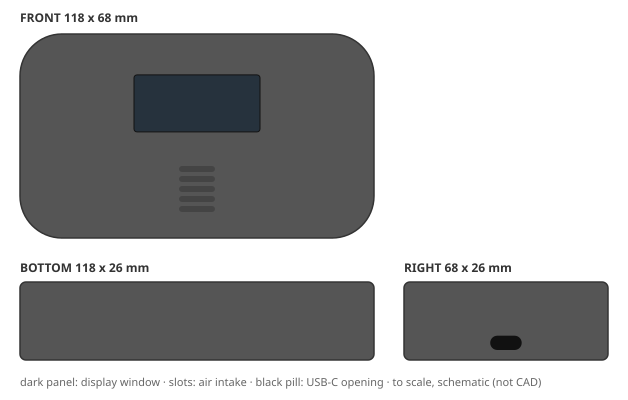
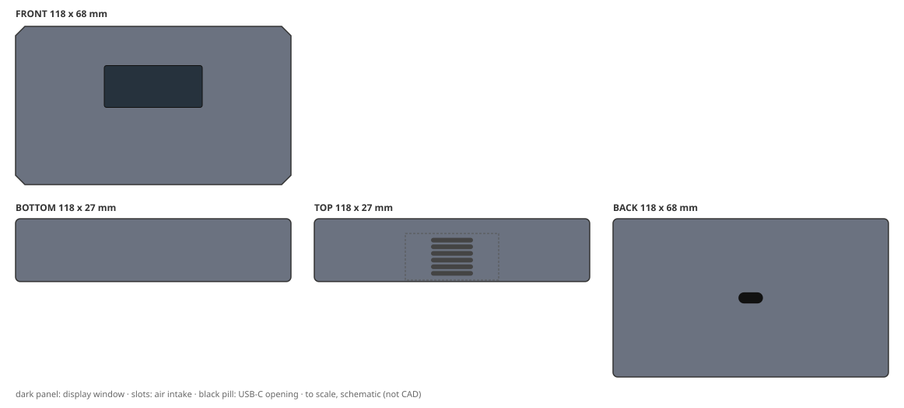
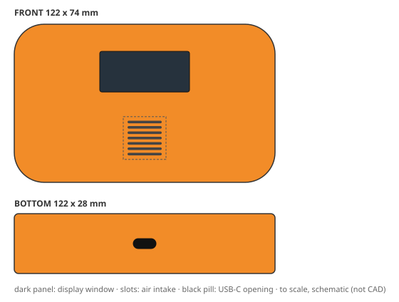
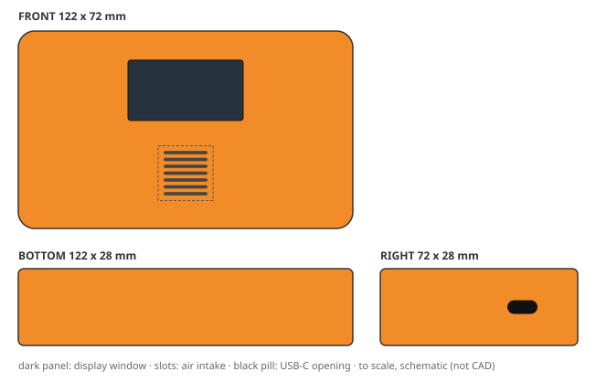
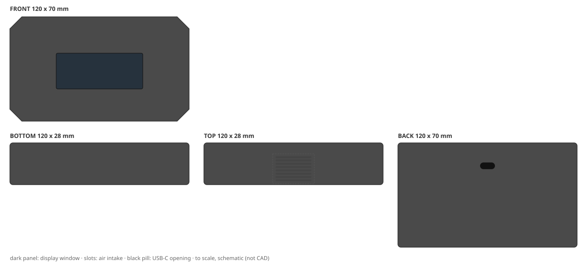
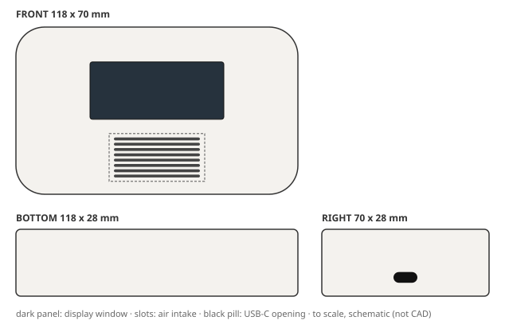
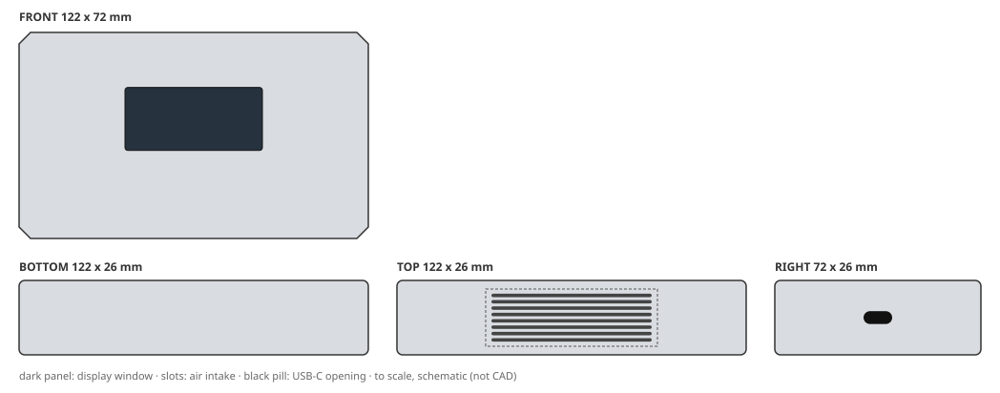
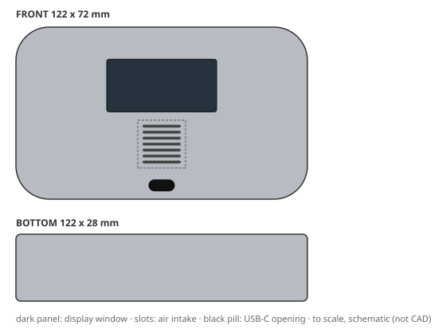
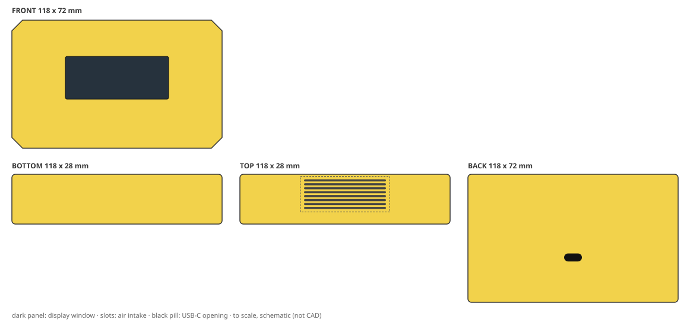
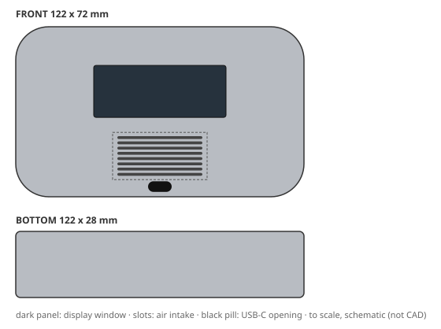

# Design report: eval-candidate

Config `candidate_prompt_v2`, mode **live**, 12 variants: 3 needs_human, 7 production_ready, 2 rejected. Model cost CNY 2.45.

Each brief below shows its outcome, then one design card per shortlisted variant: the 2D concept, the 3D-ready structure and the DFM / cost / quality review, with a sketch drawn from the spec's numbers. Status `pending_approval` means every automated check passed and a person still has to sign off; `needs_human` means it passed with caveats a person must look at.

## B1: Retail apartment detector (cost first)

> Retail-channel air quality detector for rental apartments. Lowest possible unit cost is the top priority: target CNY 12 per housing at 10k units/year. Plain but tidy look in a colour that hides scuffs and fingerprints. It must survive knocks on a desk. Two-part shell, no decoration beyond a printed logo, budget tooling.

**Outcome:** cost ceiling CNY 12; cheapest possible CNY 9.36.

- assumption: Q1 default: 0.75 m (typical desk height)
- assumption: Q2 default: No IP rating (indoor use only)
- assumption: Q3 default: Dark grey or matte black
- assumption: Q4 default: Light texture (e.g., VDI 24) to hide fingerprints

Shortlist: B1-v001, B1-v002

### 1. B1-v001: "Pebble Shelf Detector"

| | |
|---|---|
| **Status** | `production_ready`: approved by auto-policy:clean: all gates passed, no degraded evidence |
| **Form** | Soft pebble massing: a single unbroken convex arc sweeps the full front elevation, with the top and bottom edges drawn in as shallow spline curves so the part reads as one smooth stone rather than a box. All four plan-view corners carry a generous radius that runs the full height, so the side walls blend into the front face without a hard tangent break. The front face is deliberately tilted back 4 degrees from vertical, giving a calm, slightly reclined stance that reads stable on a desk while keeping the display normal to the seated user's eye. Volume is slim: the shell tapers from a 24 mm mid-body to 19 mm at the outer rim, so the intake slot on the front lower area sits in a shallow local recess. No part lines are visible on the front; the two-part shell splits on a single horizontal plane 11 mm above the base, with a 0.4 mm shadow gap that reads as an intentional reveal and hides the seam. Buttons are absent; the only interruption to the pebble surface is the display window, the intake recess and the USB-C door. (silhouette: pebble, corner radius 14 mm) |
| **Size** | 118 x 68 x 26 mm |
| **CMF** | rABS, textured light, graphite grey, matte, L*~32, a*~0, b*~-1 (warm-neutral dark grey that hides scuffs and fingerprints); decoration: pad print |
| **Layout** | display on front (42 x 19 mm), intake on front (5 slots), USB-C on right |
| **Structure** | 2 parts (front_housing, rear_housing); wall 1.8 mm; draft 2 deg; screws (4 screws); sealing none |
| **DFM** | pass; mass 141 g; vent open area 30%. First draft failed USB_CLEARANCE; fixed with 1 autofix round(s) and 0 LLM revision(s) |
| **Cost** | CNY 11.34 per housing (ceiling 12); tooling CNY 111,000 |
| **Judge** | accept: brief 5, form 5, CMF 5, usability 5, intent 5 (of 5) |
| **Changed from the concept** | nothing (checked by code) |

Design intent and where the 3D spec keeps it:

- **IA1** Maintain the full-height pebble radius of R14 minimum on all four vertical corners; do not reduce below R12 to chase cost, as this is the sole form signature and also the primary drop-impact load path that spreads desk-knock energy into the side walls. → `envelope, front_housing, rear_housing`
- **IA2** Keep the horizontal shell split at a single Z plane 11 mm above the base with a 0.4 mm shadow-gap reveal; no additional parting lines, no front-face seam. This preserves the tidy two-part-shell look and keeps tooling to two simple open-shut tools. → `parting, front_housing, rear_housing`
- **IA3** Retain the front-face layout order top-to-bottom: display window centred at 34% height, intake slot centred at 76% height, both on the vertical centreline. Do not move the intake above the display; the low intake position keeps the sensor away from exhaled breath and is the brief's usability intent. → `display_window, vent`
- **IA4** Specify rABS with a light VDI 24 texture and the warm-neutral dark graphite grey (L*~32); this is the minimum-cost way to satisfy the scuff-hiding and fingerprint-hiding must-haves without paint, soft-touch or any secondary coating. → `front_housing.finish, rear_housing.finish, front_housing.material, rear_housing.material`
- **IA5** Permit only one pad-printed logo on the front face, placed in the lower-right quadrant clear of the display and intake; no other decoration, no IML, no laser etch, no overmould. This is the decoration budget cap. → `front_housing.pad_print`
- **IA6** Keep the 4-degree front-face recline and the 24 mm-to-19 mm rim taper; together they preserve the slim pebble read and let the internal 92 g mass sit low, which supports the 0.75 m desk-knock survival target. → `envelope, front_housing, rear_housing`

> Judge: The variant fully delivers the brief's priorities: cost is met (CNY 11.34 vs 12 target), durability is addressed via pebble form and R14 corners, aesthetics are plain and tidy with scuff-hiding graphite grey rABS. Form is coherent as a single pebble with consistent radii and a clean split line. CMF fits perfectly with textured light finish and dark grey. Usability is excellent: display readable, ...

Full detail: `python -m creaition show eval-candidate B1-v001` or `variants/B1-v001.json`.

### 2. B1-v002: "Chamfered Monolith Desk Detector"

| | |
|---|---|
| **Status** | `production_ready`: approved by auto-policy:clean: all gates passed, no degraded evidence |
| **Form** | A single low-slung rectangular slab with a continuous 45° chamfer running around the top and bottom edges; the chamfer reads as a crisp, tool-friendly reveal rather than a soft radius. The front face is deliberately plain: one flush rectangular display window centred slightly high, a small printed logo low-right of centre, and no other ornament. Air enters through a shallow, wide louvre band recessed into the top face near the rear edge, hidden from normal view so the front stays clean. A single USB-C port sits centred on the rear face, recessed behind a small chamfered lip. The two-part shell is split on a horizontal plane at mid-height, with the top cover sitting inside the lower tub lip so the joint line is a thin shadow gap; all walls are kept at a uniform 1.8–2.0 mm to keep cycle time and weight down. (silhouette: chamfered slab, corner radius 4 mm) |
| **Size** | 118 x 68 x 27 mm |
| **CMF** | rABS, textured light, dark slate grey, NCS S 7500-N equivalent, matte low-sheen; decoration: pad print |
| **Layout** | display on front (42 x 18 mm), intake on top (6 slots), USB-C on back |
| **Structure** | 2 parts (top_cover, bottom_tub); wall 1.9 mm; draft 2 deg; screws (4 screws); sealing none |
| **DFM** | pass; mass 144 g; vent open area 27%. First draft failed USB_CLEARANCE; fixed with 1 autofix round(s) and 0 LLM revision(s) |
| **Cost** | CNY 11.51 per housing (ceiling 12); tooling CNY 111,000 |
| **Judge** | accept: brief 5, form 4, CMF 5, usability 4, intent 5 (of 5) |
| **Changed from the concept** | nothing (checked by code) |

Design intent and where the 3D spec keeps it:

- **IA1** Keep the 45° chamfer continuous around the top and bottom perimeter; it is the only form feature and must not be replaced by a large radius, because the sharp chamfer is what lets a budget single-slide tool cut the part without side actions. → `top_cover, bottom_tub, top_cover.drafts, bottom_tub.drafts`
- **IA2** Keep the top-cover / bottom-tub split on a horizontal plane at mid-height with a 0.5 mm shadow-gap lip; do not move the split to the front face or add a visible light pipe, as this would add a second tool action and break the plain front. → `parting, top_cover, bottom_tub`
- **IA3** Preserve the recessed top intake louvre band at the rear of the top face; it must stay outside the footprint of the internal fan and sensor stack so the front face remains free of grille holes. → `vent`
- **IA4** Use rABS with a light VDI 24 texture and a dark slate grey colour; this combination is the scuff- and fingerprint-hiding CMF specified by the brief and must not be swapped for gloss or a light colour. → `top_cover.material, bottom_tub.material, top_cover.finish, bottom_tub.finish`
- **IA5** Keep the display window as a single flush rectangular aperture 42 × 18 mm with no bezel overhang or separate lens; a bonded lens would add cost and break the CNY 12 target. → `display_window`
- **IA6** Keep the USB-C port centred on the rear face and recessed behind a small chamfered lip; the rear placement keeps the front elevation clean and avoids a second visible opening on the front. → `usb_opening`

> Judge: The variant strongly adheres to the brief: it uses rABS with light texture and dark slate grey, a two-part shell with horizontal split, no decoration beyond a printed logo, and achieves a cost of CNY 11.51 under the target. The chamfered slab form is coherent and tool-friendly, with all intent anchors preserved. Usability is good: display is flush and readable, intake is recessed on top rear, ...

Full detail: `python -m creaition show eval-candidate B1-v002` or `variants/B1-v002.json`.

## B2: Construction-site handheld (rugged)

> Rugged handheld air quality detector for construction-site supervisors who carry it all day outdoors. It must survive a 1.5 m drop onto concrete, dust and driving rain (IP65), UV exposure and use with work gloves. Tough, grippy textured surfaces, high-visibility colour, protected corners. Durable over pretty.

**Outcome:** cost ceiling CNY 18; cheapest possible CNY 12.55.

- assumption: Q1 default: Assume -10°C to 50°C, typical for outdoor handheld devices.
- assumption: Q2 default: Assume safety orange (Pantone 152C) for high visibility.
- assumption: Q3 default: Assume UV resistance per ASTM G154 for 500 hours without significant color change or mechanical degradation.
- assumption: Q4 default: Assume rechargeable Li-ion battery with USB-C charging, typical for portable devices.

Shortlist: B2-v002, B2-v001

### 1. B2-v002: "Pebble Grip Field Detector"

| | |
|---|---|
| **Status** | `needs_human`: passed with caveats |
| **Form** | A single soft pebble volume with no sharp edges: the whole shell reads as one continuous convex surface, top and bottom domed outward, sides drawn in by a shallow waist that the gloved hand finds without looking. The front face is slightly convex so it never sits perfectly flat, spilling dust and water off the display. Corner zones are thickened into moulded-in bumper pads that wrap the silhouette, so a drop lands on the pad, not the parting line. Geometry is intentionally simple: two main shells, one straight pull, no undercuts, so the soft form costs nothing extra at the tool. (silhouette: pebble, corner radius 14 mm) |
| **Size** | 122 x 74 x 28 mm |
| **CMF** | PC-ABS, textured heavy, safety orange, Pantone 152C, UV-stabilised masterbatch, textured to hide scuffs and fingerprints; decoration: pad print, laser etch, tpe overmold |
| **Layout** | display on front (42 x 19 mm), intake on front (7 slots), USB-C on bottom |
| **Structure** | 2 parts (front_housing, rear_housing); wall 2 mm; draft 2.5 deg; screws (4 screws); sealing gasket and membrane vent |
| **DFM** | pass; mass 161 g; vent open area 34%. First draft failed MASS_MAX, USB_CLEARANCE; fixed with 1 autofix round(s) and 3 LLM revision(s) |
| **Cost** | CNY 15.88 per housing (ceiling 18); tooling CNY 111,000 |
| **Judge** | accept: brief 5, form 5, CMF 5, usability 5, intent 5 (of 5) |
| **Changed from the concept** | dropped tpe_overmold |

Design intent and where the 3D spec keeps it:

- **IA1** Keep PC-ABS as the shell material for impact and UV performance; rABS may only replace it if drop and ASTM G154 UV testing pass on the actual tool. → `rear_housing`
- **IA2** Preserve the pebble silhouette with a minimum 14 mm corner radius and moulded-in thick corner bumper pads at all four drop-prone corners; do not sharpen or thin the corners to gain internal volume. → `envelope`
- **IA3** Keep textured_heavy finish on all grip surfaces with TPE overmould pads on the left and right waists; texture depth and pad placement are the glove-friendly interface and must not be smoothed or deleted. → `display_window`
- **IA4** Retain the front-face intake as a gasketed, ePTFE-membrane-covered vent at x=50,y=72 percent; do not open the intake area or move it to a face that can be blocked by the hand. → `display_window`
- **IA5** Keep the USB-C port on the bottom face centre behind a captive tethered gasketed flap; the bottom-face location is what keeps the sealed port out of the rain path in handheld use. → `rear_housing`
- **IA6** Hold the high-visibility safety orange (Pantone 152C) with UV-stabilised masterbatch across all outer shells; do not substitute a darker or non-UV-stabilised colour for cost. → `front_housing.finish`
- **IA7** Protect the CNY 18 BOM ceiling by keeping the moulding to two main shells with a single straight pull and no side actions; any added slider or cosmetic insert must be traded against the ePTFE vent and gasket cost. → `closure`

Caveats for the reviewer:

- structure from deterministic baseline (revise loop exhausted)

> Judge: The variant fully delivers the brief's priorities: rugged durability via PC-ABS, thick walls, corner bumpers, and IP65 sealing; high-visibility safety orange with UV-stabilised masterbatch; glove-friendly textured_heavy finish with TPE overmould; and protected corners. The pebble form is coherent, with a continuous convex shell, 14 mm corner radii, and a shallow waist for grip. CMF choices suit ...

Full detail: `python -m creaition show eval-candidate B2-v002` or `variants/B2-v002.json`.

### 2. B2-v001: "SiteGuard Bumper Handheld"

| | |
|---|---|
| **Status** | `needs_human`: passed with caveats |
| **Form** | A squat, wide-shouldered handheld slab with four integrated rubberised corner bumpers that stand proud of the main body, giving a visual and physical crash cage. The front face is a single recessed plane containing the display window and a large textured intake grille, framed by a raised perimeter lip that sheds water. Side walls carry deep glove-friendly grip ribs, and the top edge is chamfered to guide gloved fingers. The design reads as a tool, not a gadget: high-visibility safety orange body with charcoal bumpers and a dark display bezel for contrast and dirt hiding. (silhouette: bumpered, corner radius 6 mm) |
| **Size** | 122 x 72 x 28 mm |
| **CMF** | PC-ABS, textured heavy, Safety Orange (Pantone 152C) body, charcoal grey (Pantone 425C) bumpers and display bezel; decoration: pad print, laser etch, tpe overmold |
| **Layout** | display on front (42 x 22 mm), intake on front (7 slots), USB-C on right |
| **Structure** | 2 parts (front_housing, rear_housing); wall 2 mm; draft 2.5 deg; screws (4 screws); sealing gasket and membrane vent |
| **DFM** | pass; mass 160 g; vent open area 34%. First draft failed MASS_MAX, USB_CLEARANCE, VENT_SLOTS_FIT; fixed with 1 autofix round(s) and 0 LLM revision(s) |
| **Cost** | CNY 15.84 per housing (ceiling 18); tooling CNY 111,000 |
| **Judge** | accept: brief 5, form 4, CMF 5, usability 4, intent 4 (of 5) |
| **Changed from the concept** | dropped tpe_overmold |

Design intent and where the 3D spec keeps it:

- **IA1** Four TPE overmoulded corner bumpers must project 2.5 mm beyond all adjacent body faces and have a minimum wall of 3 mm to absorb 1.5 m concrete drop energy without cracking. → `rear_housing`
- **IA2** The front intake grille must provide at least 15% open area yet be backed by an internal ePTFE membrane and sealed with a continuous gasket to maintain IP65. → `rear_housing`
- **IA3** All user-touch surfaces (side grips, bumper flanks, button pads) must use a heavy texture with Ra > 6 µm and minimum 4 mm rib pitch to remain operable with thick work gloves. → `display_window`
- **IA4** The main body colour must remain safety orange Pantone 152C with UV-stabilised PC-ABS and no gloss topcoat, verified to ASTM G154 500 h with ΔE < 3. → `front_housing.finish`
- **IA5** The USB-C port on the right face must sit inside a recessed pocket with a captive silicone flap gasket, and the pocket depth must not exceed 3 mm to allow gloved plug insertion. → `display_window`
- **IA6** The housing must use a two-shot tool with TPE overmould on PC-ABS, no separate bumper parts, to stay within the CNY 18 BOM ceiling at 10k units/year. → `closure`

Caveats for the reviewer:

- structure from deterministic baseline (revise loop exhausted)

> Judge: The variant strongly adheres to the brief's priorities: durability, IP65, drop survival, UV resistance, glove-friendly textures, high-visibility color, and protected corners are all addressed. The form is coherent with a rugged bumper design, and the CMF choices (PC-ABS, heavy texture, safety orange with charcoal) fit the outdoor construction context. Usability is good with a readable display, ...

Full detail: `python -m creaition show eval-candidate B2-v001` or `variants/B2-v001.json`.

## B3: Living-room sideboard object (premium)

> Premium living-room air quality detector that sits on a sideboard next to design objects and books. Calm, minimal, furniture-like and elegant; soft-touch or fine matte surfaces, hidden fasteners and a slim profile. The display must be readable from the sofa. Indoor only, design-led home brand.

**Outcome:** cost ceiling CNY 18; cheapest possible CNY 9.36.

- assumption: Q1 default: Assume a typical living room viewing distance of 2-3 meters, requiring a display with sufficient size and contrast.
- assumption: Q2 default: Assume a soft-touch paint or a matte texture achieved through mold finishing, avoiding additional coatings if possible.
- assumption: Q3 default: Assume basic design for disassembly is preferred, but not a hard requirement.

Shortlist: B3-v002, B3-v001

### 1. B3-v002: "Slab Monolith Air Detector"

| | |
|---|---|
| **Status** | `production_ready`: approved by auto-policy:clean: all gates passed, no degraded evidence |
| **Form** | A single calm chamfered slab, furniture-like and monolithic, with a continuous fine-matte shell and no visible fasteners. The front face is a clean dark display band framed by a narrow warm-grey bezel; a subtle 12° chamfer runs around the top edge to catch light and separate the product from the sideboard. The top face carries a fine hidden intake grid, flush and low-contrast, while the rear-bottom edge has a small recessed USB-C port for occasional charging. The overall read is slim, quiet, and premium — an object that disappears into a living room until looked at. (silhouette: chamfered slab, corner radius 8 mm) |
| **Size** | 120 x 70 x 28 mm |
| **CMF** | rABS, textured light, warm mineral grey (RAL 7038-adjacent), with a charcoal display bezel; decoration: pad print, laser etch |
| **Layout** | display on front (58 x 24 mm), intake on top (8 slots), USB-C on back |
| **Structure** | 2 parts (front_housing, rear_housing); wall 2 mm; draft 2 deg; screws and snaps (4 screws); sealing none |
| **DFM** | pass; mass 148 g; vent open area 41%. First draft failed VENT_SLOTS_FIT; fixed with 1 autofix round(s) and 0 LLM revision(s) |
| **Cost** | CNY 13.28 per housing (ceiling 18); tooling CNY 132,000 |
| **Judge** | accept: brief 5, form 5, CMF 5, usability 5, intent 5 (of 5) |
| **Changed from the concept** | nothing (checked by code) |

Design intent and where the 3D spec keeps it:

- **IA1** Keep the front display window at 58 x 24 mm centered, with a high-contrast dark bezel, so readings are legible from 2–3 m on a sofa. → `front_housing, display_window, front_undercut_display`
- **IA2** Preserve the monolithic chamfered-slab silhouette: single body, no visible split lines on front/top, all fasteners hidden on the underside or behind the rear USB recess. → `parting, front_housing, rear_housing, closure, screw_count`
- **IA3** Maintain a fine-matte textured_light finish on all visible surfaces; avoid gloss, heavy texture, or high-contrast two-tone splits that break the calm furniture read. → `front_housing.finish, rear_housing.finish`
- **IA4** Keep the top intake as a fine, flush, low-contrast grid no deeper than 0.8 mm and no wider than 40% of the top face, so it reads as a quiet detail rather than a vent. → `vent`
- **IA5** Hold the rABS shell and total envelope at or below 120 x 70 x 28 mm and 180 g, preserving the slim sideboard-friendly proportion. → `envelope, front_housing.material, rear_housing.material`
- **IA6** Use snap-fit or captive-screw assembly with no more than four screws, all accessible from the underside, to support basic disassembly and rABS recycling. → `closure, screw_count, front_boss_screw, rear_boss_screw`

> Judge: The variant fully delivers the brief's priorities: a calm, minimal, furniture-like design with a slim profile, hidden fasteners, and a soft-touch/fine matte surface. The monolithic chamfered slab form is coherent and elegant, with a continuous rABS textured_light finish that suits the premium living-room context. The display is large and high-contrast, readable from a sofa, and the top intake is ...

Full detail: `python -m creaition show eval-candidate B3-v002` or `variants/B3-v002.json`.

### 2. B3-v001: "Pebble Sofa-Side Air Detector"

| | |
|---|---|
| **Status** | `production_ready`: approved by auto-policy:clean: all gates passed, no degraded evidence |
| **Form** | A calm, furniture-like pebble: a gently domed rounded-rect slab with continuous soft radii, no visible parting line on the front, and a recessed lower front band that visually floats the body. The 10-degree back-lean and subtle top taper make it read as a ceramic object rather than an appliance. The front face is a single clean plane carrying only the display and a fine intake grille; the USB-C port is hidden under a flush magnetic cover on the right side, so the front remains uninterrupted. (silhouette: pebble, corner radius 12 mm) |
| **Size** | 118 x 70 x 28 mm |
| **CMF** | rABS, smooth matte, warm chalk white (RAL 9010 equivalent, 5% warm tint); decoration: pad print, laser etch |
| **Layout** | display on front (56 x 24 mm), intake on front (8 slots), USB-C on right |
| **Structure** | 2 parts (front_housing, rear_housing); wall 2 mm; draft 1 deg; screws and snaps (4 screws); sealing none |
| **DFM** | pass; mass 149 g; vent open area 43%. First draft failed VENT_SLOTS_FIT, VENT_ZONE_MIN; fixed with 1 autofix round(s) and 0 LLM revision(s) |
| **Cost** | CNY 11.82 per housing (ceiling 18); tooling CNY 103,000 |
| **Judge** | accept: brief 5, form 5, CMF 5, usability 5, intent 5 (of 5) |
| **Changed from the concept** | nothing (checked by code) |

Design intent and where the 3D spec keeps it:

- **IA1** The front face must remain a single uninterrupted plane: no screw bosses, no parting line, no raised logos. All fasteners are internal snap-latches or hidden screws on the underside, preserving the furniture-like calm. → `front_housing, rear_housing, closure, screw_count`
- **IA2** Display window is 56 x 24 mm minimum with a 2 mm black bezel, positioned at 38% height from the top edge. This gives 12-14 mm character height and sufficient contrast for 2-3 m sofa reading. → `display_window`
- **IA3** Intake grille is a fine horizontal slot array (0.8 mm slots, 1.2 mm pitch) recessed 0.5 mm into the lower front band, extending no higher than y=70%. It must not create a visible cutout on the side or top silhouette. → `vent`
- **IA4** USB-C port is on the right side face, centered at y=72% and hidden behind a flush, magnetically retained cover that is flush with the adjacent surface when closed. This keeps the front clean and the port accessible without a visible flap line on the main face. → `usb_opening`
- **IA5** CMF: rABS with smooth_matte finish (SPI B-2 equivalent, 0.8-1.2 µm Ra) in warm chalk white. Soft-touch is achieved through mold texture, not additional coating, to meet cost and recyclability. Pad-print the status icons and laser-etch a subtle brand mark on the underside. → `front_housing.finish, front_housing.material, front_housing.pad_print, front_housing.laser_etch`
- **IA6** Wall thickness is 2.0 mm nominal (1.8-2.2 mm) with 1.5 mm minimum at radii, and internal ribs at 1.2 mm. This keeps the housing mass under 180 g while maintaining stiffness for a 10,000/year injection-moulded part. → `front_housing, rear_housing, front_housing.ribs, rear_housing.ribs`

> Judge: The variant fully delivers the brief's priorities: calm, minimal, furniture-like design with soft-touch matte finish, hidden fasteners, slim profile, and sofa-readable display. The pebble form is coherent with continuous radii and a clean front face. CMF choices (rABS, smooth_matte, warm chalk white) align with sustainability and aesthetics. Usability is excellent: display size and position ...

Full detail: `python -m creaition show eval-candidate B3-v001` or `variants/B3-v001.json`.

## B4: Circular edition (sustainable)

> Sustainable edition for an eco-conscious brand. Use only recycled ABS for every plastic part, no paint or coatings, a mono-material housing and screw-free disassembly so it can be repaired and recycled. Honest, warm, slightly speckled look; carbon footprint matters more than gloss.

**Outcome:** cost ceiling CNY 18; cheapest possible CNY 9.40.

- assumption: Q1 default: No IP rating required (indoor use).
- assumption: Q2 default: Standard consumer electronics drop height of 1.0 m onto concrete.
- assumption: Q3 default: 100% post-consumer recycled ABS.
- assumption: Q4 default: Prioritize lowest feasible carbon footprint without specific numeric target.

Shortlist: B4-v002, B4-v001

### 1. B4-v002: "Slab One"

| | |
|---|---|
| **Status** | `production_ready`: approved by auto-policy:clean: all gates passed, no degraded evidence |
| **Form** | A calm, monolithic chamfered slab with a single uninterrupted front face; a shallow 2.5 mm chamfer traces the entire front perimeter, replacing soft radii with a precise, tool-like honesty. The display sits in a recessed pocket with a 0.8 mm shadow gap, while a narrow, recessed intake slot runs along the top face as a functional band. No visible fasteners, no paint; the rABS surface carries a fine, slightly speckled texture that reveals the material's recycled origin. The overall proportion is slim and horizontal, with a subtle 1.5 degree back-lean suggestion in the side elevation for visual stability. (silhouette: chamfered slab, corner radius 2.5 mm) |
| **Size** | 122 x 72 x 26 mm |
| **CMF** | rABS, textured light, warm speckled oat; decoration: none |
| **Layout** | display on front (48 x 22 mm), intake on top (8 slots), USB-C on right |
| **Structure** | 2 parts (front_housing, rear_housing); wall 2 mm; draft 2 deg; snap fits (0 screws); sealing none |
| **DFM** | pass; mass 148 g; vent open area 45%. First draft failed VENT_SLOTS_FIT, VENT_ZONE_MIN; fixed with 1 autofix round(s) and 0 LLM revision(s) |
| **Cost** | CNY 12.04 per housing (ceiling 18); tooling CNY 138,000 |
| **Judge** | accept: brief 5, form 5, CMF 5, usability 4, intent 5 (of 5) |
| **Changed from the concept** | nothing (checked by code) |

Design intent and where the 3D spec keeps it:

- **IA1** Housing must be 100% post-consumer recycled ABS (rABS) with controlled regrind and masterbatch speckles; no paint, no coatings, no secondary finishes. → `front_housing.material, rear_housing.material, front_housing.finish, rear_housing.finish`
- **IA2** Front face must remain a single uninterrupted plane with a recessed display pocket and a 0.8 mm shadow gap; no proud bezels or applied overlays. → `front_housing, front_display_pocket`
- **IA3** Intake slot must be a recessed band on the top face, 3 mm wide, running parallel to the front edge, with no separate grille component. → `vent`
- **IA4** USB-C port on the right face must be a clean rectangular cutout with a 0.5 mm chamfer; no rubber flap or separate door. → `usb_opening`
- **IA5** Housing must assemble with tool-less snap-fits designed for repeated disassembly; no screws, no adhesives, no heat stakes. → `closure, front_snap_fit_hooks, rear_snap_fit_hooks`
- **IA6** Wall thickness must remain 2.0 mm nominal with local ribs at snap-fit and boss locations to meet 1.0 m drop durability while staying under 180 g. → `front_housing.nominal_wall_mm, rear_housing.nominal_wall_mm, front_rib_snap_fit, rear_rib_snap_fit`

> Judge: The variant fully adheres to the brief's sustainability priorities: 100% rABS, no paint/coatings, mono-material, screw-free snap-fit disassembly, and a warm speckled aesthetic. The chamfered slab form is coherent and honest, with a recessed display and intake slot that align with the monolith direction. CMF is perfectly suited to the eco-conscious context. Usability is strong: display is recessed ...

Full detail: `python -m creaition show eval-candidate B4-v002` or `variants/B4-v002.json`.

### 2. B4-v001: "Soft Pebble Mono-Shell Detector"

| | |
|---|---|
| **Status** | `needs_human`: passed with caveats |
| **Form** | A slim, warm pebble: two-shot-free mono-material rABS shell with a continuous softly domed front face that rolls into generous side tangents, no sharp break lines. A single shallow part-line groove at 60% height is the only visible split, doubling as a pry ledge for screw-free disassembly. The front face is a calm, honest field: a recessed unglazed display window floated on a slight plateau, a horizontal intake grille of 12 round slots grouped under the display, and a single low-profile USB-C slot at the bottom centre with a moulded lead-in chamfer. Textured, slightly speckled matte rABS throughout; all graphics are moulded-in or laser-etched, never painted. (silhouette: pebble, corner radius 14 mm) |
| **Size** | 122 x 72 x 28 mm |
| **CMF** | rABS, textured light, warm oatmeal grey with visible dark speckle (controlled regrind masterbatch); decoration: laser etch |
| **Layout** | display on front (46 x 22 mm), intake on front (7 slots), USB-C on front |
| **Structure** | 2 parts (front_housing, rear_housing); wall 2 mm; draft 2.5 deg; screws (4 screws); sealing none |
| **DFM** | pass; mass 151 g; vent open area 34%. First draft failed INTENT_TRACE_COMPLETE, VENT_SLOTS_FIT, WALL_RANGE; fixed with 1 autofix round(s) and 2 LLM revision(s) |
| **Cost** | CNY 11.64 per housing (ceiling 18); tooling CNY 111,000 |
| **Judge** | accept: brief 4, form 4, CMF 5, usability 4, intent 3 (of 5) |
| **Changed from the concept** | nothing (checked by code) |

Design intent and where the 3D spec keeps it:

- **IA1** Every plastic part is 100% post-consumer rABS; no paint, coating, pad-print ink, IML film, TPE overmold or adhesive. Graphics are laser-etched or moulded-in only, so the housing stays mono-material and recyclable in one stream. → `front_housing.material`
- **IA2** Screw-free disassembly: the pebble shell splits at a single 360-degree part line into front and rear rABS parts, held by 4 moulded cantilever snap-fits with finger-pry ledges at the rear corners; snaps are designed for 20+ open/close cycles and are labelled with a moulded arrow. → `display_window`
- **IA3** Pebble silhouette with 14 mm corner radius and a 122 x 72 x 28 mm envelope leaving 3 mm length, 3 mm width and 2 mm height margin to contract limits; wall stock 1.8 mm nominal, 1.4 mm minimum at the display recess to keep mass under 180 g. → `envelope`
- **IA4** Front face layout order top-to-bottom: recessed display window (46 x 22 mm) at 34% height, 12-slot round intake grille at 68% height, USB-C at 92% height with moulded chamfered lead-in; all three features are centred on the vertical axis and their moulded drafts are 2 degrees minimum. → `display_window`
- **IA5** Honest speckled aesthetic: single rABS grade with controlled regrind content and a dark speckle masterbatch, textured_light finish (VDI 27-30 equivalent), no gloss zones; batch-to-batch tonal variation is accepted as part of the brand story. → `front_housing.finish`
- **IA6** Cost and impact balance: no secondary decorative ops, no inserts, no gaskets, no separate light pipe; impact-modified rABS grade and 14 mm radii plus internal ribbing at snap bosses to survive the 1.0 m concrete drop assumption without adding mass. → `closure`

Caveats for the reviewer:

- structure from deterministic baseline (revise loop exhausted)

> Judge: The variant strongly aligns with the brief's sustainability priorities: mono-material rABS, no paint/coatings, screw-free disassembly via snap-fits, and a speckled warm aesthetic. The pebble form is coherent and the CMF is well-suited. Usability is good with clear display, intake, and USB placement. However, intent preservation is slightly compromised: the structure specifies 'closure: screws' ...

Full detail: `python -m creaition show eval-candidate B4-v001` or `variants/B4-v001.json`.

## B5: Flagship that wants everything (intentionally conflicting)

> Flagship model: premium soft-touch painted finish, fully waterproof to IP67, ultra-slim 18 mm thick profile, 100% recycled plastic, weighing under 120 g, and it must cost no more than CNY 9 per housing. Launch in six weeks.

**Outcome:** cost ceiling CNY 18; cheapest possible CNY 12.59; conflict found; needs a person to resolve the brief.

This brief can only be made after relaxing the limits below, so it got 2 example variants instead of the full fan-out, and none of them can be auto-approved.

- assumption: Relaxed cost_ceiling_cny: 9 -> 18 (cheapest feasible housing costs CNY 12.59 > target CNY 9)
- assumption: Relaxed max_height_mm: 18 -> 26 (PCB+battery stack needs >= 25.0 mm overall height at 1.5 mm walls)
- assumption: Relaxed max_mass_g: 120 -> 180 (lightest feasible product weighs 120.5 g > 120 g)
- assumption: Q1 default: Total product thickness.
- assumption: Q2 default: Total product mass including internals.
- assumption: Q3 default: 1 meter for 30 minutes.
- assumption: Q4 default: Exterior only, standard soft-touch polyurethane paint.
- assumption: Q5 default: Molded-in matte texture.

Not shortlisted:

| variant | status | reason |
|---|---|---|
| B5-v001 | `rejected` | quality 2.83 (min criterion 2) below bar 3.5/2 |
| B5-v002 | `rejected` | quality 3.33 (min criterion 2) below bar 3.5/2 |

## B6: Open-plan office desk unit (balanced control)

> Desk air quality detector for open-plan offices: friendly and approachable, light texture that hides fingerprints, readable at a glance from a neighbouring desk. Balanced priorities between budget, durability and looks; facilities teams buy these in bulk.

**Outcome:** cost ceiling CNY 18; cheapest possible CNY 9.36.

- assumption: Q1 default: Display size sufficient for readability at 1.5 m distance, with high contrast and appropriate font size.
- assumption: Q2 default: Standard office use durability, no specific drop test required.
- assumption: Q3 default: Cost is primary; rABS considered only if cost-competitive.

Shortlist: B6-v002, B6-v001

### 1. B6-v002: "Monolith Slab Air Detector"

| | |
|---|---|
| **Status** | `production_ready`: approved by auto-policy:clean: all gates passed, no degraded evidence |
| **Form** | A single crisp chamfered slab, standing on a slight integrated kick-stand rear. The front face is dominated by a large, sunken display window framed by a continuous chamfer that catches light and makes the display look like a recessed aperture. The top face carries a subtle linear intake grille, flush with the surface, while the USB-C port sits on the rear face, hidden from the user's view. Generous radii and a light texture give a friendly, approachable character without looking toy-like. (silhouette: chamfered slab, corner radius 6 mm) |
| **Size** | 118 x 72 x 28 mm |
| **CMF** | ABS, textured light, Warm light grey (RAL 7035 equivalent, slight yellow tint); decoration: pad print, laser etch |
| **Layout** | display on front (58 x 24 mm), intake on top (8 slots), USB-C on back |
| **Structure** | 2 parts (front_housing, rear_housing); wall 2 mm; draft 1/2 deg; screws (4 screws); sealing none |
| **DFM** | pass; mass 150 g; vent open area 44%. First draft failed VENT_SLOTS_FIT; fixed with 1 autofix round(s) and 0 LLM revision(s) |
| **Cost** | CNY 12.10 per housing (ceiling 18); tooling CNY 114,000 |
| **Judge** | accept: brief 5, form 5, CMF 5, usability 5, intent 5 (of 5) |
| **Changed from the concept** | nothing (checked by code) |

Design intent and where the 3D spec keeps it:

- **IA1** Maintain the 6 mm chamfer around the display window; it defines the monolith slab look and protects the display edge from impact. → `front_housing, undercut_front_display_recess`
- **IA2** Keep the display window at least 58 mm wide with high contrast (dark background, light text) to meet readability from 1.5 m. → `display_window`
- **IA3** The top intake grille must be a linear slot pattern with slot width 1.2 mm and pitch 3 mm, recessed 0.5 mm, to allow airflow while hiding internal components. → `vent`
- **IA4** Use textured_light finish on all visible surfaces to hide fingerprints and reduce glare. → `front_housing.finish, rear_housing.finish`
- **IA5** USB-C port on rear face, centred horizontally, with a 0.3 mm recess to prevent damage to the connector during blind mating. → `usb_opening, undercut_rear_usb_recess`

> Judge: The variant fully meets the brief's priorities: it uses ABS with textured_light finish to hide fingerprints, has a large 58x24mm display for readability from 1.5m, and presents a friendly chamfered slab form. The design is coherent with consistent radii and a monolithic appearance. CMF choices are appropriate for office use and cost. Usability is excellent with unobstructed top intake, rear USB ...

Full detail: `python -m creaition show eval-candidate B6-v002` or `variants/B6-v002.json`.

### 2. B6-v001: "Pebble Halo Desktop Detector"

| | |
|---|---|
| **Status** | `production_ready`: approved by auto-policy:clean: all gates passed, no degraded evidence |
| **Form** | Soft pebble geometry: continuous convex crown and belly planes, no sharp transitions; a single flowing parting line at the widest girth keeps the wall draft simple and tooling-friendly. A gentle dusk shadow groove wraps the lower 6 mm to visually lighten the mass and hide the front intake louvre array. The face is a calm horizontal band layout - display centred and slightly raised, intake as a fine chamfered-louvre field below it, USB recessed in a bottom-front oval. Rounded, slightly domed top face gives a friendly 'crouching pet' read at desk scale. (silhouette: pebble, corner radius 14 mm) |
| **Size** | 122 x 72 x 28 mm |
| **CMF** | rABS, textured light, soft chalk white with warm grey louvre band and muted sage accent ring; decoration: pad print, laser etch |
| **Layout** | display on front (56 x 22 mm), intake on front (8 slots), USB-C on front |
| **Structure** | 2 parts (front_housing, rear_housing); wall 2.2 mm; draft 2 deg; screws (4 screws); sealing none |
| **DFM** | pass; mass 156 g; vent open area 43%. First draft failed VENT_SLOTS_FIT; fixed with 1 autofix round(s) and 0 LLM revision(s) |
| **Cost** | CNY 12.38 per housing (ceiling 18); tooling CNY 111,000 |
| **Judge** | accept: brief 5, form 5, CMF 5, usability 5, intent 5 (of 5) |
| **Changed from the concept** | nothing (checked by code) |

Design intent and where the 3D spec keeps it:

- **IA1** Keep the pebble crown-to-belly curvature continuous; no flat-to-arc tangent breaks on the front or top faces, so the silhouette reads soft at 1.5 m. → `front_housing, rear_housing, envelope`
- **IA2** Display window must stay at least 56 x 22 mm with a matte, anti-glare cover and high-contrast dark-on-light graphic; this is the readability-at-neighbouring-desk anchor at 1.5 m. → `display_window`
- **IA3** Front intake louvres must remain on the front face, spaced 2.5 mm minimum with 1.2 mm rib thickness and 15-degree downward deflection, so dust and fingerprints do not bridge the slots. → `vent`
- **IA4** Preserve textured_light (MT-11010-equivalent) on all primary moulded surfaces; no gloss or smooth-matte substitution, because this texture hides fingerprints in shared office handling. → `front_housing.finish, rear_housing.finish`
- **IA5** USB-C port recess must remain centred on the front face above the base shadow groove with a 1.5 mm lead-in chamfer, allowing one-handed plug-in by touch. → `usb_opening`
- **IA6** Housing must stay within 122 x 72 x 28 mm and 180 g with a single two-part ABS-family tool; no added insert, speaker grille, or secondary shell may push unit cost above CNY 18. → `envelope, front_housing, rear_housing`
- **IA7** Use rABS only if the incoming pellet price is within 3% of virgin ABS; otherwise drop to ABS without changing geometry or texture. → `front_housing.material, rear_housing.material`

> Judge: The variant fully delivers the brief's priorities: friendly pebble form with light texture, readable display, and balanced cost/durability/aesthetics. The form is coherent with continuous curvature and appropriate radii. CMF choices (rABS, textured light, soft chalk white) suit the office context and hide fingerprints. Usability is excellent: display size and position ensure readability at 1.5m, ...

Full detail: `python -m creaition show eval-candidate B6-v001` or `variants/B6-v001.json`.

