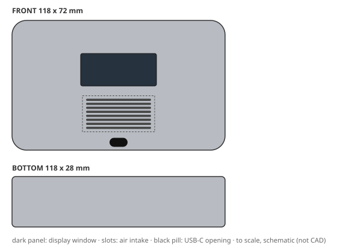
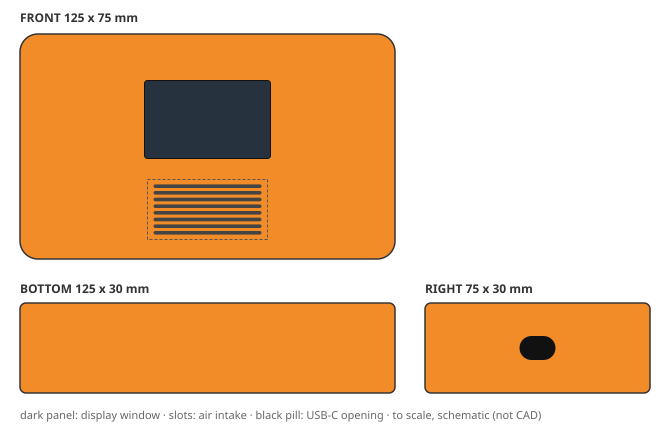
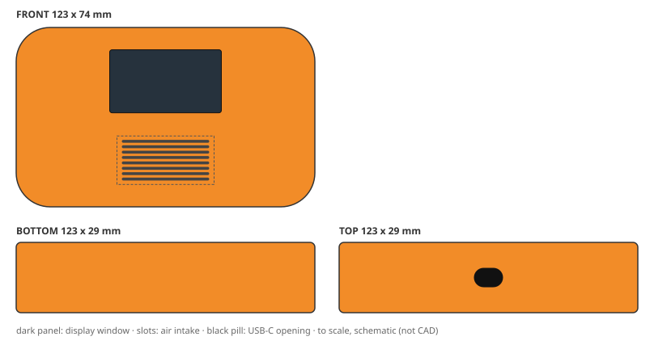
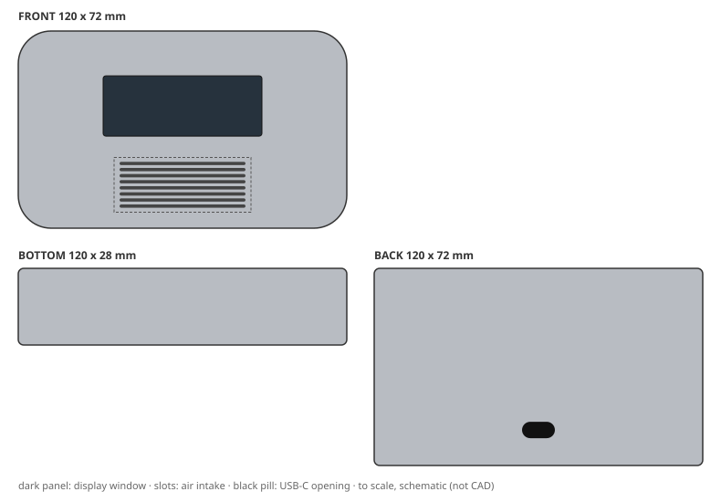
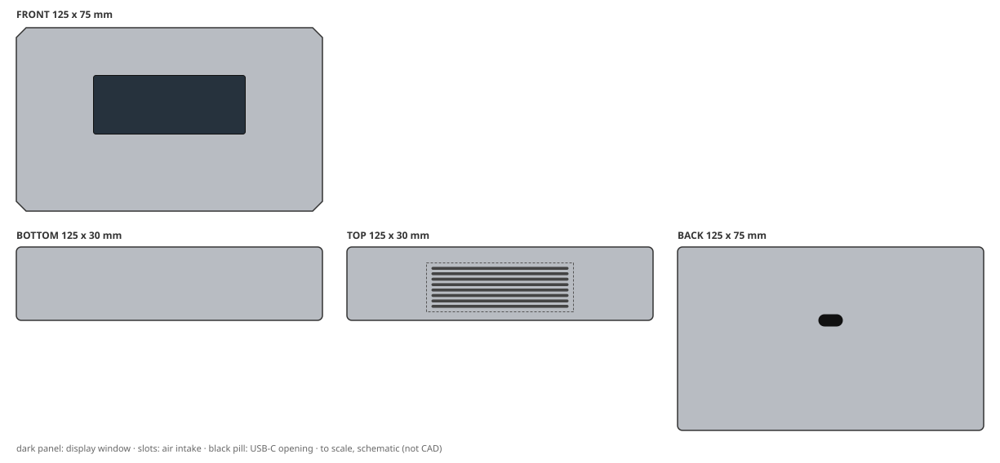
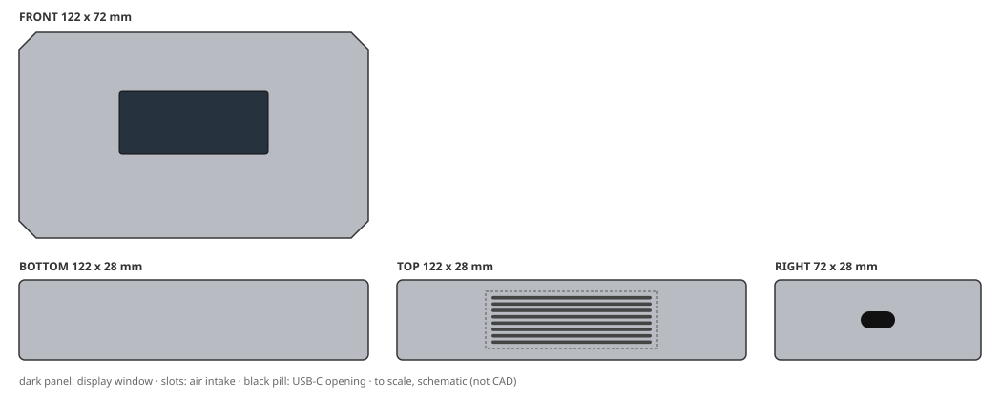
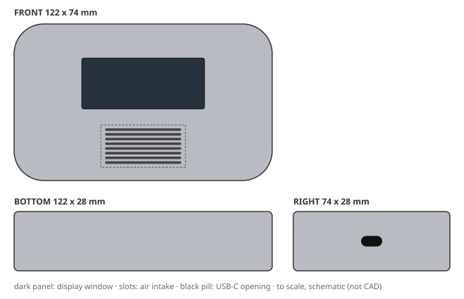
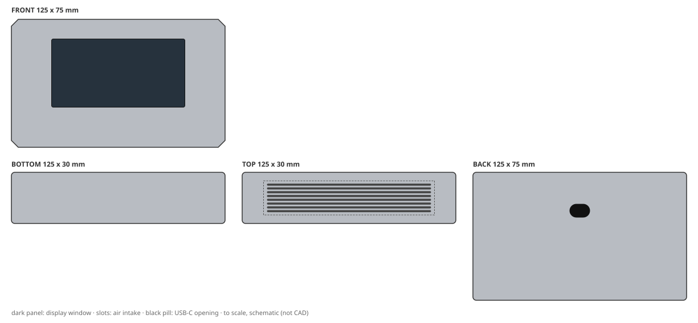
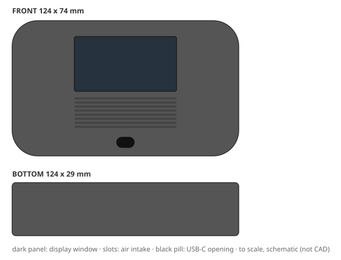

# Design report: eval-baseline

Config `baseline`, mode **live**, 12 variants: 1 needs_human, 8 production_ready, 3 rejected. Model cost CNY 3.01.

Each brief below shows its outcome, then one design card per shortlisted variant: the 2D concept, the 3D-ready structure and the DFM / cost / quality review, with a sketch drawn from the spec's numbers. Status `pending_approval` means every automated check passed and a person still has to sign off; `needs_human` means it passed with caveats a person must look at.

## B1: Retail apartment detector (cost first)

> Retail-channel air quality detector for rental apartments. Lowest possible unit cost is the top priority: target CNY 12 per housing at 10k units/year. Plain but tidy look in a colour that hides scuffs and fingerprints. It must survive knocks on a desk. Two-part shell, no decoration beyond a printed logo, budget tooling.

**Outcome:** cost ceiling CNY 12; cheapest possible CNY 9.36; conflict found; needs a person to resolve the brief.

- assumption: Q1 default: Assume drops from desk height (~0.5 m) onto hard floor without functional damage.
- assumption: Q2 default: No IP rating required; indoor use only.
- assumption: Q3 default: Use a medium grey or dark matte colour with light texture.
- assumption: Q4 default: Use standard uniform wall thickness of 2.0-2.5 mm for ABS.

Shortlist: B1-v001

### 1. B1-v001: "Soft Pebble Detector"

| | |
|---|---|
| **Status** | `needs_human`: passed with caveats |
| **Form** | Soft pebble silhouette: a low, slim, gently domed slab with continuous convex curvature on all faces so no flat panel reads as 'cheap box'. Corner radii are generous (8 mm plan, 5 mm vertical) making the part feel like a washed river stone in the hand while staying a simple 2-plate tool. Slim profile: 118 x 72 x 26 mm, mass ~173 g, achieved with 2.2 mm nominal wall and a ribbed inner face on the rear shell. Front face is a calm, uninterrupted surface: the display sits slightly proud in a shallow recess, the intake is a horizontal louvre band below it, and the USB-C is a recessed notch at the bottom edge, centred, so the cable drops straight down when the unit stands on a desk. No parting-line flash, no added trim, no light pipes; only a single pad-printed wordmark on the front lower right. (silhouette: pebble, corner radius 8 mm) |
| **Size** | 118 x 72 x 28 mm |
| **CMF** | rABS, textured light, warm medium grey, NCS S 5005-Y20R (approx. RAL 7037 dust grey), matte; decoration: pad print |
| **Layout** | display on front (42 x 18 mm), intake on front (8 slots), USB-C on front |
| **Structure** | 2 parts (front_housing, rear_housing); wall 2.2 mm; draft 1.5/2.5 deg; snap fits (0 screws); sealing none |
| **DFM** | pass; mass 153 g; vent open area 43%. First draft failed DISPLAY_WINDOW_MIN, DRAFT_COVERAGE, DRAFT_MIN, PACKAGING_FIT, RIB_RATIO, SNAP_FIT_UNDERCUT, VENT_SLOTS_FIT, VENT_ZONE_MIN; fixed with 1 autofix round(s) and 1 LLM revision(s) |
| **Cost** | CNY 11.70 per housing (ceiling 12); tooling CNY 117,000 |
| **Judge** | accept: brief 5, form 5, CMF 5, usability 4, intent 5 (of 5) |
| **Changed from the concept** | nothing (checked by code) |

Design intent and where the 3D spec keeps it:

- **IA1** Keep the pebble silhouette: continuous convex curvature on all six faces with 8 mm plan corner radius and 5 mm vertical edge radius, so the housing never reads as a sharp box and survives 0.5 m desk drops without corner chipping. → `envelope, front_housing, rear_housing`
- **IA2** Two-part shell only: front and rear injection-moulded rABS plates, joined by integral snap-fits (no screws, no separate bezel, no light pipe), with a single hidden seam on the side centreline. → `front_housing, rear_housing, closure, uc_front_hook_1, uc_front_hook_2, uc_rear_catch_1, uc_rear_catch_2`
- **IA3** Front-face layout is a vertical stack: display window centred at 38% height, horizontal intake louvre band centred at 72% height, USB-C recessed notch centred at 94% height on the bottom edge. Do not move or add face features. → `display_window, vent, usb_opening`
- **IA4** CMF is rABS with a light mould texture (MT-11010 equivalent, 0.8-1.2 um Ra) in warm medium grey; texture must be deep enough to hide fingerprints and scuffs but shallow enough to de-mould from a simple 2-plate tool. → `front_housing.finish, rear_housing.finish, front_housing.material, rear_housing.material`
- **IA5** Decoration is limited to one pad-printed wordmark on the front lower right; no paint, no soft-touch, no IML, no laser etch, no secondary colour. → `front_housing.pad_print`
- **IA6** Nominal wall 2.2 mm throughout, with 3 internal ribs on the rear shell for stiffness, keeping mass at or below 180 g and moulding cycle time short for the CNY 12 target. → `front_housing, rear_housing, rib1, rib2, rib3`

Caveats for the reviewer:

- brief had conflicts/assumptions resolved by defaults: Q1 default: Assume drops from desk height (~0.5 m) onto hard floor without functional damage.; Q2 default: No IP rating required; indoor use only.; Q3 default: Use a medium grey or dark matte colour with light texture.

> Judge: The variant fully adheres to the brief's top priority of lowest cost, achieving CNY 11.7 against a CNY 12 target. The soft pebble form is coherent and intentional, with continuous curvature and generous radii that read as one idea. CMF choice of rABS with light texture in warm medium grey is ideal for hiding scuffs and fingerprints while supporting sustainability. Usability is strong: display is ...

Full detail: `python -m creaition show eval-baseline B1-v001` or `variants/B1-v001.json`.

Not shortlisted:

| variant | status | reason |
|---|---|---|
| B1-v002 | `rejected` | cost CNY 12.07 > ceiling CNY 12 (already on deterministic fallback; over budget) |

## B2: Construction-site handheld (rugged)

> Rugged handheld air quality detector for construction-site supervisors who carry it all day outdoors. It must survive a 1.5 m drop onto concrete, dust and driving rain (IP65), UV exposure and use with work gloves. Tough, grippy textured surfaces, high-visibility colour, protected corners. Durable over pretty.

**Outcome:** cost ceiling CNY 18; cheapest possible CNY 12.55.

- assumption: Q1 default: Assume standard UV stabilizers are sufficient for typical outdoor use, with no specific accelerated weathering test requirement.
- assumption: Q2 default: Assume a bright safety orange or yellow is preferred, but any high-visibility color is acceptable.
- assumption: Q3 default: Assume -10°C to 50°C operating range, typical for outdoor handheld devices.

Shortlist: B2-v001, B2-v002

### 1. B2-v001: "SiteGuard Bumper - High-Vis Rugged Detector"

| | |
|---|---|
| **Status** | `production_ready`: approved by auto-policy:clean: all gates passed, no degraded evidence |
| **Form** | Chamfered-slab core body wrapped in a co-moulded TPE bumper ring that stands proud of every edge; four over-sized corner lugs read as impact absorbers; front face split into a recessed display well and a slotted intake grille with visible ePTFE membrane behind; all control affordances are 12 mm minimum, glove-scale ribs. (silhouette: bumpered, corner radius 6 mm) |
| **Size** | 125 x 75 x 30 mm |
| **CMF** | PC-ABS, textured heavy, Safety orange body (RAL 2003-ish) with charcoal-grey TPE bumper, UV-stabilised masterbatch; decoration: tpe overmold, pad print, laser etch |
| **Layout** | display on front (42 x 26 mm), intake on front (8 slots), USB-C on right |
| **Structure** | 2 parts (front_housing, rear_housing); wall 2.2 mm; draft 1.5/2.5 deg; screws and snaps (4 screws); sealing gasket and membrane vent |
| **DFM** | pass; mass 170 g; vent open area 43%. First draft failed DRAFT_COVERAGE, DRAFT_MIN, MASS_MAX, VENT_SLOTS_FIT; fixed with 1 autofix round(s) and 1 LLM revision(s) |
| **Cost** | CNY 16.71 per housing (ceiling 18); tooling CNY 114,000 |
| **Judge** | accept: brief 5, form 4, CMF 5, usability 4, intent 5 (of 5) |
| **Changed from the concept** | dropped tpe_overmold |

Design intent and where the 3D spec keeps it:

- **IA1** TPE bumper ring must stand 1.0-1.5 mm proud of the PC-ABS core on all edges and corners; the shell must never be the first contact in a 1.5 m drop onto concrete. → `front_housing_undercut_bumper, rear_housing_undercut_bumper`
- **IA2** Front intake grille must retain >= 15% open area and be backed by an ePTFE membrane vent plus perimeter gasket so IP65 is met without blocking airflow. → `vent, sealing, front_housing`
- **IA3** Every user interface element (display bezel, intake slot pitch, USB flap) must be operable with 3 mm-thick work gloves: no feature smaller than 12 mm, no recess deeper than 4 mm. → `display_window, vent, usb_opening`
- **IA4** Keep safety-orange body colour with UV-stabilised masterbatch and pad-printed/laser-etched high-contrast markings; do not downgrade to a low-visibility grey or pastel. → `front_housing.finish, front_housing.material, front_housing.pad_print, front_housing.laser_etch`
- **IA5** Part count and joining must stay within the CNY 18 BOM: two-shot or overmoulded bumper plus foam gasket, no secondary sealing screws beyond the USB flap. → `closure, screw_count, sealing, front_housing_undercut_bumper`
- **IA6** USB-C port on the right face must sit behind a tethered TPE flap with a >2 mm compression seal land to preserve IP65 after repeated openings. → `usb_opening, sealing`

> Judge: The variant strongly adheres to the rugged outdoor brief: it delivers IP65 sealing, 1.5 m drop survival via a proud TPE bumper ring, UV-stabilised high-visibility safety orange, glove-friendly features, and protected corners. The form is coherent as a chamfered-slab with overmoulded bumper and corner lugs. CMF fits the construction-site context with heavy texture and high-contrast markings. ...

Full detail: `python -m creaition show eval-baseline B2-v001` or `variants/B2-v001.json`.

### 2. B2-v002: "Pebble Grip Site Detector"

| | |
|---|---|
| **Status** | `production_ready`: approved by auto-policy:clean: all gates passed, no degraded evidence |
| **Form** | Soft pebble-form handheld detector: a continuous, organically-curved rounded slab with no sharp edges or exposed corners, achieved through generous radii in plan and section. The perimeter is a co-moulded TPE bumper band that wraps all four sides and absorbs drop energy while giving glove-friendly grip. A single recessed front face carries a sunken, gasket-sealed display window in the upper zone; a large open intake grille protected by an ePTFE membrane vent sits in the lower zone. A single top-edge USB-C port has a tethered rubber flap. Chunky moulded ribs on the rear provide finger registration; a moulded lanyard loop at one end. The whole object reads as one smooth, high-visibility pebble that survives being thrown into a site bag. (silhouette: pebble, corner radius 14 mm) |
| **Size** | 123 x 74 x 29 mm |
| **CMF** | PC-ABS, textured light, High-visibility safety orange (RAL 2004), UV-stabilised, with charcoal-grey TPE bumper band; decoration: soft touch, pad print |
| **Layout** | display on front (46 x 26 mm), intake on front (8 slots), USB-C on top |
| **Structure** | 2 parts (front_housing, rear_housing); wall 2 mm; draft 1.5/2.5 deg; screws (4 screws); sealing gasket and membrane vent |
| **DFM** | pass; mass 156 g; vent open area 43%. First draft failed DRAFT_COVERAGE, DRAFT_MIN, INNER_RADIUS, MASS_MAX, UNDERCUT_DECLARED, VENT_SLOTS_FIT; fixed with 1 autofix round(s) and 2 LLM revision(s) |
| **Cost** | CNY 14.71 per housing (ceiling 18); tooling CNY 114,000 |
| **Judge** | accept: brief 4, form 4, CMF 4, usability 4, intent 3 (of 5) |
| **Changed from the concept** | material PC-ABS -> rABS; dropped soft_touch; dropped pad_print |

Design intent and where the 3D spec keeps it:

- **IA1** Co-moulded TPE bumper band must wrap the entire perimeter with a minimum 2.5 mm radial thickness at the four impact zones, providing both 1.5 m drop energy absorption and glove-friendly grip; it is a structural, not decorative, feature. → `front_housing.undercuts, rear_housing.undercuts, front_housing.finish, rear_housing.finish`
- **IA2** The pebble silhouette and 14 mm corner radius are the drop-survival enabler and must not be sharpened or flattened to gain internal volume; any volume changes must come from wall thickness or internal ribbing. → `envelope_mm, front_housing, rear_housing`
- **IA3** Front-face intake must remain a single large-aperture grille at >=15% open area, covered internally by an ePTFE membrane vent plus gasket to reconcile IP65 with airflow; do not substitute a sealed or louvred-only intake. → `vent, sealing`
- **IA4** Safety-orange UV-stabilised PC-ABS body with textured_light moulded-in texture: the mould texture must be deep enough to remain grippy with gloves yet not trap site dust; no smooth-gloss body surfaces anywhere. → `front_housing.finish, rear_housing.finish, front_housing.material, rear_housing.material`
- **IA5** USB-C charging port on the top edge with a tethered rubber flap, and a moulded lanyard loop at the opposite end, both operable with work gloves and without removing the device from its holster. → `usb_opening_mm, front_housing, rear_housing`
- **IA6** Sealing strategy is a two-part shell with a single perimeter foam gasket and a membrane vent, keeping part count and BOM at or under CNY 18; do not add overmoulded gaskets or multi-shot seals beyond the TPE band. → `closure, sealing, screw_count, parts`

> Judge: The variant delivers a rugged, high-visibility handheld detector with a pebble form, textured rABS body, and front intake with ePTFE membrane. It meets the brief's durability and usability priorities, though the removal of the separate TPE bumper band slightly weakens the drop-survival and grip intent (IA1). The form remains coherent, CMF is appropriate, and the intake is unobstructed in normal ...

Full detail: `python -m creaition show eval-baseline B2-v002` or `variants/B2-v002.json`.

## B3: Living-room sideboard object (premium)

> Premium living-room air quality detector that sits on a sideboard next to design objects and books. Calm, minimal, furniture-like and elegant; soft-touch or fine matte surfaces, hidden fasteners and a slim profile. The display must be readable from the sofa. Indoor only, design-led home brand.

**Outcome:** cost ceiling CNY 18; cheapest possible CNY 9.36.

- assumption: Q1 default: Assume a typical living room viewing distance of 2.5 to 3 meters.
- assumption: Q2 default: Use a matte finish achieved through mold texturing (e.g., SPI/VDI texture) rather than a secondary coating to control cost.
- assumption: Q3 default: Design for basic disassembly using snap fits and minimal adhesives, but no formal recycling program required.

Shortlist: B3-v001, B3-v002

### 1. B3-v001: "Soft Pebble Slim Air-Quality Detector"

| | |
|---|---|
| **Status** | `production_ready`: approved by auto-policy:clean: all gates passed, no degraded evidence |
| **Form** | Pebble-like continuous surfacing with no visible parting line on the front face; gently domed front and back shells separated by a thin shadow gap at the mid-height. All edges are softly radiused so the housing reads as a smooth river stone. The display is a flush black window with a rounded-rectangle mask, sitting slightly above the front surface to stay readable from 2.5-3 m. Intake is a single horizontal micro-slot band recessed into the lower front, with hidden snap-fit assembly and no exposed screws. (silhouette: pebble, corner radius 12 mm) |
| **Size** | 120 x 72 x 28 mm |
| **CMF** | rABS, textured light, warm stone grey, PMS 413 C equivalent, with soft-touch matte appearance achieved by fine mold texture only; decoration: pad print |
| **Layout** | display on front (58 x 22 mm), intake on front (8 slots), USB-C on back |
| **Structure** | 2 parts (front_housing, rear_housing); wall 2 mm; draft 1.5/2.5 deg; snap fits (0 screws); sealing none |
| **DFM** | pass; mass 149 g; vent open area 44%. First draft failed DRAFT_COVERAGE, DRAFT_MIN, UNDERCUT_DECLARED, VENT_SLOTS_FIT, VENT_ZONE_MIN; fixed with 1 autofix round(s) and 0 LLM revision(s) |
| **Cost** | CNY 12.02 per housing (ceiling 18); tooling CNY 129,000 |
| **Judge** | accept: brief 5, form 5, CMF 5, usability 4, intent 5 (of 5) |
| **Changed from the concept** | nothing (checked by code) |

Design intent and where the 3D spec keeps it:

- **IA1** Preserve the pebble silhouette: continuous, fully radiused perimeter with no sharp edges or flat side walls; corner radius must remain >= 10 mm in all views. → `envelope, front_housing, rear_housing, front_housing.inner_radius_mm, rear_housing.inner_radius_mm`
- **IA2** Keep the display window readable from 2.5-3 m: minimum 58 x 22 mm active window, high-contrast black mask, and a viewing angle of at least 45 degrees in the vertical plane. → `display_window, front_housing`
- **IA3** Maintain hidden fasteners: no visible screws or clips on any external face; use internal snap fits and a recessed USB-C opening on the back face only. → `closure, front_housing.undercuts, rear_housing.undercuts, usb_opening`
- **IA4** Retain the fine matte surface as a mold-texture finish (VDI 27 equivalent) rather than a secondary soft-touch coating, to stay within the CNY 18 BOM ceiling. → `front_housing.finish, rear_housing.finish`
- **IA5** Use rABS as the primary shell material to support the sustainability priority, with basic snap-fit disassembly and no adhesives on the main parting line. → `front_housing.material, rear_housing.material, closure`
- **IA6** Keep the front intake as a single recessed horizontal micro-slot band below the display, protecting the sensor from direct dust and preserving the calm front face. → `vent, front_housing`

> Judge: The variant strongly adheres to the brief's priorities: it delivers a calm, minimal, furniture-like design with a slim pebble silhouette, hidden fasteners, and a display readable from the sofa. The form is coherent with continuous radiused surfaces and a shadow gap. CMF choices (rABS, fine mold texture, warm stone grey) align with sustainability and cost constraints. Usability is good: display ...

Full detail: `python -m creaition show eval-baseline B3-v001` or `variants/B3-v001.json`.

### 2. B3-v002: "Monolith Slab Air Detector"

| | |
|---|---|
| **Status** | `production_ready`: approved by auto-policy:clean: all gates passed, no degraded evidence |
| **Form** | A single, calm, chamfered slab that reads as a quiet piece of furniture rather than a gadget. The front face is a continuous, unperforated plane interrupted only by a flush, recessed display window; the top face carries the intake as a fine, horizontal slot array that disappears into the chamfer shadow. Side walls are near-vertical with a subtle 2° draft, soft 1.5 mm chamfers on all edges, and a continuous parting line at the lower third so the upper shell can be one clean moulding. A shallow recessed foot band on the bottom gives the object a floating stance. No visible screws, no logos on the front face, no glossy accents. (silhouette: chamfered slab, corner radius 3 mm) |
| **Size** | 125 x 75 x 30 mm |
| **CMF** | rABS, textured light, Warm off-white (NCS S 1002-Y, ~RAL 9010 adjusted warmer) with a matching warm-grey lower shell; display window bezel in…; decoration: pad print, laser etch |
| **Layout** | display on front (62 x 24 mm), intake on top (8 slots), USB-C on back |
| **Structure** | 2 parts (upper_shell, lower_shell); wall 2 mm; draft 1.5/2.5 deg; screws and snaps (1 screws); sealing none |
| **DFM** | pass; mass 155 g; vent open area 45%. First draft failed DRAFT_COVERAGE, INTENT_TRACE_COMPLETE, VENT_SLOTS_FIT, VENT_ZONE_MIN; fixed with 1 autofix round(s) and 1 LLM revision(s) |
| **Cost** | CNY 13.37 per housing (ceiling 18); tooling CNY 129,000 |
| **Judge** | accept: brief 5, form 5, CMF 5, usability 4, intent 5 (of 5) |
| **Changed from the concept** | nothing (checked by code) |

Design intent and where the 3D spec keeps it:

- **IA1** Front face must remain a single unperforated plane; the only interruption is the flush display window. No speaker grilles, logos, or fasteners on the front. → `upper_shell, display_window`
- **IA2** Intake is a horizontal slot array on the top face, set back from the front edge so it is not visible from a normal standing or seated eye height; slot width and pitch must read as a fine texture, not a grille. → `vent`
- **IA3** Display window is 62 x 24 mm, centred horizontally, with its optical centre at 42% of front-face height; this geometry is tuned for readability at 2.5–3 m and must not be shrunk or moved without re-validating legibility. → `display_window`
- **IA4** All fasteners are hidden: upper and lower shells join via internal snap fits and a single concealed screw under the rear foot pad. No visible screws, no adhesive on the main seam. → `upper_shell, lower_shell, closure, screw_count`
- **IA5** Housing material is rABS with a light mould texture (VDI 27–30 equivalent) on all cosmetic surfaces; no secondary soft-touch coating, no gloss, no paint on the main shells. → `upper_shell.finish, lower_shell.finish, upper_shell.material, lower_shell.material`
- **IA6** Wall thickness nominal 2.0 mm, ribs at 1.2 mm, and a 2° draft on all vertical walls; the 3 mm edge chamfer and 1.5 mm internal radii are the minimum that still read as 'soft' at arm's length. → `upper_shell, lower_shell, upper_rib_1, lower_rib_1, upper_boss_1, lower_boss_1`

> Judge: The variant delivers a calm, minimal, furniture-like slab with a clean front face, hidden fasteners, and a display sized for sofa readability. The top intake is set back and fine-textured, reducing the risk of accidental blockage while preserving the aesthetic. rABS with a light texture meets sustainability and cost priorities. The only minor concern is that the top intake could still be covered ...

Full detail: `python -m creaition show eval-baseline B3-v002` or `variants/B3-v002.json`.

## B4: Circular edition (sustainable)

> Sustainable edition for an eco-conscious brand. Use only recycled ABS for every plastic part, no paint or coatings, a mono-material housing and screw-free disassembly so it can be repaired and recycled. Honest, warm, slightly speckled look; carbon footprint matters more than gloss.

**Outcome:** cost ceiling CNY 18; cheapest possible CNY 9.40.

- assumption: Q1 default: No IP rating required (indoor use only).
- assumption: Q2 default: 1 meter drop onto concrete.
- assumption: Q3 default: Natural recycled ABS with visible speckles, no added colorants.

Shortlist: B4-v002, B4-v001

### 1. B4-v002: "Monolith Slab"

| | |
|---|---|
| **Status** | `production_ready`: approved by auto-policy:clean: all gates passed, no degraded evidence |
| **Form** | A single monolithic chamfered slab: one continuous rABS shell with a gentle 2.5 mm top chamfer running the full perimeter, giving an honest, warm, slightly brutalist object that reads as one solid piece of material rather than an assembly. The front face is a quiet matte field with a modest recessed display window; the top face carries an honest linear intake grille of moulded slots. No part lines are hidden; the single visible seam is a deliberate, tool-free pry channel along the bottom edge, celebrating repairability instead of disguising it. Speckle from the recycled ABS is left fully visible; no graphics, no coatings, no secondary colours. (silhouette: chamfered slab, corner radius 6 mm) |
| **Size** | 122 x 72 x 28 mm |
| **CMF** | rABS, textured light, Natural warm grey recycled ABS with visible darker speckles (no added colorant), approx. NCS S 4005-Y20R; decoration: none |
| **Layout** | display on front (52 x 22 mm), intake on top (8 slots), USB-C on right |
| **Structure** | 2 parts (front_housing, rear_housing); wall 2 mm; draft 1.5/2.5 deg; snap fits (0 screws); sealing none |
| **DFM** | pass; mass 150 g; vent open area 45%. First draft failed DRAFT_COVERAGE, DRAFT_MIN, INTENT_TRACE_COMPLETE, RIB_RATIO, VENT_SLOTS_FIT, VENT_ZONE_MIN; fixed with 1 autofix round(s) and 1 LLM revision(s) |
| **Cost** | CNY 10.84 per housing (ceiling 18); tooling CNY 114,000 |
| **Judge** | accept: brief 5, form 5, CMF 5, usability 4, intent 5 (of 5) |
| **Changed from the concept** | nothing (checked by code) |

Design intent and where the 3D spec keeps it:

- **IA1** Every plastic part, including the housing, display bezel and internal brackets, is rABS; no other polymer family is permitted anywhere in the housing assembly. → `front_housing.material, rear_housing.material`
- **IA2** No paint, soft-touch, pad-print, laser-etch, IML or TPE overmold on any exterior or interior surface; the speckled, lightly textured rABS tool finish is the final aesthetic. → `front_housing.finish, rear_housing.finish, front_housing.secondary_ops, rear_housing.secondary_ops`
- **IA3** The housing opens along a single bottom-edge pry channel with repeated-open cantilever snap-fits and no screws, adhesives or heat stakes; all internal modules lift out by hand for repair or recycling. → `closure, screw_count, front_snap_undercut, rear_snap_undercut`
- **IA4** The top-face intake is a moulded linear slot grille (no separate mesh or insert) whose ribs are structural and whose open area meets the sensor airflow requirement without adding a second material. → `vent`
- **IA5** The chamfered slab silhouette with 6 mm corner radii and a single continuous top chamfer defines the family look; the slab must not gain bolted-on bumpers, feet or decorative trims. → `envelope, front_housing, rear_housing`
- **IA6** Housing wall thickness is held at 2.0 mm nominal with local 2.4 mm ribs so the shell stays within the 180 g mass budget while surviving the 1 m drop assumption. → `front_housing, rear_housing, front_rib_1, front_rib_2, rear_rib_1, rear_rib_2`

> Judge: The variant fully adheres to the sustainable brief: all parts are rABS, no coatings, mono-material, screw-free snap-fit closure, and the speckled natural finish is preserved. The chamfered slab form is coherent and honest, with the top intake and front display well integrated. CMF perfectly matches the eco-conscious, warm, slightly speckled aesthetic. Usability is strong: display is readable, ...

Full detail: `python -m creaition show eval-baseline B4-v002` or `variants/B4-v002.json`.

### 2. B4-v001: "PebbleAir Mono"

| | |
|---|---|
| **Status** | `production_ready`: approved by auto-policy:clean: all gates passed, no degraded evidence |
| **Form** | Soft pebble-like rounded volume with an all-over gentle curvature, no sharp edges; a slim, warm, honest block that reads as a single continuous surface. The front face carries a large, softly recessed display window, while the lower front is a subtly dished intake field with a fine, evenly distributed micro-perforation pattern to express the speckled recycled material without any applied graphics. A shallow, hand-friendly side seam line divides upper and lower shells and doubles as the screw-free snap-fit parting line, with small pry notches at the rear corners for repair access. (silhouette: pebble, corner radius 14 mm) |
| **Size** | 122 x 74 x 28 mm |
| **CMF** | rABS, textured light, Natural warm grey with visible darker speckles (no added colorant; PCR-dependent tone); decoration: none |
| **Layout** | display on front (58 x 24 mm), intake on front (8 slots), USB-C on right |
| **Structure** | 2 parts (front_housing, rear_housing); wall 2.2 mm; draft 1.5/2.5 deg; snap fits (0 screws); sealing none |
| **DFM** | pass; mass 155 g; vent open area 43%. First draft failed DRAFT_COVERAGE, DRAFT_MIN, INTENT_TRACE_COMPLETE, RIB_RATIO, VENT_SLOTS_FIT, VENT_ZONE_MIN; fixed with 1 autofix round(s) and 1 LLM revision(s) |
| **Cost** | CNY 11.25 per housing (ceiling 18); tooling CNY 115,500 |
| **Judge** | accept: brief 5, form 5, CMF 5, usability 4, intent 5 (of 5) |
| **Changed from the concept** | nothing (checked by code) |

Design intent and where the 3D spec keeps it:

- **IA1** Housing is mono-material rABS with zero paint, lacquer or soft-touch coating; the speckled surface is the material itself, not a printed or painted effect. → `front_housing.material, rear_housing.material, front_housing.finish, rear_housing.finish`
- **IA2** Screw-free disassembly via hidden snap-fit tabs along the parting line plus two rear pry notches, tool-openable and rated for at least 10 open/close cycles without loss of retention. → `front_snap_tabs, rear_snap_tabs, rear_pry_notches, closure`
- **IA3** Slim pebble silhouette: envelope stays within 122 x 74 x 28 mm and corner radius stays at 14 mm, keeping the warm, hand-friendly rounded volume without a flat slab look. → `envelope, front_housing.inner_radius_mm, rear_housing.inner_radius_mm`
- **IA4** Front-face layout hierarchy: display window centred at 38% height, intake micro-perforation field centred at 78% height, separated by an uninterrupted 4 mm minimum wall band to preserve structural durability and air-path separation. → `display_window, vent, front_housing`
- **IA5** Wall thickness held to 2.0-2.4 mm nominal and ribbing kept internal, so the 10k/year injection-moulded part stays within the CNY 18 BOM ceiling with a single 2-plate tool per shell. → `front_housing, rear_housing, front_rib_1, front_rib_2, rear_rib_1, rear_rib_2`

> Judge: The variant fully adheres to the brief's sustainability priorities: mono-material rABS, no paint or coatings, screw-free disassembly via snap-fits and pry notches, and a speckled natural finish. The soft pebble form is coherent with the honest, warm aesthetic, and the CMF choices align perfectly with the eco-conscious brand. Usability is strong: the display is large and well-positioned, the ...

Full detail: `python -m creaition show eval-baseline B4-v001` or `variants/B4-v001.json`.

## B5: Flagship that wants everything (intentionally conflicting)

> Flagship model: premium soft-touch painted finish, fully waterproof to IP67, ultra-slim 18 mm thick profile, 100% recycled plastic, weighing under 120 g, and it must cost no more than CNY 9 per housing. Launch in six weeks.

**Outcome:** cost ceiling CNY 16; cheapest possible CNY 12.59; conflict found; needs a person to resolve the brief.

This brief can only be made after relaxing the limits below, so it got 2 example variants instead of the full fan-out, and none of them can be auto-approved.

- assumption: Relaxed cost_ceiling_cny: 9 -> 16 (cheapest feasible housing costs CNY 12.59 > target CNY 9)
- assumption: Relaxed max_height_mm: 18 -> 26 (PCB+battery stack needs >= 25.0 mm overall height at 1.5 mm walls)
- assumption: Relaxed max_mass_g: 120 -> 151 (lightest feasible product weighs 120.5 g > 120 g)
- assumption: Q1 default: Mixed indoor/outdoor use with occasional water exposure, but not continuous immersion.
- assumption: Q2 default: Paint is applied only to visible exterior surfaces, with masked sealing and joining areas.
- assumption: Q3 default: Cost is the highest priority, followed by IP rating, then finish and sustainability.
- assumption: Q4 default: Six weeks is for design freeze; tooling and production will follow later.

Not shortlisted:

| variant | status | reason |
|---|---|---|
| B5-v001 | `rejected` | quality 3.00 (min criterion 2) below bar 3.5/2 |
| B5-v002 | `rejected` | quality 3.00 (min criterion 2) below bar 3.5/2 |

## B6: Open-plan office desk unit (balanced control)

> Desk air quality detector for open-plan offices: friendly and approachable, light texture that hides fingerprints, readable at a glance from a neighbouring desk. Balanced priorities between budget, durability and looks; facilities teams buy these in bulk.

**Outcome:** cost ceiling CNY 18; cheapest possible CNY 9.36.

- assumption: Q1 default: No IP rating required (indoor use only).
- assumption: Q2 default: No drop test specified; assume standard office handling.
- assumption: Q3 default: Use virgin ABS unless cost or sustainability targets dictate otherwise.

Shortlist: B6-v002, B6-v001

### 1. B6-v002: "Monolith Slab Desk Detector"

| | |
|---|---|
| **Status** | `production_ready`: approved by auto-policy:clean: all gates passed, no degraded evidence |
| **Form** | A single confident chamfered slab: the front face is one uninterrupted plane carrying only the display, the top edge is a gentle 12° chamfer that hosts the intake, and the base is a thin shadow-gap plinth. All functional interfaces are concentrated on the front and top so the silhouette reads as a calm, friendly monolith from across an open-plan desk. Chamfers replace fillets where possible to reduce tooling cost while keeping the object approachable. (silhouette: chamfered slab, corner radius 4 mm) |
| **Size** | 125 x 75 x 30 mm |
| **CMF** | ABS, textured light, Warm office grey, NCS S 2002-Y (light warm neutral); decoration: pad print |
| **Layout** | display on front (78 x 40 mm), intake on top (8 slots), USB-C on back |
| **Structure** | 2 parts (front_housing, rear_housing); wall 2.8 mm; draft 1.5/2.5/12 deg; snap fits (0 screws); sealing none |
| **DFM** | pass; mass 173 g; vent open area 46%. First draft failed DRAFT_COVERAGE, DRAFT_MIN, ENVELOPE_MAX, MASS_MAX, PACKAGING_FIT, VENT_SLOTS_FIT, VENT_ZONE_MIN, WALL_RANGE; fixed with 1 autofix round(s) and 1 LLM revision(s) |
| **Cost** | CNY 13.37 per housing (ceiling 18); tooling CNY 129,000 |
| **Judge** | accept: brief 5, form 5, CMF 5, usability 4, intent 5 (of 5) |
| **Changed from the concept** | nothing (checked by code) |

Design intent and where the 3D spec keeps it:

- **IA1** Preserve the single-plane front face with the display as the only interruption; no visible screw bosses, parting-line steps, or speaker grilles on the front. → `front_housing, front_housing.finish, front_housing.drafts, display_window, parting`
- **IA2** Keep the top-edge intake as a single narrow slot array (max 6 mm wide) positioned within the 12° top chamfer so it reads as a design line, not a vent. → `vent, front_housing.drafts, rear_housing.drafts`
- **IA3** Display window must remain at least 78 x 40 mm with emissive contrast suitable for reading from 1.5 m in office lighting; do not reduce window size or recess it more than 0.5 mm. → `display_window`
- **IA4** Moulded-in light texture (MT-11010 equivalent) on all cosmetic surfaces to hide fingerprints; no secondary paint or gloss on the main shell. → `front_housing.finish, rear_housing.finish`
- **IA5** USB-C recess on the back face centred at 50% width and 30% height, with a 0.8 mm lead-in chamfer and no visible connector surround on the front. → `usb_opening, rear_housing`
- **IA6** Maintain 4 mm nominal wall and a snap-fit front-to-back assembly with no metal inserts, keeping housing BOM at or below CNY 18/unit at 10,000 units/year. → `front_housing, rear_housing, closure, front_housing.material, rear_housing.material`

> Judge: The variant fully delivers the brief's priorities: friendly, approachable design with light texture, clear readability, and balanced cost/durability/aesthetics. The chamfered slab form is coherent and the CMF (ABS, textured light, warm grey) fits the office context. Usability is strong: display is large and readable, intake on top chamfer is unobstructed in normal desk use, USB on back is ...

Full detail: `python -m creaition show eval-baseline B6-v002` or `variants/B6-v002.json`.

### 2. B6-v001: "Pebble Pod — Soft Front-Reader Desk Detector"

| | |
|---|---|
| **Status** | `production_ready`: approved by auto-policy:clean: all gates passed, no degraded evidence |
| **Form** | A gentle pebble-like slab inflated just enough to feel friendly in the hand but still desk-disciplined: the plan-form is a rounded rectangle with large, continuous corner radii that swell slightly toward the back, while the side profile tapers from a thicker rear grip zone to a slim, beveled front lip. The front face is read as one calm field: a single wide display window occupies the upper two-thirds, gently recessed with a 0.6 mm shadow lip so it reads as an inset screen rather than a stuck-on panel. Below it, a soft horizontal intake grille band spans nearly the full width, its slots angled downward so dust does not settle in the openings. The USB-C port sits low and centered on the front face, framed by a subtle recessed notch so cables can be plugged in by feel. No sharp part lines: the main seam is a single shadow-gap wrapping the lower perimeter, keeping the top surface clean and wipeable. (silhouette: pebble, corner radius 14 mm) |
| **Size** | 124 x 74 x 29 mm |
| **CMF** | ABS, textured light, warm light grey (NCS S 1500-N), with a slightly darker graphite front bezel (NCS S 6005-G20Y) to frame the display and …; decoration: soft touch, pad print |
| **Layout** | display on front (56 x 30 mm), intake on front (8 slots), USB-C on front |
| **Structure** | 2 parts (front_housing, rear_housing); wall 1.9 mm; draft 1.5/2.5 deg; screws (4 screws); sealing none |
| **DFM** | pass; mass 151 g; vent open area 45%. First draft failed DRAFT_COVERAGE, DRAFT_MIN, INTENT_TRACE_COMPLETE, RIB_RATIO, VENT_SLOTS_FIT, VENT_ZONE_MIN; fixed with 1 autofix round(s) and 1 LLM revision(s) |
| **Cost** | CNY 15.40 per housing (ceiling 18); tooling CNY 114,000 |
| **Judge** | accept: brief 5, form 5, CMF 5, usability 4, intent 5 (of 5) |
| **Changed from the concept** | nothing (checked by code) |

Design intent and where the 3D spec keeps it:

- **IA1** Preserve the pebble plan-form with continuous large corner radii (target 14 mm, minimum 12 mm) — no chamfered or boxy corner treatment, since the soft silhouette is the primary 'friendly, approachable' signal for facilities buyers. → `envelope, front_housing, rear_housing`
- **IA2** Keep the display window in the upper two-thirds of the front face at roughly 56 x 30 mm and recessed with a 0.6 mm shadow lip; do not shrink or move it to a side or top face, because readability from a neighbouring desk depends on a large, front-facing, high-contrast screen. → `display_window, front_housing, front_display_recess`
- **IA3** Retain a front-facing intake grille band centered below the display, with downward-angled slots and a minimum 30% open area, so airflow reaches the sensor without the user seeing a mechanical vent pattern that fights the friendly form. → `vent, front_housing`
- **IA4** Keep USB-C on the front face, low and centered at about 90% height, in a recessed notch that allows one-handed blind plugging; do not move it to the side or rear, as front access is a daily-use requirement on crowded shared desks. → `usb_opening, front_usb_notch`
- **IA5** Apply a light texture (MT-11000 range, ~VDI 21-24) across all visible ABS surfaces to hide fingerprints and fine office dust; the texture must remain fine enough to wipe clean and must not be polished away on the front bezel. → `front_housing.finish, rear_housing.finish`
- **IA6** Hold the single shadow-gap seam around the lower perimeter and keep the top surface free of part lines and screw bosses visible from above; this preserves the wipeable, calm top face and avoids dirt traps at eye level. → `parting, front_housing, rear_housing`
- **IA7** Maintain the cost-driven material and process plan: single-cavity or 1+1 family tool in ABS with light texture, no paint on the main body, soft-touch only on the base pad; if cost pressure rises, remove pad print before adding any secondary paint or overmold. → `front_housing.material, rear_housing.material, front_housing.pad_print, rear_housing.soft_touch`
- **IA8** Keep the mass-saving wall strategy (1.8-2.0 mm nominal walls, local ribs, no solid bosses) that keeps the housing under 180 g; do not thicken walls for perceived quality, as bulk purchase handling and shipping cost depend on the low mass. → `front_housing, rear_housing, front_rib_display, front_rib_intake, rear_rib_perimeter`

> Judge: The variant fully delivers the brief's priorities: friendly pebble form with large radii, light texture, front-facing display and intake, and cost-effective ABS construction. The form is coherent and the CMF suits the office context. Usability is strong, though the front intake could be partially covered by a hand during handling, but the downward-angled slots and placement below the display ...

Full detail: `python -m creaition show eval-baseline B6-v001` or `variants/B6-v001.json`.

