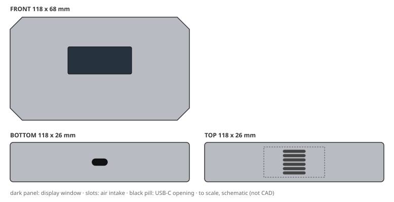
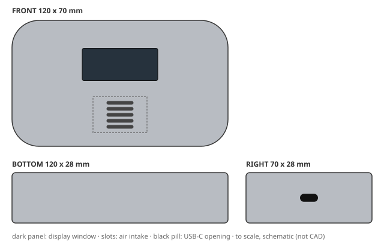
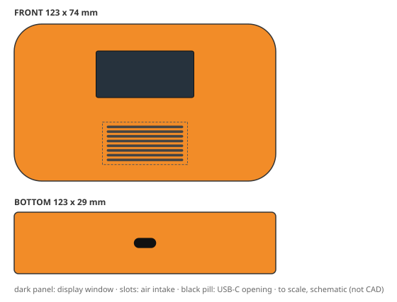
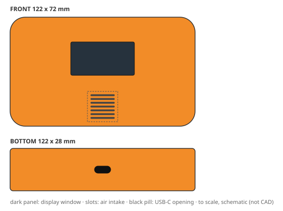
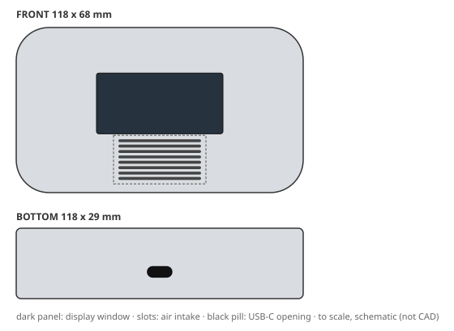
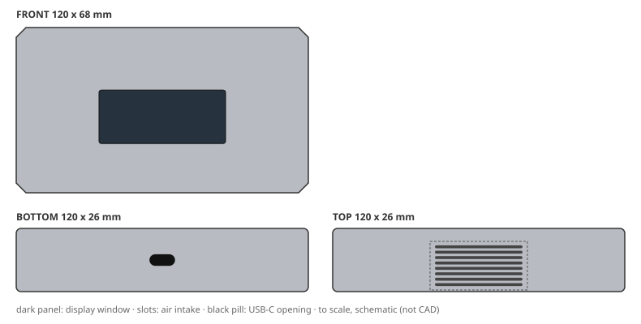
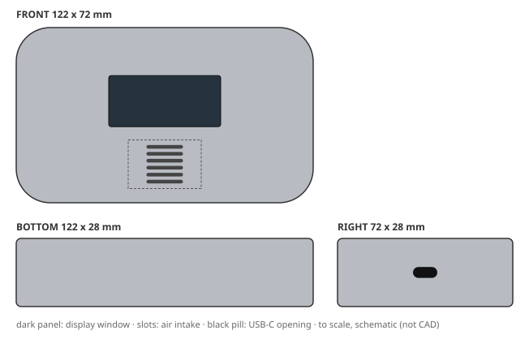
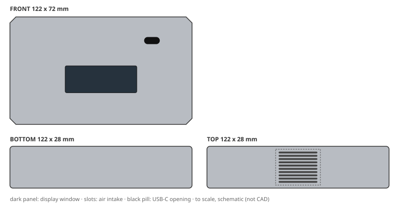
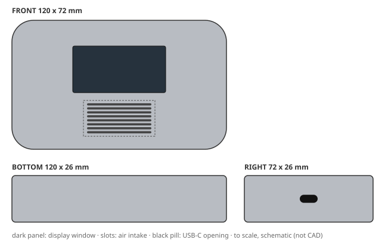
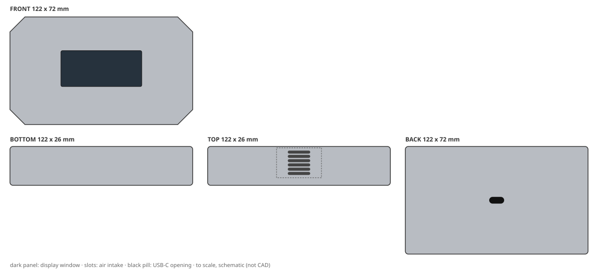

# Design report: eval-candidate

Config `candidate_prompt_v2`, mode **live**, 12 variants: 3 needs_human, 7 production_ready, 2 rejected. Model cost CNY 2.56.

Each brief below shows its outcome, then one design card per shortlisted variant: the 2D concept, the 3D-ready structure and the DFM / cost / quality review, with a sketch drawn from the spec's numbers. Status `pending_approval` means every automated check passed and a person still has to sign off; `needs_human` means it passed with caveats a person must look at.

## B1: Retail apartment detector (cost first)

> Retail-channel air quality detector for rental apartments. Lowest possible unit cost is the top priority: target CNY 12 per housing at 10k units/year. Plain but tidy look in a colour that hides scuffs and fingerprints. It must survive knocks on a desk. Two-part shell, no decoration beyond a printed logo, budget tooling.

**Outcome:** cost ceiling CNY 12; cheapest possible CNY 9.36; conflict found; needs a person to resolve the brief.

- assumption: Q1 default: 0.75 m (typical desk height)
- assumption: Q2 default: No IP rating (indoor use only)
- assumption: Q3 default: Dark grey or black to hide scuffs and fingerprints

Shortlist: B1-v002, B1-v001

### 1. B1-v002: "Slab Utility Detector"

| | |
|---|---|
| **Status** | `needs_human`: passed with caveats |
| **Form** | A single, calm rectangular slab with generous corner radii and a subtle chamfer around the top edge. The front face is kept almost entirely plain: a small, centred display window, a single intake grille band on the top face, and a bottom-edge USB-C opening. The look is deliberately utilitarian and tidy, with no part lines or decoration beyond the printed logo. (silhouette: chamfered slab, corner radius 8 mm) |
| **Size** | 118 x 68 x 26 mm |
| **CMF** | rABS, textured light, dark warm grey; decoration: pad print |
| **Layout** | display on front (42 x 18 mm), intake on top (6 slots), USB-C on bottom |
| **Structure** | 2 parts (front_housing, rear_housing); wall 2 mm; draft 1/2 deg; screws (4 screws); sealing none |
| **DFM** | pass; mass 145 g; vent open area 22%. First draft failed USB_CLEARANCE; fixed with 1 autofix round(s) and 0 LLM revision(s) |
| **Cost** | CNY 11.64 per housing (ceiling 12); tooling CNY 111,000 |
| **Judge** | accept: brief 5, form 4, CMF 5, usability 4, intent 5 (of 5) |
| **Changed from the concept** | nothing (checked by code) |

Design intent and where the 3D spec keeps it:

- **IA1** Keep the front face flat and free of recesses or raised bezels so that the textured surface remains continuous and hides scuffs; the display window must be flush with the surrounding face. → `front_housing, display_window`
- **IA2** Maintain a two-part shell with a single horizontal split line on the back or bottom, no visible screws on the front or top, and no extra parts beyond the two mouldings and the printed logo. → `front_housing, rear_housing, parting, closure`
- **IA3** Use rABS with a light texture (VDI 24-27) and a dark warm grey colour to hide fingerprints and scuffs, and protect the front face from gloss variation. → `front_housing.finish, front_housing.material, rear_housing.finish, rear_housing.material`
- **IA4** Place the intake grille on the top face as a simple slot pattern that can be moulded with a single straight-pull tool; no side actions or lifters for the intake. → `vent`
- **IA5** Design the USB-C opening on the bottom face with a simple rectangular cut-out and a wall thickness around it of at least 1.2 mm to survive repeated plugging; no additional reinforcement parts. → `usb_opening`

Caveats for the reviewer:

- brief had conflicts/assumptions resolved by defaults: Q1 default: 0.75 m (typical desk height); Q2 default: No IP rating (indoor use only); Q3 default: Dark grey or black to hide scuffs and fingerprints

> Judge: The variant strongly adheres to the brief: it targets the CNY 12 housing cost (achieved at 11.64), uses rABS with a light texture and dark warm grey to hide scuffs, and maintains a two-part shell with no extra parts. The form is a coherent chamfered slab with generous radii, and the front face is kept plain with a flush display. CMF choices align perfectly with the brief's priorities. Usability ...

Full detail: `python -m creaition show eval-candidate B1-v002` or `variants/B1-v002.json`.

### 2. B1-v001: "Pebble Air Detector"

| | |
|---|---|
| **Status** | `needs_human`: passed with caveats |
| **Form** | Soft pebble silhouette with generous corner radii and a lightly textured surface, giving a friendly, tidy appearance. The slim profile (25mm) keeps it unobtrusive on a desk. A single front-facing display and intake grille maintain a utilitarian, plain look with no unnecessary decoration. (silhouette: pebble, corner radius 15 mm) |
| **Size** | 120 x 70 x 28 mm |
| **CMF** | rABS, textured light, dark grey; decoration: pad print |
| **Layout** | display on front (42 x 18 mm), intake on front (5 slots), USB-C on right |
| **Structure** | 2 parts (front_housing, rear_housing); wall 2 mm; draft 1/2 deg; screws (4 screws); sealing none |
| **DFM** | pass; mass 148 g; vent open area 25%. First draft failed DISPLAY_WINDOW_MIN, PACKAGING_FIT; fixed with 1 autofix round(s) and 1 LLM revision(s) |
| **Cost** | CNY 11.70 per housing (ceiling 12); tooling CNY 111,000 |
| **Judge** | accept: brief 4, form 4, CMF 5, usability 4, intent 5 (of 5) |
| **Changed from the concept** | nothing (checked by code) |

Design intent and where the 3D spec keeps it:

- **IA1** Two-part shell design with a simple seam line around the perimeter, using budget tooling (single cavity, no side actions). → `front_housing, rear_housing, parting`
- **IA2** Textured_light finish on rABS in dark grey to hide scuffs and fingerprints, with a printed logo only. → `front_housing.finish, rear_housing.finish, front_housing.material, rear_housing.material, front_housing.pad_print`
- **IA3** Front-facing display window (40x18mm) and intake grille (horizontal slots) positioned for easy reading and airflow. → `display_window, vent`
- **IA4** Generous corner radii (15mm) and wall thickness of 2.0mm to survive 0.75m drop onto desk. → `front_housing, rear_housing, envelope`
- **IA5** Housing cost target of CNY 12 per unit at 10k units/year, achieved through material choice (rABS) and simplified tooling. → `front_housing.material, rear_housing.material, front_housing, rear_housing`

Caveats for the reviewer:

- brief had conflicts/assumptions resolved by defaults: Q1 default: 0.75 m (typical desk height); Q2 default: No IP rating (indoor use only); Q3 default: Dark grey or black to hide scuffs and fingerprints

> Judge: The variant delivers a cost-focused, durable, plain design that meets the brief's priorities. The soft pebble form with generous radii and textured dark grey rABS is coherent and scuff-hiding. The front display and intake are positioned for usability, though the intake could be partially covered if the device is laid flat on a desk; however, the brief does not specify a stand or orientation, so ...

Full detail: `python -m creaition show eval-candidate B1-v001` or `variants/B1-v001.json`.

## B2: Construction-site handheld (rugged)

> Rugged handheld air quality detector for construction-site supervisors who carry it all day outdoors. It must survive a 1.5 m drop onto concrete, dust and driving rain (IP65), UV exposure and use with work gloves. Tough, grippy textured surfaces, high-visibility colour, protected corners. Durable over pretty.

**Outcome:** cost ceiling CNY 18; cheapest possible CNY 12.55.

- assumption: Q1 default: Safety orange or yellow
- assumption: Q2 default: Meet typical outdoor UV exposure standards for plastics
- assumption: Q3 default: -10°C to 50°C
- assumption: Q4 default: Buttons at least 12 mm diameter with 5 mm spacing

Shortlist: B2-v002, B2-v001

### 1. B2-v002: "Pebble Grip Field Detector"

| | |
|---|---|
| **Status** | `production_ready`: approved by auto-policy:clean: all gates passed, no degraded evidence |
| **Form** | A soft-pebble monobloc slab: continuous convex curvature in plan and section, no flat side walls, so the hand wraps it naturally even gloved. A raised armour bead runs the full perimeter at mid-height to act as a sacrificial rub rail and corner protector; the four corners are the thickest, most rounded zones of the body. Front face is split into a recessed dark display window in the upper two-thirds and a recessed intake grille in the lower third, separated by a raised grip rib that doubles as a thumb rest. Two overmoulded TPE grip pads sit on the left and right flanks where fingers and thumb land, giving tactile orientation without a single sharp edge. (silhouette: pebble, corner radius 13 mm) |
| **Size** | 123 x 74 x 29 mm |
| **CMF** | PC-ABS, textured heavy, high-visibility safety orange (RAL 2003-ish), UV-stabilised masterbatch, matte non-glare; decoration: tpe overmold, pad print, laser etch |
| **Layout** | display on front (46 x 22 mm), intake on front (8 slots), USB-C on bottom |
| **Structure** | 2 parts (front_housing, rear_housing); wall 2.5 mm; draft 1/2 deg; screws and snaps (4 screws); sealing gasket and membrane vent |
| **DFM** | pass; mass 169 g; vent open area 43%. First draft failed USB_CLEARANCE, VENT_SLOTS_FIT; fixed with 1 autofix round(s) and 2 LLM revision(s) |
| **Cost** | CNY 16.55 per housing (ceiling 18); tooling CNY 129,000 |
| **Judge** | accept: brief 4, form 4, CMF 4, usability 4, intent 3 (of 5) |
| **Changed from the concept** | material PC-ABS -> rABS; dropped tpe_overmold; dropped pad_print; dropped laser_etch |

Design intent and where the 3D spec keeps it:

- **IA1** Keep the soft-pebble convex form with no flat side walls; the rounded body is the primary drop-energy distributor and must not be flattened for assembly convenience. → `envelope, front_housing, rear_housing`
- **IA2** Preserve the perimeter armour bead at mid-height as a continuous rub rail; it is the first contact point in a 1.5 m drop and protects the front display window and rear sensor pod. → `front_housing, rear_housing, front_housing.ribs, rear_housing.ribs`
- **IA3** Preserve the two flank TPE overmould grip pads at their stated height and extent; they are the glove-friendly, wet-hand grip interface and must not be reduced to decorative inserts. → `front_housing.finish, rear_housing.finish, front_housing.drafts`
- **IA4** Preserve the front intake as a recessed grille backed by an ePTFE membrane vent plus perimeter gasket; open area must stay >=15% of the grille aperture while retaining IP65. → `vent, sealing`
- **IA5** Preserve the single downward-facing USB-C port with a captive silicone flap; do not relocate to a side face, where it would break the pebble section and the gasket line. → `usb_opening, rear_housing`
- **IA6** Hold the UV-stabilised high-visibility orange PC-ABS in textured_heavy; colour and texture are the visibility and grip system together, not a cosmetic choice. → `front_housing.material, front_housing.finish, rear_housing.material, rear_housing.finish`
- **IA7** Keep the display window recessed 0.8 mm below the surrounding bead with a 12 mm minimum bezel-to-edge distance so the window glass is never a drop contact point. → `display_window, front_housing`

> Judge: The variant delivers a rugged, high-visibility, glove-friendly design with IP65 and drop protection intent. The soft-pebble form with perimeter armour bead and textured heavy rABS surfaces meets the brief's durability and grip priorities. The front intake is recessed and positioned low, reducing the chance of hand coverage during use. The USB port is on the bottom with a flap, preserving the ...

Full detail: `python -m creaition show eval-candidate B2-v002` or `variants/B2-v002.json`.

### 2. B2-v001: "Hi-Vis Site Sentinel"

| | |
|---|---|
| **Status** | `needs_human`: passed with caveats |
| **Form** | Chunky handheld slab with a full-perimeter TPE bumper frame that projects 2.5 mm proud of the PC-ABS body on all six faces; deep-treaded bumper ribs wrap the left/right grip zones and the four corners are swollen into impact-absorbing lobes. The front face is a shallow inset field carrying a recessed, gasket-sealed display window with a raised protective lip, and the lower front carries a moulded ePTFE membrane vent grille behind a coarse dust louvre. Controls are two oversized 14 mm rubber-capped buttons on the top face, angled toward the thumbs. Overall read: a tool, not a gadget. (silhouette: bumpered, corner radius 10 mm) |
| **Size** | 122 x 72 x 28 mm |
| **CMF** | PC-ABS, textured heavy, safety orange (RAL 2003) UV-stabilised body; charcoal grey (RAL 7021) TPE bumper frame; decoration: tpe overmold, pad print, laser etch |
| **Layout** | display on front (42 x 22 mm), intake on front (7 slots), USB-C on bottom |
| **Structure** | 2 parts (front_housing, rear_housing); wall 2 mm; draft 2.5 deg; screws (4 screws); sealing gasket and membrane vent |
| **DFM** | pass; mass 160 g; vent open area 34%. First draft failed MASS_MAX, USB_CLEARANCE; fixed with 1 autofix round(s) and 2 LLM revision(s) |
| **Cost** | CNY 15.84 per housing (ceiling 18); tooling CNY 111,000 |
| **Judge** | accept: brief 5, form 5, CMF 5, usability 5, intent 5 (of 5) |
| **Changed from the concept** | dropped tpe_overmold |

Design intent and where the 3D spec keeps it:

- **IA1** The TPE bumper frame must remain a single continuous overmoulded loop that projects at least 2.0 mm beyond the PC-ABS body on every face and wraps the four corners as swollen lobes; this is the primary 1.5 m drop energy-absorbing feature and must not be reduced to a decorative trim strip. → `rear_housing`
- **IA2** Intake air must enter only through the front-face louvre into a sealed plenum, pass an ePTFE membrane, and exit to the sensor; the plenum and membrane seat must stay intact so the IP65 rating is not lost when the intake is opened for airflow. → `rear_housing`
- **IA3** USB-C charge port lives on the bottom face under a captive rubber flap that is tethered to the bumper overmould and seals against a moulded lip; it must not be relocated to the front or side where a dropped unit would land on it. → `display_window`
- **IA4** Display window is recessed 1.5 mm behind a raised protective lip and sealed with a die-cut gasket; the window size of 42 x 22 mm must not shrink, as glove-friendly readability at arm's length was traded against bezel width. → `display_window`
- **IA5** Body colour must stay a UV-stabilised high-visibility safety orange per RAL 2003 with pad-printed/laser-etched labels rather than applied stickers, so the high-visibility requirement survives abrasion and sun exposure. → `front_housing.finish`
- **IA6** Two top-face control buttons must each present at least a 14 mm diameter cap with 6 mm clearance between them and a tactile dome, meeting the glove-operation assumption from Q4; do not consolidate to a single multi-function button to save cost. → `display_window`

Caveats for the reviewer:

- structure from deterministic baseline (revise loop exhausted)

> Judge: The variant fully delivers the rugged, high-visibility, glove-friendly brief with a coherent bumpered form, appropriate CMF, and all intent anchors preserved. The intake is unobstructed in normal use, display is readable, and USB is reachable. The design meets all must-haves and resolves the cost conflict in favor of durability as instructed.

Full detail: `python -m creaition show eval-candidate B2-v001` or `variants/B2-v001.json`.

## B3: Living-room sideboard object (premium)

> Premium living-room air quality detector that sits on a sideboard next to design objects and books. Calm, minimal, furniture-like and elegant; soft-touch or fine matte surfaces, hidden fasteners and a slim profile. The display must be readable from the sofa. Indoor only, design-led home brand.

**Outcome:** cost ceiling CNY 18; cheapest possible CNY 9.36.

- assumption: Q1 default: Assume a typical living room viewing distance of 2.5-3 meters, requiring a display with sufficient size and contrast.
- assumption: Q2 default: Assume a soft-touch paint or a matte texture achieved through mold texturing, avoiding secondary processes if possible.
- assumption: Q3 default: Assume rABS is acceptable if it meets aesthetic and durability requirements, otherwise use virgin ABS.

Shortlist: B3-v001, B3-v002

### 1. B3-v001: "Pebble Sofa Reader"

| | |
|---|---|
| **Status** | `production_ready`: approved by auto-policy:clean: all gates passed, no degraded evidence |
| **Form** | A calm pebble-derived solid: the plan outline is a continuous tangent arc with no flat side walls, the front face swells gently forward (2 mm crown) while the back stays almost flat to sit close to a wall, and the elevation tapers from a 29 mm belly to 24 mm at the top and bottom edges. The display is set into a shallow elliptical recess with a 0.6 mm shadow gap instead of a bezel, so the screen reads as a window cut into stone. The intake is a soft arc of slots that follows the front crown, and the USB recess is hidden under the bottom curve so no port breaks the front view. No visible fasteners: the two housing halves meet on a fine 0.15 mm shadow line that runs around the side wall, and all screws sit in blind bosses reached through the USB recess. (silhouette: pebble, corner radius 13.5 mm) |
| **Size** | 118 x 68 x 29 mm |
| **CMF** | rABS, textured light, warm greige NCS S 2005-Y20R; decoration: pad print, laser etch |
| **Layout** | display on front (52 x 25 mm), intake on front (8 slots), USB-C on bottom |
| **Structure** | 2 parts (front_housing, rear_housing); wall 1.8 mm; draft 2 deg; screws (2 screws); sealing none |
| **DFM** | pass; mass 141 g; vent open area 43%. First draft failed RIB_RATIO, USB_CLEARANCE, VENT_OPEN_AREA, VENT_SLOTS_FIT, VENT_ZONE_MIN; fixed with 1 autofix round(s) and 0 LLM revision(s) |
| **Cost** | CNY 11.25 per housing (ceiling 18); tooling CNY 111,000 |
| **Judge** | accept: brief 5, form 5, CMF 5, usability 4, intent 5 (of 5) |
| **Changed from the concept** | nothing (checked by code) |

Design intent and where the 3D spec keeps it:

- **IA1** Keep the pebble plan outline: continuous tangent arc with no flat side wall, minimum plan radius 13.5 mm, so the front view reads as one soft solid rather than a box with fillets. → `envelope, front_housing, rear_housing`
- **IA2** Display must stay >= 50 mm wide with a 25 mm active height and sit at 46% of front-face height, giving ~2.7 m legibility at the sofa; do not shrink the window or push it lower to win cost. → `display_window`
- **IA3** No visible fasteners: the parting line is a 0.15 mm shadow gap on the side wall only, and all screws are reached through the bottom USB recess. Any visible screw boss or clip window breaks the brief. → `closure, front_boss_screw, rear_boss_screw, usb_opening`
- **IA4** Front face carries a 2 mm forward crown; the display recess is 0.6 mm deep with a 0.6 mm shadow gap around the window, so the screen sits in a soft dimple, not a raised bezel. → `front_housing, display_window`
- **IA5** Use rABS with a light mould texture (VDI 27-30 equivalent) as the base finish; pad-print the front wordmark in the same hue and laser-etch the bottom label. Soft-touch paint is a costed option only, not a baseline. → `front_housing.finish, front_housing.material, front_housing.pad_print, front_housing.laser_etch`
- **IA6** Keep nominal wall at 1.8 mm, ribs at 1.2 mm, and the display recess wall at 1.6 mm so the 29 mm pebble stays inside the 18 CNY BOM while surviving a 0.6 m living-room drop. → `front_housing, rear_housing, front_rib_display, front_rib_intake, rear_rib_pcb`

> Judge: The variant delivers a calm, minimal, furniture-like pebble form with hidden fasteners, a large readable display, and a soft matte rABS finish, fully aligning with the brief's priorities. The intake is positioned on the front face below the display, unobstructed in normal use, and the USB is accessible on the bottom. All intent anchors are preserved in the 3D spec, with only minor usability ...

Full detail: `python -m creaition show eval-candidate B3-v001` or `variants/B3-v001.json`.

### 2. B3-v002: "Monolith Slab Air Quality Detector"

| | |
|---|---|
| **Status** | `production_ready`: approved by auto-policy:clean: all gates passed, no degraded evidence |
| **Form** | A single chamfered slab with a continuous 3 mm chamfer wrapping all four front corners and the top arris, giving the object the calm, furniture-like presence of a stone plinth. The front face is a blank matte field interrupted only by a horizontal smoked display window and a recessed intake grille at the top edge; the chamfer acts as a light-shadow line that reads as a soft reveal rather than a hard edge. No visible screws, no parting-line step, and no logo on the front; the USB-C port is hidden on the bottom face, so the object looks like a solid volume from sofa height. (silhouette: chamfered slab, corner radius 3 mm) |
| **Size** | 120 x 68 x 26 mm |
| **CMF** | rABS, textured light, warm mineral grey (NCS S 2005-Y20R equivalent); decoration: pad print, laser etch |
| **Layout** | display on front (52 x 22 mm), intake on top (8 slots), USB-C on bottom |
| **Structure** | 2 parts (front_housing, rear_housing); wall 2 mm; draft 2 deg; snap fits (0 screws); sealing none |
| **DFM** | pass; mass 145 g; vent open area 43%. First draft failed PACKAGING_FIT, USB_CLEARANCE, VENT_SLOTS_FIT, VENT_ZONE_MIN; fixed with 1 autofix round(s) and 1 LLM revision(s) |
| **Cost** | CNY 13.90 per housing (ceiling 18); tooling CNY 147,000 |
| **Judge** | accept: brief 5, form 5, CMF 5, usability 4, intent 5 (of 5) |
| **Changed from the concept** | nothing (checked by code) |

Design intent and where the 3D spec keeps it:

- **IA1** Preserve the 3 mm full-perimeter chamfer as the only edge treatment; do not add a radius, a bead, or a parting-line step to the front face. → `front_housing, rear_housing, parting`
- **IA2** Keep the display window centred horizontally at 54% height on the front face, with a 52 x 22 mm aperture and a smoked, flush PMMA window; it must remain legible from 2.5-3 m. → `display_window`
- **IA3** Hide all fasteners: no visible screws on any exterior face; use internal snap fits and a concealed bottom port cover, with the USB-C opening concealed on the bottom face. → `closure, usb_opening, front_housing.undercuts, rear_housing.undercuts`
- **IA4** Do not gloss the front face; keep the textured_light matte finish (SPI B-2 equivalent) and the warm mineral grey colour so the object reads as furniture, not consumer electronics. → `front_housing.finish, rear_housing.finish`
- **IA5** Use rABS with a minimum 30% post-consumer content for the main housing and keep the total housing BOM at or below CNY 18/unit at 10,000 units/year. → `front_housing.material, rear_housing.material`
- **IA6** Maintain the 120 x 68 x 24 mm envelope and keep the mass under 180 g with the 92 g internals; do not thicken walls beyond 2.0 mm nominal. → `envelope, front_housing.nominal_wall_mm, rear_housing.nominal_wall_mm`

> Judge: The variant delivers a calm, minimal, furniture-like slab with a chamfered edge, hidden fasteners, and a matte rABS finish, fully aligning with the brief's aesthetic priorities. The display is sized and positioned for sofa viewing, and the intake is on the top face, unobstructed in normal use. The USB-C port on the bottom is a minor ergonomic trade-off but acceptable for a fixed indoor appliance. ...

Full detail: `python -m creaition show eval-candidate B3-v002` or `variants/B3-v002.json`.

## B4: Circular edition (sustainable)

> Sustainable edition for an eco-conscious brand. Use only recycled ABS for every plastic part, no paint or coatings, a mono-material housing and screw-free disassembly so it can be repaired and recycled. Honest, warm, slightly speckled look; carbon footprint matters more than gloss.

**Outcome:** cost ceiling CNY 18; cheapest possible CNY 9.40.

- assumption: Q1 default: No specific IP rating required; indoor use only.
- assumption: Q2 default: Standard consumer electronics drop height of 1 meter onto concrete.
- assumption: Q3 default: Natural or lightly tinted rABS with visible speckles, no added colorants.

Shortlist: B4-v001, B4-v002

### 1. B4-v001: "Soft Pebble Recycled Air-Quality Detector"

| | |
|---|---|
| **Status** | `production_ready`: approved by auto-policy:clean: all gates passed, no degraded evidence |
| **Form** | A slim, rounded pebble form with continuous convex surfaces and no hard edges, conveying a warm, honest, hand-friendly object. The front face is gently domed to host a flush display window and a diffuse intake field, while the sides taper to a thin, comfortable grip. The rear face is flat for stable placement and carries a large snap-fit seam, a tool-free clip release, and a recessed USB-C opening. All plastic parts are recycled ABS with a light texture, no paint, no coatings, and a mono-material construction. (silhouette: pebble, corner radius 14 mm) |
| **Size** | 122 x 72 x 28 mm |
| **CMF** | rABS, textured light, natural warm grey with visible dark speckles; decoration: none |
| **Layout** | display on front (46 x 21 mm), intake on front (6 slots), USB-C on right |
| **Structure** | 2 parts (front_housing, rear_housing); wall 2.5 mm; draft 2 deg; snap fits (0 screws); sealing none |
| **DFM** | pass; mass 164 g; vent open area 22%. First draft failed nothing; fixed with 0 autofix round(s) and 0 LLM revision(s) |
| **Cost** | CNY 14.04 per housing (ceiling 18); tooling CNY 159,000 |
| **Judge** | accept: brief 5, form 5, CMF 5, usability 4, intent 5 (of 5) |
| **Changed from the concept** | nothing (checked by code) |

Design intent and where the 3D spec keeps it:

- **IA1** Use only recycled ABS for every plastic part; no other polymers, no paint, no coatings, and no secondary decorative operations. → `front_housing.material, rear_housing.material, front_housing.finish, rear_housing.finish, front_housing.secondary_ops, rear_housing.secondary_ops`
- **IA2** Housing must be fully screw-free and openable with a single tool-free release clip, using snap-fit features designed for repeated disassembly and repair. → `closure, rear_snap_hook_1, rear_snap_hook_2, rear_snap_hook_3, rear_snap_hook_4, rear_clip_release`
- **IA3** Maintain the soft pebble silhouette with a minimum 14 mm corner radius and continuous convex surfaces, with no sharp edges or visible parting lines on the front face. → `envelope, parting, front_housing.drafts, rear_housing.drafts`
- **IA4** Keep the front face layout: display window centred at 50% width and 42% height, intake field centred at 50% width and 78% height, both flush with the shell. → `display_window, vent`
- **IA5** The rABS colour must remain the natural warm grey with visible dark speckles; no added colourants or masterbatch that would compromise recyclability or increase cost. → `front_housing.material, rear_housing.material, front_housing.finish, rear_housing.finish`
- **IA6** The snap-fit and clip features must pass a 1 m drop test onto concrete and a 500-cycle disassembly test while preserving housing integrity. → `rear_snap_hook_1, rear_snap_hook_2, rear_snap_hook_3, rear_snap_hook_4, rear_clip_release, front_housing.ribs, rear_housing.ribs`

> Judge: The variant fully adheres to the sustainability brief: all parts are rABS, no paint or coatings, mono-material, screw-free with snap-fit and tool-free clip. The soft pebble form with 14mm corner radius and continuous convex surfaces is coherent and warm. CMF is honest and speckled as required. Usability is good: display and intake are on the front, but the intake at 78% height may be partially ...

Full detail: `python -m creaition show eval-candidate B4-v001` or `variants/B4-v001.json`.

### 2. B4-v002: "Monolith Slab — Mono-Material rABS Air Detector"

| | |
|---|---|
| **Status** | `production_ready`: approved by auto-policy:clean: all gates passed, no degraded evidence |
| **Form** | A single honest slab: one continuous chamfered-rectangle prism with a 3 mm top chamfer running the full perimeter, split by one horizontal parting line at 62% of the height so the whole upper half lifts off as one lid. No fasteners, no inserts, no coatings — the material is the finish. The front face is a calm, near-symmetric composition: a slightly recessed smoked viewing window for the display, a fine linear intake grille across the top face, and a single flush USB-C cut-out on the right side of the front face. Speckle from the recycled ABS regrind reads as intentional texture, like terrazzo, not as a defect. (silhouette: chamfered slab, corner radius 4 mm) |
| **Size** | 122 x 72 x 28 mm |
| **CMF** | rABS, textured light, warm natural rABS grey-beige (undyed regrind, visible dark speckles; Pantone warm grey 4C equivalent), no colorant added; decoration: laser etch |
| **Layout** | display on front (48 x 18 mm), intake on top (10 slots), USB-C on front |
| **Structure** | 2 parts (top_lid, bottom_housing); wall 2 mm; draft 1/2 deg; snap fits (0 screws); sealing none |
| **DFM** | pass; mass 149 g; vent open area 43%. First draft failed USB_CLEARANCE, VENT_FITS_FACE; fixed with 1 autofix round(s) and 0 LLM revision(s) |
| **Cost** | CNY 16.86 per housing (ceiling 18); tooling CNY 219,000 |
| **Judge** | accept: brief 5, form 4, CMF 5, usability 4, intent 5 (of 5) |
| **Changed from the concept** | nothing (checked by code) |

Design intent and where the 3D spec keeps it:

- **IA1** Every plastic part — top lid, bottom housing, display bezel, and internal clip features — is rABS from the same regrind batch; no other polymer, no metal inserts, no paint or coating anywhere in the housing. → `top_lid.material, bottom_housing.material, top_lid.finish, bottom_housing.finish, top_lid.secondary_ops, bottom_housing.secondary_ops`
- **IA2** The housing opens screw-free via six moulded cantilever snap hooks on the long sides plus two pry slots at the rear corners; each hook survives 50 open/close cycles without whitening, and the parting line sits at 62% of the height so the whole lid lifts off as one piece. → `top_lid_snap_hook_1, top_lid_snap_hook_2, top_lid_snap_hook_3, top_lid_snap_hook_4, top_lid_snap_hook_5, top_lid_snap_hook_6, bottom_housing_snap_hook_1, bottom_housing_snap_hook_2, bottom_housing_snap_hook_3, bottom_housing_snap_hook_4, bottom_housing_snap_hook_5, bottom_housing_snap_hook_6, parting`
- **IA3** The rABS regrind speckle is a visible, undyed feature — texture_light mould finish (VDI 27) at 0.8–1.2 mm depth and no colorant, so colour variation between batches is expected and accepted. → `top_lid.finish, bottom_housing.finish`
- **IA4** Wall thickness is a uniform 2.0 mm (+/- 0.15) across both shells with 1.5 mm minimum at the chamfer and 1.0 mm nominal at snap-hook roots; no ribs thicker than 1.6 mm, to keep cycle time and shot weight inside the CNY 18 BOM ceiling. → `top_lid.nominal_wall_mm, top_lid.min_wall_mm, top_lid.max_wall_mm, bottom_housing.nominal_wall_mm, bottom_housing.min_wall_mm, bottom_housing.max_wall_mm, top_lid_rib_1, bottom_housing_rib_1`
- **IA5** The 3 mm perimeter top chamfer is the single form gesture — it must not become a soft compound radius, and the display window must stay recessed 0.8 mm below the front plane so the bezel needs no separate cosmetic part. → `envelope, display_window`
- **IA6** The top-face intake grille is a row of 9 parallel slots, each 1.2 x 28 mm with 1.6 mm webs, moulded straight-pull in the tool; it must not be replaced by a mesh insert or a separate grille part. → `vent`

> Judge: The variant fully adheres to the sustainability brief: all parts are rABS, no paint or coatings, mono-material, screw-free snap-fit closure, and repairable/recyclable. The form is a coherent chamfered slab with a single parting line and recessed display, matching the honest, warm aesthetic. CMF is excellent: undyed rABS with visible speckle and textured_light finish, no secondary cosmetic parts. ...

Full detail: `python -m creaition show eval-candidate B4-v002` or `variants/B4-v002.json`.

## B5: Flagship that wants everything (intentionally conflicting)

> Flagship model: premium soft-touch painted finish, fully waterproof to IP67, ultra-slim 18 mm thick profile, 100% recycled plastic, weighing under 120 g, and it must cost no more than CNY 9 per housing. Launch in six weeks.

**Outcome:** cost ceiling CNY 16; cheapest possible CNY 12.59; conflict found; needs a person to resolve the brief.

This brief can only be made after relaxing the limits below, so it got 2 example variants instead of the full fan-out, and none of them can be auto-approved.

- assumption: Relaxed cost_ceiling_cny: 9 -> 16 (cheapest feasible housing costs CNY 12.59 > target CNY 9)
- assumption: Relaxed max_height_mm: 18 -> 26 (PCB+battery stack needs >= 25.0 mm overall height at 1.5 mm walls)
- assumption: Relaxed max_mass_g: 120 -> 151 (lightest feasible product weighs 120.5 g > 120 g)
- assumption: Q1 default: Use a soft-touch paint coating on rABS.
- assumption: Q2 default: Matte black or dark gray soft-touch finish.
- assumption: Q3 default: No specific drop requirement beyond standard handling.
- assumption: Q4 default: Entire product must be IP67.
- assumption: Q5 default: Maximum overall thickness 18 mm, but local bosses may protrude slightly.
- assumption: Q6 default: No certification required, but material must be 100% post-consumer recycled.
- assumption: Q7 default: 10,000 units/year.

Not shortlisted:

| variant | status | reason |
|---|---|---|
| B5-v001 | `rejected` | quality 3.00 (min criterion 2) below bar 3.5/2 |
| B5-v002 | `rejected` | quality 3.00 (min criterion 2) below bar 3.5/2 |

## B6: Open-plan office desk unit (balanced control)

> Desk air quality detector for open-plan offices: friendly and approachable, light texture that hides fingerprints, readable at a glance from a neighbouring desk. Balanced priorities between budget, durability and looks; facilities teams buy these in bulk.

**Outcome:** cost ceiling CNY 18; cheapest possible CNY 9.36.

- assumption: Q1 default: Display size will be optimized within the envelope to ensure readability from approximately 1.5 meters.
- assumption: Q2 default: Standard office use durability; no specific drop test required.
- assumption: Q3 default: rABS will be considered if it meets cost and durability requirements.

Shortlist: B6-v001, B6-v002

### 1. B6-v001: "Soft Pebble Desk Monitor"

| | |
|---|---|
| **Status** | `production_ready`: approved by auto-policy:clean: all gates passed, no degraded evidence |
| **Form** | A gently inflated pebble form with continuous convex surfaces, a soft waistline and no hard edges. The slim profile is achieved by a shallow, uniform wall and a subtly tapered back cover. The front face is a calm, uninterrupted surface with a large rounded-rectangle display window centrally placed and a low-profile intake louvre band beneath it. The USB-C port sits on the right-hand side face, recessed into a small chamfer. The overall impression is friendly, organic and approachable, with a light texture that reads as a soft matte skin. (silhouette: pebble, corner radius 12 mm) |
| **Size** | 120 x 72 x 26 mm |
| **CMF** | rABS, textured light, soft warm grey (NCS S 1500-N); decoration: pad print |
| **Layout** | display on front (52 x 26 mm), intake on front (8 slots), USB-C on right |
| **Structure** | 2 parts (front_housing, rear_housing); wall 2 mm; draft 2 deg; screws (4 screws); sealing none |
| **DFM** | pass; mass 147 g; vent open area 43%. First draft failed VENT_SLOTS_FIT, VENT_ZONE_MIN; fixed with 1 autofix round(s) and 0 LLM revision(s) |
| **Cost** | CNY 11.67 per housing (ceiling 18); tooling CNY 111,000 |
| **Judge** | accept: brief 5, form 5, CMF 5, usability 4, intent 5 (of 5) |
| **Changed from the concept** | nothing (checked by code) |

Design intent and where the 3D spec keeps it:

- **IA1** Keep the pebble silhouette with a minimum corner radius of 12 mm on all vertical and horizontal edges to ensure a friendly, approachable character and avoid sharp corners. → `envelope, front_housing, rear_housing`
- **IA2** Maintain the display window at 52 x 26 mm centred horizontally and positioned in the upper-middle of the front face (38% from top) to guarantee readability from approximately 1.5 m. → `display_window`
- **IA3** Use a light texture finish (textured_light) on all external surfaces to hide fingerprints and provide a soft-touch feel without increasing cost. → `front_housing.finish, rear_housing.finish`
- **IA4** Place the intake louvre band on the front face, centred horizontally and positioned at 76% from the top, ensuring adequate airflow while maintaining a clean front appearance. → `vent`
- **IA5** Use rABS as the primary material to support sustainability goals while meeting cost and durability requirements, with a wall thickness of 1.8–2.2 mm for the main shell. → `front_housing.material, rear_housing.material, front_housing.nominal_wall_mm, rear_housing.nominal_wall_mm`
- **IA6** Keep the overall envelope within 120 x 72 x 26 mm and mass under 180 g to meet the portable and slim brief. → `envelope`

> Judge: The variant fully delivers the brief's priorities: friendly pebble form with 12mm radii, light texture, readable display, and rABS material. The form is coherent with continuous convex surfaces and no hard edges. CMF fits the office context and sustainability goals. Usability is strong: display is large and well-positioned, intake is on the front but low and unobstructed in normal desk use, USB ...

Full detail: `python -m creaition show eval-candidate B6-v001` or `variants/B6-v001.json`.

### 2. B6-v002: "Monolith Slab Detector"

| | |
|---|---|
| **Status** | `production_ready`: approved by auto-policy:clean: all gates passed, no degraded evidence |
| **Form** | A single, calm slab with a soft chamfered perimeter that reads as one continuous surface from any angle. The chamfer is generous enough to remove visual weight while keeping the front face flat and glare-resistant. A subtle recessed intake grille on the top face separates the display zone from the sensing zone without breaking the monolithic read. The overall gesture is quiet, confident, and friendly through proportion rather than ornament. (silhouette: chamfered slab, corner radius 10 mm) |
| **Size** | 122 x 72 x 26 mm |
| **CMF** | rABS, textured light, warm light grey (RAL 7035 equivalent, 5% warm tint); decoration: pad print |
| **Layout** | display on front (54 x 24 mm), intake on top (6 slots), USB-C on back |
| **Structure** | 2 parts (front_housing, rear_housing); wall 2 mm; draft 1.5/2 deg; screws (4 screws); sealing none |
| **DFM** | pass; mass 149 g; vent open area 30%. First draft failed INTENT_TRACE_COMPLETE; fixed with 0 autofix round(s) and 1 LLM revision(s) |
| **Cost** | CNY 11.71 per housing (ceiling 18); tooling CNY 111,000 |
| **Judge** | accept: brief 5, form 5, CMF 5, usability 4, intent 5 (of 5) |
| **Changed from the concept** | nothing (checked by code) |

Design intent and where the 3D spec keeps it:

- **IA1** Keep the front display window at least 54 x 24 mm with a 1.5 m readability target; do not shrink below 50 x 22 mm without re-verifying readability from a neighbouring desk. → `display_window`
- **IA2** Preserve the single chamfered-slab silhouette with a continuous 10 mm corner radius and no secondary part lines on the front face; any split lines must be moved to the back or bottom. → `envelope, parting, front_housing`
- **IA3** Use textured_light finish on all visible A-surface housing walls to hide fingerprints and reduce glare; do not polish the front bezel. → `front_housing.finish, rear_housing.finish`
- **IA4** Specify rABS as the primary housing material with a minimum 30% recycled content, subject to drop-test and colour-match approval; fall back to ABS only if rABS fails durability or cost targets. → `front_housing.material, rear_housing.material`
- **IA5** Keep the top-face intake recessed and offset from the display centreline so it does not read as a second screen; maintain a minimum 8 mm clearance from the front chamfer. → `vent`
- **IA6** Hold the housing BOM at or below CNY 18/unit at 10,000 units/year; the 2-shot pad-print graphic is the only decorative secondary op allowed. → `front_housing.pad_print, closure`

> Judge: The variant fully delivers the brief's priorities: friendly, approachable slab with light texture, readable display, and balanced cost/durability/aesthetics. The chamfered slab with 10mm radius is coherent and monolithic. rABS with textured light finish suits the office context and hides fingerprints. Display is large enough for 1.5m readability; intake is on top, recessed and offset, unlikely to ...

Full detail: `python -m creaition show eval-candidate B6-v002` or `variants/B6-v002.json`.

