# Design report: demo-designs

Config `baseline`, mode **mock**, 17 variants: 2 needs_human, 10 pending_approval, 5 rejected. Model cost CNY 1.96.

Each brief below shows its outcome, then one design card per shortlisted variant: the 2D concept, the 3D-ready structure and the DFM / cost / quality review, with a sketch drawn from the spec's numbers. Status `pending_approval` means every automated check passed and a person still has to sign off; `needs_human` means it passed with caveats a person must look at.

## B1: Retail apartment detector (cost first)

> Retail-channel air quality detector for rental apartments. Lowest possible unit cost is the top priority: target CNY 12 per housing at 10k units/year. Plain but tidy look in a colour that hides scuffs and fingerprints. It must survive knocks on a desk. Two-part shell, no decoration beyond a printed logo, budget tooling.

**Outcome:** cost ceiling CNY 12; cheapest possible CNY 9.36.

Shortlist: B1-v003, B1-v002

### 1. B1-v003: "Rugged Bumper ABS"

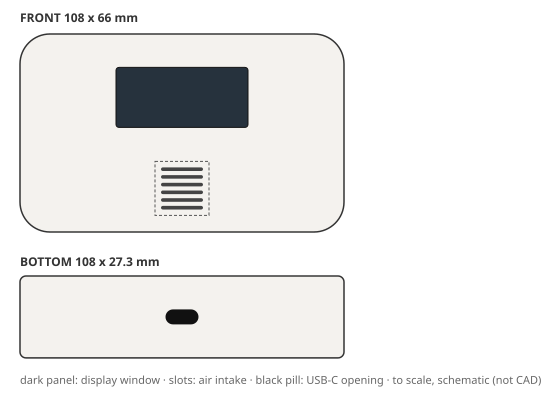

| | |
|---|---|
| **Status** | `pending_approval`: all gates passed; awaiting approval |
| **Form** | rugged bumper form; clean, compact character with smooth matte surfaces (silhouette: bumpered, corner radius 10 mm) |
| **Size** | 108 x 66 x 27.3 mm |
| **CMF** | ABS, smooth matte, white; decoration: pad print |
| **Layout** | display on front (44 x 20 mm), intake on front (6 slots), USB-C on bottom |
| **Structure** | 2 parts (front_housing, rear_housing); wall 1.8 mm; draft 1/1.5 deg; screws (4 screws); sealing none |
| **DFM** | pass; mass 137 g; vent open area 31%. First draft failed nothing; fixed with 0 autofix round(s) and 1 LLM revision(s) |
| **Cost** | CNY 10.80 per housing (ceiling 12); tooling CNY 103,000 |
| **Judge** | accept: brief 5, form 2, CMF 3, usability 5, intent 4 (of 5) |
| **Changed from the concept** | nothing (checked by code) |

Design intent and where the 3D spec keeps it:

- **IA1** bumpered silhouette, 10 mm corner radius → `envelope`
- **IA2** Display upper-centre on the front face, readable at arm's length → `display_window`
- **IA3** smooth matte white in ABS with pad_print → `front_housing.finish`
- **IA6** Two-part shell, no side actions, minimal operations → `closure, parting`

> Judge: cost-led brief; 4/4 key brief signals present in the spec (bumpered, smooth_matte, ABS, ops=['pad_print']).

Full detail: `python -m creaition show demo-designs B1-v003` or `variants/B1-v003.json`.

### 2. B1-v002: "Monolith Slab ABS"

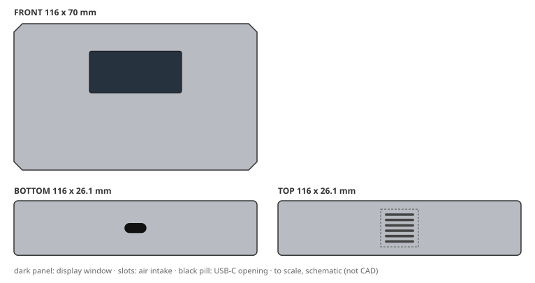

| | |
|---|---|
| **Status** | `pending_approval`: all gates passed; awaiting approval |
| **Form** | monolith slab form; clean, compact character with smooth matte surfaces (silhouette: chamfered slab, corner radius 3 mm) |
| **Size** | 116 x 70 x 26.1 mm |
| **CMF** | ABS, smooth matte, light grey; decoration: pad print |
| **Layout** | display on front (44 x 20 mm), intake on top (6 slots), USB-C on bottom |
| **Structure** | 2 parts (front_housing, rear_housing); wall 1.8 mm; draft 1/1.5 deg; screws (4 screws); sealing none |
| **DFM** | pass; mass 141 g; vent open area 31%. First draft failed PACKAGING_FIT, USB_CLEARANCE; fixed with 1 autofix round(s) and 1 LLM revision(s) |
| **Cost** | CNY 10.86 per housing (ceiling 12); tooling CNY 103,000 |
| **Judge** | accept: brief 4, form 4, CMF 4, usability 4, intent 4 (of 5) |
| **Changed from the concept** | nothing (checked by code) |

Design intent and where the 3D spec keeps it:

- **IA1** chamfered slab silhouette, 3 mm corner radius → `envelope`
- **IA2** Display upper-centre on the front face, readable at arm's length → `display_window`
- **IA3** smooth matte light grey in ABS with pad_print → `front_housing.finish`
- **IA6** Two-part shell, no side actions, minimal operations → `closure, parting`

> Judge: cost-led brief; 4/4 key brief signals present in the spec (chamfered_slab, smooth_matte, ABS, ops=['pad_print']).

Full detail: `python -m creaition show demo-designs B1-v002` or `variants/B1-v002.json`.

Not shortlisted:

| variant | status | reason |
|---|---|---|
| B1-v001 | `rejected` | off-brief: judge brief_adherence 2 < 4 (cost-led brief; 3/4 key brief signals present in the spec (pebble, textured_ligh) |

## B2: Construction-site handheld (rugged)

> Rugged handheld air quality detector for construction-site supervisors who carry it all day outdoors. It must survive a 1.5 m drop onto concrete, dust and driving rain (IP65), UV exposure and use with work gloves. Tough, grippy textured surfaces, high-visibility colour, protected corners. Durable over pretty.

**Outcome:** cost ceiling CNY 18; cheapest possible CNY 12.55.

- assumption: Q1 default: Use the CNY 18 housing BOM ceiling

Shortlist: B2-v002, B2-v001

### 1. B2-v002: "Soft Pebble PC-ABS"

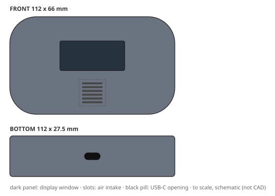

| | |
|---|---|
| **Status** | `pending_approval`: all gates passed; awaiting approval |
| **Form** | soft pebble form; rugged, durable character with textured light surfaces (silhouette: pebble, corner radius 18 mm) |
| **Size** | 112 x 66 x 27.5 mm |
| **CMF** | PC-ABS, textured light, slate grey; decoration: none |
| **Layout** | display on front (44 x 20 mm), intake on front (6 slots), USB-C on bottom |
| **Structure** | 2 parts (front_housing, rear_housing); wall 2.5 mm; draft 1/1.5/2.5 deg; screws (6 screws); sealing gasket and membrane vent |
| **DFM** | pass; mass 164 g; vent open area 31%. First draft failed PACKAGING_FIT; fixed with 0 autofix round(s) and 1 LLM revision(s) |
| **Cost** | CNY 16.25 per housing (ceiling 18); tooling CNY 111,000 |
| **Judge** | accept: brief 5, form 4, CMF 3, usability 3, intent 5 (of 5) |
| **Changed from the concept** | nothing (checked by code) |

Design intent and where the 3D spec keeps it:

- **IA1** pebble silhouette, 18 mm corner radius → `envelope`
- **IA2** Display upper-centre on the front face, readable at arm's length → `display_window`
- **IA3** textured light slate grey in PC-ABS → `front_housing.finish`
- **IA4** Protected corners survive a drop onto concrete → `rear_housing, front_housing_rib`

> Judge: durability-led brief; 4/4 key brief signals present in the spec (pebble, textured_light, PC-ABS, ops=none).

Full detail: `python -m creaition show demo-designs B2-v002` or `variants/B2-v002.json`.

### 2. B2-v001: "Rugged Bumper PC-ABS"

| | |
|---|---|
| **Status** | `needs_human`: passed with caveats |
| **Form** | rugged bumper form; rugged, durable character with textured heavy surfaces (silhouette: bumpered, corner radius 10 mm) |
| **Size** | 116 x 66 x 28.8 mm |
| **CMF** | PC-ABS, textured heavy, olive drab; decoration: tpe overmold |
| **Layout** | display on front (44 x 20 mm), intake on front (6 slots), USB-C on bottom |
| **Structure** | 2 parts (front_housing, rear_housing); wall 2.2 mm; draft 1/1.5/2.5 deg; screws (6 screws); sealing gasket and membrane vent |
| **DFM** | pass; mass 160 g; vent open area 31%. First draft failed MASS_MAX; fixed with 0 autofix round(s) and 2 LLM revision(s) |
| **Cost** | CNY 15.77 per housing (ceiling 18); tooling CNY 111,000 |
| **Judge** | accept: brief 5, form 3, CMF 4, usability 4, intent 3 (of 5) |
| **Changed from the concept** | dropped tpe_overmold |

Design intent and where the 3D spec keeps it:

- **IA1** bumpered silhouette, 10 mm corner radius → `envelope`
- **IA2** Display upper-centre on the front face, readable at arm's length → `display_window`
- **IA3** textured heavy olive drab in PC-ABS with tpe_overmold → `front_housing.finish`
- **IA4** Protected corners survive a drop onto concrete → `rear_housing`

Caveats for the reviewer:

- concept features changed in the final structure (checked by code): dropped tpe_overmold

> Judge: durability-led brief; 4/4 key brief signals present in the spec (bumpered, textured_heavy, PC-ABS, ops=none).

Full detail: `python -m creaition show demo-designs B2-v001` or `variants/B2-v001.json`.

Not shortlisted:

| variant | status | reason |
|---|---|---|
| B2-v003 | `rejected` | off-brief: judge brief_adherence 3 < 4 (durability-led brief; 3/4 key brief signals present in the spec (chamfered_slab,) |

## B3: Living-room sideboard object (premium)

> Premium living-room air quality detector that sits on a sideboard next to design objects and books. Calm, minimal, furniture-like and elegant; soft-touch or fine matte surfaces, hidden fasteners and a slim profile. The display must be readable from the sofa. Indoor only, design-led home brand.

**Outcome:** cost ceiling CNY 18; cheapest possible CNY 9.36.

- assumption: Q1 default: Use the CNY 18 housing BOM ceiling

Shortlist: B3-v001, B3-v002, B3-v003

### 1. B3-v001: "Soft Pebble ABS"

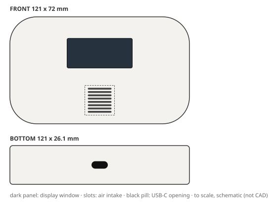

| | |
|---|---|
| **Status** | `pending_approval`: all gates passed; awaiting approval |
| **Form** | soft pebble form; premium, minimal, soft character with smooth matte surfaces (silhouette: pebble, corner radius 18 mm) |
| **Size** | 121 x 72 x 26.1 mm |
| **CMF** | ABS, smooth matte, warm white; decoration: iml |
| **Layout** | display on front (44 x 20 mm), intake on front (8 slots), USB-C on bottom |
| **Structure** | 2 parts (front_housing, rear_housing); wall 1.8 mm; draft 1/1.5 deg; screws and snaps (2 screws); sealing none |
| **DFM** | pass; mass 144 g; vent open area 38%. First draft failed VENT_OPEN_AREA; fixed with 1 autofix round(s) and 0 LLM revision(s) |
| **Cost** | CNY 12.86 per housing (ceiling 18); tooling CNY 121,000 |
| **Judge** | accept: brief 5, form 5, CMF 4, usability 4, intent 5 (of 5) |
| **Changed from the concept** | nothing (checked by code) |

Design intent and where the 3D spec keeps it:

- **IA1** pebble silhouette, 18 mm corner radius → `envelope`
- **IA2** Display upper-centre on the front face, readable at arm's length → `display_window`
- **IA3** smooth matte warm white in ABS with iml → `front_housing.finish`

> Judge: aesthetics-led brief; 4/4 key brief signals present in the spec (pebble, smooth_matte, ABS, ops=['iml']).

Full detail: `python -m creaition show demo-designs B3-v001` or `variants/B3-v001.json`.

### 2. B3-v002: "Monolith Slab PC-ABS"

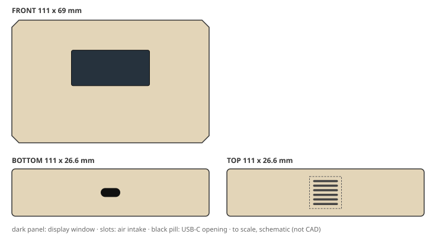

| | |
|---|---|
| **Status** | `pending_approval`: all gates passed; awaiting approval |
| **Form** | monolith slab form; premium, minimal, soft character with smooth matte surfaces (silhouette: chamfered slab, corner radius 3 mm) |
| **Size** | 111 x 69 x 26.6 mm |
| **CMF** | PC-ABS, smooth matte, sand beige; decoration: laser etch, soft touch |
| **Layout** | display on front (44 x 20 mm), intake on top (6 slots), USB-C on bottom |
| **Structure** | 2 parts (front_housing, rear_housing); wall 1.8 mm; draft 1/1.5 deg; screws and snaps (2 screws); sealing none |
| **DFM** | pass; mass 143 g; vent open area 31%. First draft failed nothing; fixed with 0 autofix round(s) and 0 LLM revision(s) |
| **Cost** | CNY 15.69 per housing (ceiling 18); tooling CNY 121,000 |
| **Judge** | accept: brief 5, form 3, CMF 5, usability 4, intent 5 (of 5) |
| **Changed from the concept** | nothing (checked by code) |

Design intent and where the 3D spec keeps it:

- **IA1** chamfered slab silhouette, 3 mm corner radius → `envelope`
- **IA2** Display upper-centre on the front face, readable at arm's length → `display_window`
- **IA3** smooth matte sand beige in PC-ABS with laser_etch, soft_touch → `front_housing.finish`

> Judge: aesthetics-led brief; 4/4 key brief signals present in the spec (chamfered_slab, smooth_matte, PC-ABS, ops=['laser_etch', 'soft_touch']).

Full detail: `python -m creaition show demo-designs B3-v002` or `variants/B3-v002.json`.

### 3. B3-v003: "Rugged Bumper PC-ABS"

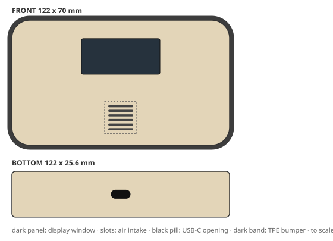

| | |
|---|---|
| **Status** | `needs_human`: passed with caveats |
| **Form** | rugged bumper form; premium, minimal, soft character with smooth gloss surfaces (silhouette: bumpered, corner radius 10 mm) |
| **Size** | 122 x 70 x 25.6 mm |
| **CMF** | PC-ABS, smooth gloss, sand beige; decoration: iml, soft touch |
| **Layout** | display on front (44 x 20 mm), intake on front (6 slots), USB-C on bottom |
| **Structure** | 3 parts (front_housing, rear_housing, bumper); wall 1.8 mm; draft 1/1.5 deg; screws and snaps (2 screws); sealing none |
| **DFM** | pass; mass 159 g; vent open area 31%. First draft failed UNDERCUT_DECLARED; fixed with 1 autofix round(s) and 1 LLM revision(s) |
| **Cost** | CNY 16.21 per housing (ceiling 18); tooling CNY 151,000 |
| **Judge** | accept: brief 5, form 2, CMF 4, usability 4, intent 4 (of 5) |
| **Changed from the concept** | dropped soft_touch |

Design intent and where the 3D spec keeps it:

- **IA1** bumpered silhouette, 10 mm corner radius → `envelope`
- **IA2** Display upper-centre on the front face, readable at arm's length → `display_window`
- **IA3** smooth gloss sand beige in PC-ABS with iml, soft_touch → `front_housing.finish`

Caveats for the reviewer:

- concept features changed in the final structure (checked by code): dropped soft_touch

> Judge: aesthetics-led brief; 4/4 key brief signals present in the spec (bumpered, smooth_gloss, PC-ABS, ops=['iml']).

Full detail: `python -m creaition show demo-designs B3-v003` or `variants/B3-v003.json`.

## B4: Circular edition (sustainable)

> Sustainable edition for an eco-conscious brand. Use only recycled ABS for every plastic part, no paint or coatings, a mono-material housing and screw-free disassembly so it can be repaired and recycled. Honest, warm, slightly speckled look; carbon footprint matters more than gloss.

**Outcome:** cost ceiling CNY 18; cheapest possible CNY 9.40.

- assumption: Q1 default: Use the CNY 18 housing BOM ceiling
- assumption: Q2 default: Manufacturability and budget win; aesthetics adapts

Shortlist: B4-v001, B4-v002, B4-v003

### 1. B4-v001: "Soft Pebble rABS"

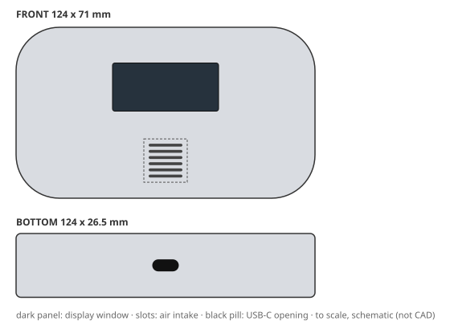

| | |
|---|---|
| **Status** | `pending_approval`: all gates passed; awaiting approval |
| **Form** | soft pebble form; recycled, warm, honest character with smooth matte surfaces (silhouette: pebble, corner radius 18 mm) |
| **Size** | 124 x 71 x 26.5 mm |
| **CMF** | rABS, smooth matte, natural flax; decoration: laser etch |
| **Layout** | display on front (44 x 20 mm), intake on front (6 slots), USB-C on bottom |
| **Structure** | 2 parts (front_housing, rear_housing); wall 2 mm; draft 1/1.5 deg; snap fits (0 screws); sealing none |
| **DFM** | pass; mass 149 g; vent open area 31%. First draft failed PACKAGING_FIT; fixed with 0 autofix round(s) and 1 LLM revision(s) |
| **Cost** | CNY 12.43 per housing (ceiling 18); tooling CNY 139,000 |
| **Judge** | accept: brief 5, form 3, CMF 4, usability 5, intent 5 (of 5) |
| **Changed from the concept** | nothing (checked by code) |

Design intent and where the 3D spec keeps it:

- **IA1** pebble silhouette, 18 mm corner radius → `envelope`
- **IA2** Display upper-centre on the front face, readable at arm's length → `display_window`
- **IA3** smooth matte natural flax in rABS with laser_etch → `front_housing.finish`
- **IA5** Mono-material housing, separable without tools → `front_housing.material, closure`

> Judge: sustainability-led brief; 4/4 key brief signals present in the spec (pebble, smooth_matte, rABS, ops=['laser_etch']).

Full detail: `python -m creaition show demo-designs B4-v001` or `variants/B4-v001.json`.

### 2. B4-v002: "Monolith Slab rABS"

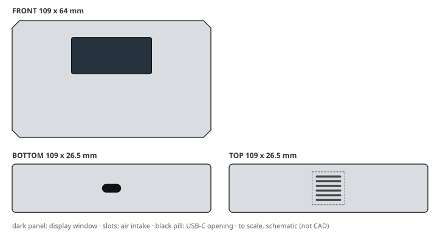

| | |
|---|---|
| **Status** | `pending_approval`: all gates passed; awaiting approval |
| **Form** | monolith slab form; recycled, warm, honest character with textured light surfaces (silhouette: chamfered slab, corner radius 3 mm) |
| **Size** | 109 x 64 x 26.5 mm |
| **CMF** | rABS, textured light, natural flax; decoration: laser etch |
| **Layout** | display on front (44 x 20 mm), intake on top (6 slots), USB-C on bottom |
| **Structure** | 2 parts (front_housing, rear_housing); wall 2 mm; draft 1/1.5/2.5 deg; snap fits (0 screws); sealing none |
| **DFM** | pass; mass 139 g; vent open area 31%. First draft failed PACKAGING_FIT, USB_CLEARANCE; fixed with 1 autofix round(s) and 1 LLM revision(s) |
| **Cost** | CNY 12.66 per housing (ceiling 18); tooling CNY 147,000 |
| **Judge** | accept: brief 5, form 4, CMF 4, usability 4, intent 5 (of 5) |
| **Changed from the concept** | nothing (checked by code) |

Design intent and where the 3D spec keeps it:

- **IA1** chamfered slab silhouette, 3 mm corner radius → `envelope`
- **IA2** Display upper-centre on the front face, readable at arm's length → `display_window`
- **IA3** textured light natural flax in rABS with laser_etch → `front_housing.finish`
- **IA5** Mono-material housing, separable without tools → `front_housing.material, closure`

> Judge: sustainability-led brief; 4/4 key brief signals present in the spec (chamfered_slab, textured_light, rABS, ops=['laser_etch']).

Full detail: `python -m creaition show demo-designs B4-v002` or `variants/B4-v002.json`.

### 3. B4-v003: "Rugged Bumper rABS"

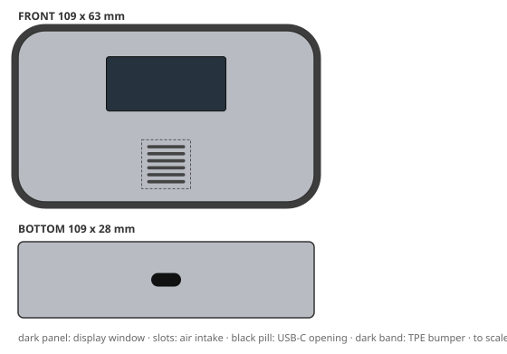

| | |
|---|---|
| **Status** | `pending_approval`: all gates passed; awaiting approval |
| **Form** | rugged bumper form; recycled, warm, honest character with smooth matte surfaces (silhouette: bumpered, corner radius 10 mm) |
| **Size** | 109 x 63 x 28 mm |
| **CMF** | rABS, smooth matte, speckled grey (recycled); decoration: laser etch |
| **Layout** | display on front (44 x 20 mm), intake on front (6 slots), USB-C on bottom |
| **Structure** | 3 parts (front_housing, rear_housing, bumper); wall 2 mm; draft 1/1.5 deg; snap fits (0 screws); sealing none |
| **DFM** | pass; mass 151 g; vent open area 31%. First draft failed nothing; fixed with 0 autofix round(s) and 0 LLM revision(s) |
| **Cost** | CNY 15.04 per housing (ceiling 18); tooling CNY 169,000 |
| **Judge** | accept: brief 5, form 3, CMF 3, usability 4, intent 5 (of 5) |
| **Changed from the concept** | nothing (checked by code) |

Design intent and where the 3D spec keeps it:

- **IA1** bumpered silhouette, 10 mm corner radius → `envelope`
- **IA2** Display upper-centre on the front face, readable at arm's length → `display_window`
- **IA3** smooth matte speckled grey (recycled) in rABS with laser_etch → `front_housing.finish`
- **IA5** Mono-material housing, separable without tools → `front_housing.material, closure`

> Judge: sustainability-led brief; 4/4 key brief signals present in the spec (bumpered, smooth_matte, rABS, ops=['laser_etch']).

Full detail: `python -m creaition show demo-designs B4-v003` or `variants/B4-v003.json`.

## B5: Flagship that wants everything (intentionally conflicting)

> Flagship model: premium soft-touch painted finish, fully waterproof to IP67, ultra-slim 18 mm thick profile, 100% recycled plastic, weighing under 120 g, and it must cost no more than CNY 9 per housing. Launch in six weeks.

**Outcome:** cost ceiling CNY 16; cheapest possible CNY 12.59; conflict found; needs a person to resolve the brief.

This brief can only be made after relaxing the limits below, so it got 2 example variants instead of the full fan-out, and none of them can be auto-approved.

- assumption: Relaxed cost_ceiling_cny: 9 -> 16 (cheapest feasible housing costs CNY 12.59 > target CNY 9)
- assumption: Relaxed max_height_mm: 18 -> 26 (PCB+battery stack needs >= 25.0 mm overall height at 1.5 mm walls)
- assumption: Relaxed max_mass_g: 120 -> 151 (lightest feasible product weighs 120.5 g > 120 g)
- assumption: Q2 default: Manufacturability and budget win; aesthetics adapts

Not shortlisted:

| variant | status | reason |
|---|---|---|
| B5-v001 | `rejected` | quality 2.67 (min criterion 1) below bar 3.5/2 |
| B5-v002 | `rejected` | quality 3.33 (min criterion 2) below bar 3.5/2 |

## B6: Open-plan office desk unit (balanced control)

> Desk air quality detector for open-plan offices: friendly and approachable, light texture that hides fingerprints, readable at a glance from a neighbouring desk. Balanced priorities between budget, durability and looks; facilities teams buy these in bulk.

**Outcome:** cost ceiling CNY 18; cheapest possible CNY 9.36.

- assumption: Q1 default: Use the CNY 18 housing BOM ceiling

Shortlist: B6-v001, B6-v003

### 1. B6-v001: "Soft Pebble rABS"

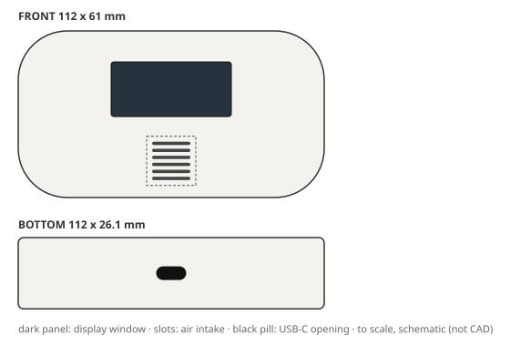

| | |
|---|---|
| **Status** | `pending_approval`: all gates passed; awaiting approval |
| **Form** | soft pebble form; friendly character with smooth matte surfaces (silhouette: pebble, corner radius 18 mm) |
| **Size** | 112 x 61 x 26.1 mm |
| **CMF** | rABS, smooth matte, white; decoration: pad print |
| **Layout** | display on front (44 x 20 mm), intake on front (6 slots), USB-C on bottom |
| **Structure** | 2 parts (front_housing, rear_housing); wall 1.8 mm; draft 1/1.5 deg; screws (4 screws); sealing none |
| **DFM** | pass; mass 135 g; vent open area 31%. First draft failed PACKAGING_FIT; fixed with 0 autofix round(s) and 1 LLM revision(s) |
| **Cost** | CNY 10.83 per housing (ceiling 18); tooling CNY 103,000 |
| **Judge** | accept: brief 5, form 3, CMF 4, usability 4, intent 5 (of 5) |
| **Changed from the concept** | nothing (checked by code) |

Design intent and where the 3D spec keeps it:

- **IA1** pebble silhouette, 18 mm corner radius → `envelope`
- **IA2** Display upper-centre on the front face, readable at arm's length → `display_window`
- **IA3** smooth matte white in rABS with pad_print → `front_housing.finish`
- **IA6** Two-part shell, no side actions, minimal operations → `closure, parting`

> Judge: cost-led brief; 4/4 key brief signals present in the spec (pebble, smooth_matte, rABS, ops=['pad_print']).

Full detail: `python -m creaition show demo-designs B6-v001` or `variants/B6-v001.json`.

### 2. B6-v003: "Rugged Bumper rABS"

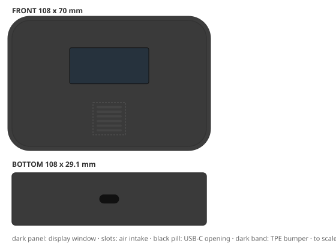

| | |
|---|---|
| **Status** | `pending_approval`: all gates passed; awaiting approval |
| **Form** | rugged bumper form; friendly character with textured light surfaces (silhouette: bumpered, corner radius 10 mm) |
| **Size** | 108 x 70 x 29.1 mm |
| **CMF** | rABS, textured light, black; decoration: pad print |
| **Layout** | display on front (44 x 20 mm), intake on front (6 slots), USB-C on bottom |
| **Structure** | 3 parts (front_housing, rear_housing, bumper); wall 1.8 mm; draft 1/1.5/2.5 deg; screws (4 screws); sealing none |
| **DFM** | pass; mass 152 g; vent open area 31%. First draft failed INNER_RADIUS, RIB_RATIO; fixed with 1 autofix round(s) and 0 LLM revision(s) |
| **Cost** | CNY 14.23 per housing (ceiling 18); tooling CNY 145,000 |
| **Judge** | accept: brief 5, form 3, CMF 4, usability 4, intent 5 (of 5) |
| **Changed from the concept** | nothing (checked by code) |

Design intent and where the 3D spec keeps it:

- **IA1** bumpered silhouette, 10 mm corner radius → `envelope`
- **IA2** Display upper-centre on the front face, readable at arm's length → `display_window`
- **IA3** textured light black in rABS with pad_print → `front_housing.finish`
- **IA6** Two-part shell, no side actions, minimal operations → `closure, parting`

> Judge: cost-led brief; 4/4 key brief signals present in the spec (bumpered, textured_light, rABS, ops=['pad_print']).

Full detail: `python -m creaition show demo-designs B6-v003` or `variants/B6-v003.json`.

Not shortlisted:

| variant | status | reason |
|---|---|---|
| B6-v002 | `rejected` | quality 3.33 (min criterion 3) below bar 3.5/2 |

