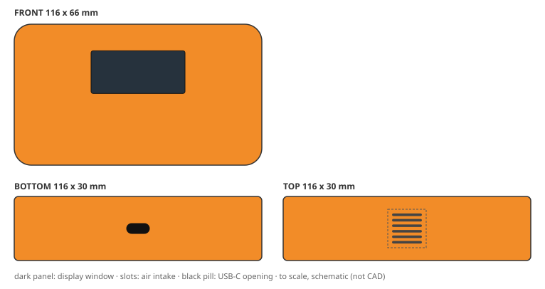
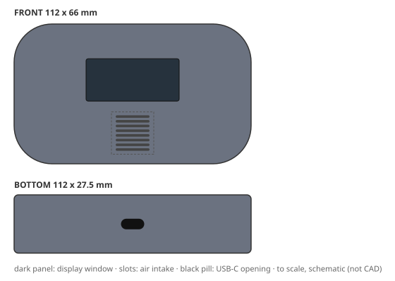
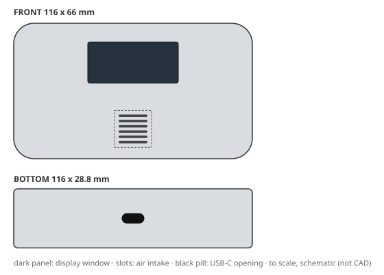

# Design report: demo-faults

Config `fault_demo`, mode **mock**, 5 variants: 1 needs_human, 2 pending_approval, 2 rejected. Model cost CNY 0.29.

Each brief below shows its outcome, then one design card per shortlisted variant: the 2D concept, the 3D-ready structure and the DFM / cost / quality review, with a sketch drawn from the spec's numbers. Status `pending_approval` means every automated check passed and a person still has to sign off; `needs_human` means it passed with caveats a person must look at.

## B2: Construction-site handheld (rugged)

> Rugged handheld air quality detector for construction-site supervisors who carry it all day outdoors. It must survive a 1.5 m drop onto concrete, dust and driving rain (IP65), UV exposure and use with work gloves. Tough, grippy textured surfaces, high-visibility colour, protected corners. Durable over pretty.

**Outcome:** cost ceiling CNY 18; cheapest possible CNY 12.55.

- assumption: Q1 default: Use the CNY 18 housing BOM ceiling

Shortlist: B2-v005, B2-v002, B2-v001

### 1. B2-v005: "Architectural Rect PC-ABS"

| | |
|---|---|
| **Status** | `pending_approval`: all gates passed; awaiting approval |
| **Form** | architectural rect form; rugged, durable character with textured heavy surfaces (silhouette: rounded rect, corner radius 8 mm) |
| **Size** | 116 x 66 x 30 mm |
| **CMF** | PC-ABS, textured heavy, safety orange / graphite; decoration: none |
| **Layout** | display on front (44 x 20 mm), intake on top (6 slots), USB-C on bottom |
| **Structure** | 2 parts (front_housing, rear_housing); wall 2.2 mm; draft 1.5/2.5 deg; screws (6 screws); sealing gasket and membrane vent |
| **DFM** | pass; mass 161 g; vent open area 31%. First draft failed DRAFT_MIN, INNER_RADIUS, MASS_MAX, RIB_RATIO, WALL_RANGE; fixed with 1 autofix round(s) and 1 LLM revision(s) |
| **Cost** | CNY 15.79 per housing (ceiling 18); tooling CNY 111,000 |
| **Judge** | accept: brief 5, form 4, CMF 4, usability 4, intent 4 (of 5) |
| **Changed from the concept** | nothing (checked by code) |

Design intent and where the 3D spec keeps it:

- **IA1** rounded rect silhouette, 8 mm corner radius → `envelope`
- **IA2** Display upper-centre on the front face, readable at arm's length → `display_window`
- **IA3** textured heavy safety orange / graphite in PC-ABS → `front_housing.finish`
- **IA4** Protected corners survive a drop onto concrete → `rear_housing, front_housing_rib`

> Judge: durability-led brief; 4/4 key brief signals present in the spec (rounded_rect, textured_heavy, PC-ABS, ops=none).

Full detail: `python -m creaition show demo-faults B2-v005` or `variants/B2-v005.json`.

### 2. B2-v002: "Soft Pebble PC-ABS"

| | |
|---|---|
| **Status** | `pending_approval`: all gates passed; awaiting approval |
| **Form** | soft pebble form; rugged, durable character with textured light surfaces (silhouette: pebble, corner radius 18 mm) |
| **Size** | 112 x 66 x 27.5 mm |
| **CMF** | PC-ABS, textured light, slate grey; decoration: none |
| **Layout** | display on front (44 x 20 mm), intake on front (8 slots), USB-C on bottom |
| **Structure** | 2 parts (front_housing, rear_housing); wall 2.5 mm; draft 1/1.5/2.5 deg; screws (6 screws); sealing gasket and membrane vent |
| **DFM** | pass; mass 164 g; vent open area 38%. First draft failed PACKAGING_FIT, VENT_OPEN_AREA; fixed with 1 autofix round(s) and 1 LLM revision(s) |
| **Cost** | CNY 16.25 per housing (ceiling 18); tooling CNY 111,000 |
| **Judge** | accept: brief 4, form 3, CMF 3, usability 4, intent 5 (of 5) |
| **Changed from the concept** | nothing (checked by code) |

Design intent and where the 3D spec keeps it:

- **IA1** pebble silhouette, 18 mm corner radius → `envelope`
- **IA2** Display upper-centre on the front face, readable at arm's length → `display_window`
- **IA3** textured light slate grey in PC-ABS → `front_housing.finish`
- **IA4** Protected corners survive a drop onto concrete → `rear_housing, front_housing_rib`

> Judge: durability-led brief; 4/4 key brief signals present in the spec (pebble, textured_light, PC-ABS, ops=none).

Full detail: `python -m creaition show demo-faults B2-v002` or `variants/B2-v002.json`.

### 3. B2-v001: "Rugged Bumper PC-ABS"

| | |
|---|---|
| **Status** | `needs_human`: passed with caveats |
| **Form** | rugged bumper form; rugged, durable character with textured heavy surfaces (silhouette: bumpered, corner radius 10 mm) |
| **Size** | 116 x 66 x 28.8 mm |
| **CMF** | PC-ABS, textured heavy, olive drab; decoration: tpe overmold |
| **Layout** | display on front (44 x 20 mm), intake on front (6 slots), USB-C on bottom |
| **Structure** | 2 parts (front_housing, rear_housing); wall 2.2 mm; draft 1/1.5/2.5 deg; screws (6 screws); sealing gasket and membrane vent |
| **DFM** | pass; mass 160 g; vent open area 31%. First draft failed MASS_MAX; fixed with 0 autofix round(s) and 2 LLM revision(s) |
| **Cost** | CNY 15.77 per housing (ceiling 18); tooling CNY 111,000 |
| **Judge** | accept: brief 5, form 3, CMF 4, usability 3, intent 4 (of 5) |
| **Changed from the concept** | dropped tpe_overmold |

Design intent and where the 3D spec keeps it:

- **IA1** bumpered silhouette, 10 mm corner radius → `envelope`
- **IA2** Display upper-centre on the front face, readable at arm's length → `display_window`
- **IA3** textured heavy olive drab in PC-ABS with tpe_overmold → `front_housing.finish`
- **IA4** Protected corners survive a drop onto concrete → `rear_housing`

Caveats for the reviewer:

- concept features changed in the final structure (checked by code): dropped tpe_overmold

> Judge: durability-led brief; 4/4 key brief signals present in the spec (bumpered, textured_heavy, PC-ABS, ops=none).

Full detail: `python -m creaition show demo-faults B2-v001` or `variants/B2-v001.json`.

Not shortlisted:

| variant | status | reason |
|---|---|---|
| B2-v003 | `rejected` | off-brief: judge brief_adherence 3 < 4 (durability-led brief; 3/4 key brief signals present in the spec (chamfered_slab,) |
| B2-v004 | `rejected` | off-brief: judge brief_adherence 3 < 4 (1 intent-affecting change(s) during revision) |

